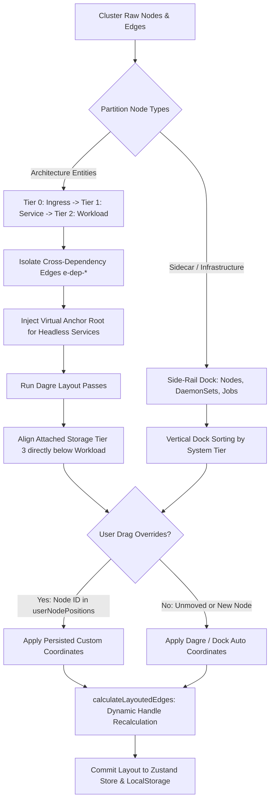

# EnvScale — Core Algorithms & Mathematical Formulations

> **Document Classification:** Engineering Reference & Architectural Specification  
> **Applicable Modules:** `apps/web`, `apps/k8s-streamer`, `apps/api-server`  
> **Status:** Production Reference  

---

## 1. Executive Summary & Algorithmic Taxonomy

**EnvScale** employs algorithms across multiple disciplines of computer science: Graph Theory, Distributed Streaming, Telemetry Deduplication, Cryptographic Security, Statistical Health Indexing, and Anomaly Classification.

| Domain | Key Algorithm / Heuristic | Primary File Link | Time / Space Complexity |
| :--- | :--- | :--- | :--- |
| **Visual Topology** | Multi-Tier Sugiyama Hierarchical DAG Layout | [`layout.ts`](file:///run/media/pranavissam/files%20and%20data/programming/mega%20projects/EnvScale/apps/web/src/utils/layout.ts) | $O(V + E)$ layout passes |
| **Visual Topology** | Dynamic Graph Edge Resolution & Health Propagation | [`edgeHelpers.ts`](file:///run/media/pranavissam/files%20and%20data/programming/mega%20projects/EnvScale/apps/web/src/store/helpers/edgeHelpers.ts) | $O(V_{svc} \cdot V_{pod})$ |
| **Visual Topology** | Pod Rolling Update & Dual-Revision Diffing | [`rolloutHelpers.ts`](file:///run/media/pranavissam/files%20and%20data/programming/mega%20projects/EnvScale/apps/web/src/store/helpers/rolloutHelpers.ts) | $O(N_{rs} + N_{pod})$ |
| **Telemetry Streaming** | FNV-1a Hash-Based Delta Deduplication Cache | [`dedup.go`](file:///run/media/pranavissam/files%20and%20data/programming/mega%20projects/EnvScale/apps/k8s-streamer/pkg/k8s/dedup.go) | $O(1)$ amortized lookup |
| **Telemetry Streaming** | High-Throughput Frame Coalescing / Micro-Batching | [`client.go`](file:///run/media/pranavissam/files%20and%20data/programming/mega%20projects/EnvScale/apps/k8s-streamer/pkg/websocket/client.go) | $O(M)$ channel drain |
| **Metric Evaluation** | Sliding-Window Alert Debounce & Hysteresis | [`evaluator.go`](file:///run/media/pranavissam/files%20and%20data/programming/mega%20projects/EnvScale/apps/k8s-streamer/pkg/k8s/evaluator.go) | $O(R \cdot P)$ per cycle |
| **Anomaly Detection** | Deterministic Regex & State Machine Log Classifier | [`parser.go`](file:///run/media/pranavissam/files%20and%20data/programming/mega%20projects/EnvScale/apps/k8s-streamer/pkg/k8s/parser.go) | $O(L \cdot P)$ per log line |
| **Chaos Engineering** | Reversible Fault Injection & Spec Patching | [`injector.go`](file:///run/media/pranavissam/files%20and%20data/programming/mega%20projects/EnvScale/apps/k8s-streamer/pkg/chaos/injector.go) | $O(1)$ patch execution |
| **Distributed Pub/Sub** | Redis Fan-Out with Self-Echo Suppression | [`adapter.go`](file:///run/media/pranavissam/files%20and%20data/programming/mega%20projects/EnvScale/apps/k8s-streamer/pkg/redis/adapter.go) | $O(1)$ routing |
| **Health & Governance** | Multi-Factor Cluster Health Index (CHI) Penalty Model | [`health-calculator.service.ts`](file:///run/media/pranavissam/files%20and%20data/programming/mega%20projects/EnvScale/apps/api-server/src/services/health-calculator.service.ts) | $O(I)$ active incidents |
| **Gamification** | Longest Zero-Incident Streak & Composite Ranking | [`leaderboard.service.ts`](file:///run/media/pranavissam/files%20and%20data/programming/mega%20projects/EnvScale/apps/api-server/src/services/leaderboard.service.ts) | $O(D)$ streak + $O(W \log W)$ sort |
| **Cryptography** | AES-256-GCM Authenticated Encryption with Random IV | [`crypto.ts`](file:///run/media/pranavissam/files%20and%20data/programming/mega%20projects/EnvScale/apps/api-server/src/utils/crypto.ts), [`crypto.go`](file:///run/media/pranavissam/files%20and%20data/programming/mega%20projects/EnvScale/apps/k8s-streamer/pkg/crypto/crypto.go) | $O(N)$ block cipher ops |
| **Concurrency & Workers**| Mutex-Guarded Recursive Worker Scheduling | [`cluster-reconcile.worker.ts`](file:///run/media/pranavissam/files%20and%20data/programming/mega%20projects/EnvScale/apps/api-server/src/workers/cluster-reconcile.worker.ts) | Non-overlapping $O(C)$ |

---

## 2. Frontend Topology & Graph Visualization Algorithms

### 2.1 Multi-Tier Hierarchical Graph Layout Algorithm (Extended Dagre / Sugiyama)
- **Source File:** [`apps/web/src/utils/layout.ts`](file:///run/media/pranavissam/files%20and%20data/programming/mega%20projects/EnvScale/apps/web/src/utils/layout.ts)
- **Objective:** Dynamically layout complex Kubernetes clusters into an intuitive, readable architecture graph while isolating sidecar workloads, batch jobs, and infrastructure daemonsets.

#### Algorithmic Formulation & Heuristic Phases:
1. **Node Classification & Partitioning:**
   - Nodes are bifurcated into **Architecture DAG Nodes** (Ingresses, Services, Deployments, StatefulSets, PVCs) and **Side-Rail Dock Nodes** (Worker Nodes, DaemonSets, CronJobs, standalone Batch Jobs, collapsed Completed Jobs).
2. **Cycle Prevention & Virtual Anchoring:**
   - Cross-workload dependency lateral edges (`e-dep-*`) are excluded from rank constraints to guarantee that the graph fed into Dagre remains a strict Directed Acyclic Graph (DAG).
   - A virtual root node (`__virtual_root__`) or the top-level Ingress anchor is conditionally connected with weight 0 and minimum length 1 to all unrouted Services (e.g. headless cluster services) to ensure uniform rank assignment across Tier 1.
3. **Multi-Tier Coordinate Computation:**
   - **Tier 0:** Ingress Gateways ($Y \approx 40\text{px}$).
   - **Tier 1:** Kubernetes Services ($Y \approx 160\text{px}$).
   - **Tier 2:** Workload Groups / Deployments ($Y \approx 350\text{px}$).
   - **Tier 3:** Attached Persistent Volume Claims ($Y \approx 510\text{px}$).
4. **Storage Edge Alignment Heuristic:**
   - Unrouted workloads are sorted: pure compute workloads are placed first, and workloads with attached storage (along with their PVCs) are shifted to the outer right edge. This prevents PVC storage nodes from rendering between compute nodes and crossing service edges.
5. **Side-Rail Dock Placement:**
   - Dock nodes are sorted by structural tier:
     $$\text{Worker Node (Tier 1)} \to \text{DaemonSet (Tier 2)} \to \text{CronJob (Tier 3)} \to \text{Batch Job (Tier 4)} \to \text{Completed Jobs (Tier 5)}$$
   - Placed at $X \ge \max(X_{\text{DAG, max}} + 100, 1100\text{px})$ in a dedicated vertical rail.

#### 2.1.1 Persistent User Drag Positioning & Non-Destructive Live Streaming (Hybrid Local & Backend Persistence)
- **Source Files:** [`apps/web/src/utils/layout.ts`](file:///run/media/pranavissam/files%20and%20data/programming/mega%20projects/EnvScale/apps/web/src/utils/layout.ts), [`apps/web/src/utils/layoutEdgeHelpers.ts`](file:///run/media/pranavissam/files%20and%20data/programming/mega%20projects/EnvScale/apps/web/src/utils/layoutEdgeHelpers.ts), [`apps/web/src/store/helpers/layoutStorage.ts`](file:///run/media/pranavissam/files%20and%20data/programming/mega%20projects/EnvScale/apps/web/src/store/helpers/layoutStorage.ts), [`apps/web/src/hooks/useClusterLayoutPersistence.ts`](file:///run/media/pranavissam/files%20and%20data/programming/mega%20projects/EnvScale/apps/web/src/hooks/useClusterLayoutPersistence.ts), [`apps/web/src/store/slices/topologyLayoutSlice.ts`](file:///run/media/pranavissam/files%20and%20data/programming/mega%20projects/EnvScale/apps/web/src/store/slices/topologyLayoutSlice.ts), [`apps/web/src/config/api.ts`](file:///run/media/pranavissam/files%20and%20data/programming/mega%20projects/EnvScale/apps/web/src/config/api.ts), [`apps/api-server/src/services/cluster.service.ts`](file:///run/media/pranavissam/files%20and%20data/programming/mega%20projects/EnvScale/apps/api-server/src/services/cluster.service.ts)
- **Problem Formulation:** When WebSocket streaming deltas (`EVENT_POD_MUTATED`, `EVENT_BATCH_COMPLETE`) arrive at sub-second frequencies, graph layout functions triggered by state listeners recalculate tree hierarchies from scratch. Without coordinate memoization, this causes active mouse drags and custom arrangement geometries to snap back to default coordinates. Furthermore, users expect custom arrangements to persist seamlessly across browser reloads, user logouts, and different devices.
- **Algorithmic Solution:**
  1. **Active Drag Immature Lock:** When React Flow emits `onNodesChange` with `node.dragging = true`, `getLayoutedElements` bypasses Dagre coordinates and strictly preserves the real-time cursor coordinate $(X_{\text{cursor}}, Y_{\text{cursor}})$.
  2. **Scoped Browser Local Cache (`envscale-layout-user-${userId}-${clusterId}`):** On `onNodeDragStop`, terminal coordinates are quantized and written to `userNodePositions`. Simultaneously, [`saveLocalLayout`](file:///run/media/pranavissam/files%20and%20data/programming/mega%20projects/EnvScale/apps/web/src/store/helpers/layoutStorage.ts) stores the coordinates in a dedicated local storage key scoped strictly by user and cluster ID. This cache is isolated from session tokens and is **not wiped** by `resetStore()` upon logout, ensuring immediate zero-latency rehydration when logging back in.
  3. **Backend Database Persistence (PostgreSQL):** A debounced background sync (`apiSaveClusterLayout`) persists the user's custom layout to PostgreSQL via the REST API (`PUT /api/v1/clusters/:clusterId/layout`), storing coordinates within `clusters.metadata.userLayouts[userId]`. When logging in from another device or machine, [`apiGetClusterLayout`](file:///run/media/pranavissam/files%20and%20data/programming/mega%20projects/EnvScale/apps/web/src/config/api.ts) rehydrates the custom arrangement automatically.
  4. **Hybrid Coordinate Resolution:** During subsequent layout invocations:
     $$P(n) = \begin{cases} P_{\text{live}}(n) & \text{if } n.\text{dragging} = \text{true} \\ P_{\text{user}}(n) & \text{if } n.\text{id} \in \text{userNodePositions} \\ P_{\text{dock}}(n) & \text{if } n \in \text{DockNodes} \\ P_{\text{dagre}}(n) & \text{otherwise} \end{cases}$$
  5. **Dynamic Edge Handle Re-projection:** As node coordinates diverge from standard horizontal/vertical ranks, [`calculateLayoutedEdges`](file:///run/media/pranavissam/files%20and%20data/programming/mega%20projects/EnvScale/apps/web/src/utils/layoutEdgeHelpers.ts#L3) computes directional vectors $\Delta X = X_t - X_s$ and $\Delta Y = Y_t - Y_s$ across bounding centers, dynamically reassigning source/target connection handles (`source-right`, `target-left`, `source-bottom`, `target-top`) to maintain clean orthogonal or smoothstep paths without visual intersection.
  6. **Auto Layout Fallback & Multi-Tier Purge:** An explicit reset signal triggered by the "Auto Layout" button invokes `handleAutoLayoutReset`:
     - Clears the in-memory `userNodePositions` Zustand store.
     - Deletes the local scoped key via [`clearLocalLayout`](file:///run/media/pranavissam/files%20and%20data/programming/mega%20projects/EnvScale/apps/web/src/store/helpers/layoutStorage.ts).
     - Issues a REST request (`DELETE /api/v1/clusters/:clusterId/layout`) via [`apiResetClusterLayout`](file:///run/media/pranavissam/files%20and%20data/programming/mega%20projects/EnvScale/apps/web/src/config/api.ts) to remove the user's entry from PostgreSQL.
     - Re-executes hierarchical Sugiyama Dagre placement with automated viewport centering (`fitView`).

---

### 2.2 Dynamic Graph Edge Resolution & Health Evaluation Algorithm
- **Source File:** [`apps/web/src/store/helpers/edgeHelpers.ts`](file:///run/media/pranavissam/files%20and%20data/programming/mega%20projects/EnvScale/apps/web/src/store/helpers/edgeHelpers.ts)
- **Objective:** Infer dynamic topological dataflow relationships between Services and Pods using label selectors, while computing real-time aggregated edge status.

#### Edge Health State Equation:
For a service connected to a pod group $P = \{p_1, p_2, \dots, p_n\}$:
- Let $H = \sum [p \text{ is ready}]$,
- Let $F = \sum [p \text{ in CrashLoop / OOM / Error}]$,
- Let $D = \sum [p \text{ is terminating}]$.

$$\text{Edge Status} = \begin{cases} 
\text{broken } (\text{crimson: } \mathtt{\#ef4444}), & \text{if } |P| = 0 \lor (F > 0 \land H = 0) \\
\text{degraded } (\text{amber: } \mathtt{\#f59e0b}), & \text{if } F > 0 \land H > 0 \\
\text{healthy } (\text{emerald: } \mathtt{\#10b981}), & \text{if } H > 0 \land F = 0 \\
\text{idle / draining } (\text{slate: } \mathtt{\#52525b}), & \text{if } H = 0 \land F = 0 \land D > 0 
\end{cases}$$

---

### 2.3 Rolling Update & Dual-Revision Diffing Algorithm
- **Source File:** [`apps/web/src/store/helpers/rolloutHelpers.ts`](file:///run/media/pranavissam/files%20and%20data/programming/mega%20projects/EnvScale/apps/web/src/store/helpers/rolloutHelpers.ts)
- **Objective:** Detect live Kubernetes Deployment rollouts in progress by analyzing ReplicaSet revisions, template hashes, and replica ratios.

#### Steps:
1. **Template Hash Extraction:** Extracts the 8-to-10 character alphanumeric pod template hash from `labels["pod-template-hash"]` or suffix regex.
2. **Revision Sorting:** Collects all ReplicaSets owned by the target Deployment and sorts them descending by `metadata.annotations["deployment.kubernetes.io/revision"]`.
3. **Rolling Update Condition:**
   $$\text{isRollingUpdate} \iff \exists RS_{new}, RS_{old} \text{ such that } RS_{new}.\text{replicas} < \text{desired} \land RS_{old}.\text{replicas} > 0$$
4. **State Classification:** Revisions are assigned one of 4 dynamic lifecycle states: `Active (Current)`, `Scaling Up`, `Scaling Down`, or `Scaled Down (Old)`.

---

### 2.4 Log Stream Parsing, ANSI Stripping & Run-Length Deduplication Algorithm
- **Source Files:** [`apps/web/src/utils/logParser.ts`](file:///run/media/pranavissam/files%20and%20data/programming/mega%20projects/EnvScale/apps/web/src/utils/logParser.ts), [`apps/web/src/utils/logAggregator.ts`](file:///run/media/pranavissam/files%20and%20data/programming/mega%20projects/EnvScale/apps/web/src/utils/logAggregator.ts)
- **Objective:** Transform high-velocity stdout/stderr logs into structured events without crashing the browser thread.

#### Algorithmic Mechanisms:
1. **ANSI Escape Code Stripping:**
   Uses compiled regular expression `/\x1b\[[0-9;]*[a-zA-Z]|\u001b\[[0-9;]*[a-zA-Z]/g` to strip terminal colors and escape sequences in $O(N)$ linear time.
2. **Structured JSON Autodetection:**
   Fast-path character checks (`startsWith("{")` and `endsWith("}")`) before JSON deserialization. Automatically normalizes nested keys (`level`, `lvl`, `severity`, `level_name`, `@timestamp`, `asctime`).
3. **Noise Log Filtering Heuristic:**
   Identifies high-frequency repetitive health checks (`/healthz`, `/livez`, `/readyz`, `/metrics`, `heartbeat`) and suppresses them when noise filtering is toggled.
4. **Sliding-Window Run-Length Log Compression:**
   Aggregates consecutive identical log lines into a single item with a dynamic count increment:
   $$\text{If } \text{msg}_t = \text{msg}_{t-1} \land \text{source}_t = \text{source}_{t-1} \land \text{level}_t = \text{level}_{t-1} \implies \text{prev}.\text{count} \mathrel{+}= 1$$
   This prevents DOM explosion during rapid error loops or repetitive log spam.

---

## 3. Real-Time Telemetry & Streaming Gateway Algorithms

### 3.1 Hash-Based Delta Deduplication Cache (`DedupCache`)
- **Source File:** [`apps/k8s-streamer/pkg/k8s/dedup.go`](file:///run/media/pranavissam/files%20and%20data/programming/mega%20projects/EnvScale/apps/k8s-streamer/pkg/k8s/dedup.go)
- **Objective:** Eliminate redundant WebSocket events generated by Kubernetes Informer periodic re-syncs when resource states have not changed.

#### Algorithmic Mechanism:
1. **FNV-1a 64-bit Non-Cryptographic Hash:**
   Computes a deterministic hash over the serialized JSON delta struct:
   $$\text{hash} = \text{offset\_basis} \quad (14695981039346656037)$$
   $$\text{for each byte } b: \quad \text{hash} = (\text{hash} \oplus b) \times \text{FNV\_prime} \quad (1099511628211)$$
2. **$O(1)$ State Suppression:**
   Compares the newly generated hash against `dc.entries[key].hash`. If equal, the event broadcast is suppressed, saving up to 90% network overhead.
3. **Time-to-Live (TTL) Eviction Sweep:**
   A background ticker running every 60 seconds prunes entries with $\text{now} - \text{lastSeen} > 5\text{ minutes}$, bounding memory usage even as thousands of short-lived pods terminate.

---

### 3.2 High-Throughput WebSocket Frame Coalescing / Micro-Batching
- **Source File:** [`apps/k8s-streamer/pkg/websocket/client.go`](file:///run/media/pranavissam/files%20and%20data/programming/mega%20projects/EnvScale/apps/k8s-streamer/pkg/websocket/client.go)
- **Objective:** Maximize WebSocket throughput and minimize TCP/TLS frame overhead during high-density cluster event spikes.

#### Algorithmic Mechanism:
- In the client write loop (`WritePump`), after reading the first message from the buffered channel `c.send`, the worker checks the remaining channel buffer length $Q = \text{len}(c.\text{send})$.
- **Zero-Queued Case ($Q = 0$):** Emits a single frame immediately (zero batching latency under low load).
- **Spike Case ($Q > 0$):** Drains all $Q$ messages into a single coalesced JSON array frame:
  $$\mathtt{[} \, \text{msg}_0 \mathtt{,} \, \text{msg}_1 \mathtt{,} \, \dots \mathtt{,} \, \text{msg}_Q \, \mathtt{]}$$
- **Impact:** Decreases TCP header and WebSocket frame encapsulation overhead by up to $60\%$, drastically lowering browser message dispatch interruptions.

---

### 3.3 Sliding-Window Alert Debounce & Hysteresis Algorithm (`MetricEvaluator`)
- **Source File:** [`apps/k8s-streamer/pkg/k8s/evaluator.go`](file:///run/media/pranavissam/files%20and%20data/programming/mega%20projects/EnvScale/apps/k8s-streamer/pkg/k8s/evaluator.go)
- **Objective:** Evaluate cluster metrics against dynamic alert rules without flapping alerts due to transient spikes.

#### State Machine & Evaluation Loop:
For each violation key $V_k = (\text{clusterId}, \text{namespace}, \text{podName}, \text{ruleId})$:
1. **Rule Evaluation:** Evaluates condition $M \text{ op } T$ (numeric restart threshold, phase string match, CPU %, or memory MB).
2. **First-Seen Tracking:**
   $$\text{if } V_k \notin \text{violations} \implies \text{violations}[V_k] = \{ \text{firstSeen: } \text{now}, \text{fired: false} \}$$
3. **Hysteresis / Sustained Window Check:**
   $$\Delta t = \text{now} - \text{violations}[V_k].\text{firstSeen}$$
   $$\text{Fire Alert} \iff \Delta t \ge \text{rule}.\text{durationSeconds} \land \neg \text{violations}[V_k].\text{fired}$$
4. **Automatic Clearance Sweep:**
   At the conclusion of each evaluation pass, violation keys absent from the current active violation set are immediately pruned from the tracking table, resetting the trigger state if the resource self-heals.

---

### 3.4 Deterministic Regex & State Machine Anomaly Classifier
- **Source File:** [`apps/k8s-streamer/pkg/k8s/parser.go`](file:///run/media/pranavissam/files%20and%20data/programming/mega%20projects/EnvScale/apps/k8s-streamer/pkg/k8s/parser.go)
- **Objective:** Classify unstructured log outputs and Kubelet status events into standardized incident severity tiers.

#### Classification Table:
| Anomaly Signature | Pattern Type | Severity Tier | Action Triggered |
| :--- | :--- | :--- | :--- |
| `OOMKilled`, `oom-kill`, `invoked oom-killer` | Regular Expression & Phase Map | `CRITICAL` | Canvas Alert Badge + Incident Log |
| `panic:`, `runtime error:`, `goroutine \d+` | Multiline Regex | `CRITICAL` | Crash Incident Event |
| `fatal error:`, `FATAL:`, `fatal exception` | Case-insensitive Regex | `CRITICAL` | Pod Degradation Flag |
| `ImagePullBackOff`, `ErrImagePull` | Regex & Kubelet Waiting Reason | `WARNING` | Node/Pod State Indicator |
| `CrashLoopBackOff`, `back-off restarting` | Regex & Kubelet Status Reason | `WARNING` | Health Score Degradation |
| `Readiness probe failed`, `Liveness probe failed`| Case-insensitive Regex | `WARNING` | Service Edge Color Shift |

---

### 3.5 Reversible Chaos Fault Injection Algorithm
- **Source File:** [`apps/k8s-streamer/pkg/chaos/injector.go`](file:///run/media/pranavissam/files%20and%20data/programming/mega%20projects/EnvScale/apps/k8s-streamer/pkg/chaos/injector.go)
- **Objective:** Inject deliberate operational failures to validate resilience and automated recovery pipelines, with state-preserving reversals.

#### Supported Fault Operations:
1. **Crash Simulation:** Deletes the pod resource directly using Kubernetes Client API, exercising controller self-healing and Informer delta propagation.
2. **OOM Memory Starvation Injection:**
   - Reads existing memory limit from `pod.Spec.Containers[0].Resources.Limits[Memory]`.
   - Stores original value in the active fault registry.
   - Applies JSON patch reducing memory to $1\text{Mi}$.
   - **Reversal:** Re-applies the original memory limit on `ClearFault`.
3. **Outage Scale-Down Injection:**
   - Reads existing `deployment.Spec.Replicas`.
   - Patches `replicas = 0`.
   - **Reversal:** Re-patches replicas back to the preserved initial count.

---

### 3.6 Redis Pub/Sub Distributed Fan-Out with Self-Echo Suppression
- **Source File:** [`apps/k8s-streamer/pkg/redis/adapter.go`](file:///run/media/pranavissam/files%20and%20data/programming/mega%20projects/EnvScale/apps/k8s-streamer/pkg/redis/adapter.go)
- **Objective:** Enable horizontal scaling across multiple streamer replicas while preventing message replication loops.

#### Algorithmic Formulation:
- Each streamer instance generates a unique identifier $I = \mathtt{streamer\text{-}}\langle\text{nanoseconds}\rangle$.
- Published message format:
  $$\text{Payload} = \{ \text{instanceId: } I, \text{envelope: } E \}$$
- **Self-Echo Filtering:**
  When a replica receives a message from `envscale:events:*`:
  $$\text{if } \text{message}.\text{instanceId} == I_{\text{local}} \implies \text{drop}$$
  $$\text{else} \implies \text{hub}.\text{RouteRaw}(\text{clusterId}, \text{serializedEnvelope})$$
- Directly routes to clients via raw bypass, avoiding re-triggering `BroadcastEvent` and guaranteeing zero infinite message cycles.

---

## 4. Backend Health, Governance & Gamification Algorithms

### 4.1 Multi-Factor Cluster Health Index (CHI) Algorithm
- **Source File:** [`apps/api-server/src/services/health-calculator.service.ts`](file:///run/media/pranavissam/files%20and%20data/programming/mega%20projects/EnvScale/apps/api-server/src/services/health-calculator.service.ts)
- **Objective:** Quantify aggregate cluster health into a continuous metric between $0.00$ and $100.00$.

#### Mathematical Formulation:
Let $I_{\text{active}}$ be the set of unresolved incidents for cluster $c$:
$$I_{\text{active}} = \{ i \in I_c \mid \text{status}(i) \neq \text{"resolved"} \}$$

Penalty weight function $w(\text{severity})$:
$$w(s) = \begin{cases}
25, & s = \text{"critical"} \\
15, & s = \text{"error"} \\
8,  & s = \text{"warning"} \\
3,  & s = \text{"info"}
\end{cases}$$

The total cluster penalty is:
$$P = \sum_{i \in I_{\text{active}}} w(\text{severity}(i))$$

The Cluster Health Index (CHI) is:
$$\text{Score} = \max(0, 100 - P)$$

Periodic snapshots are executed on background workers to maintain historical time-series logs in `health_snapshots`.

---

### 4.2 Consecutive Zero-Incident Streak & Composite Leaderboard Ranking
- **Source File:** [`apps/api-server/src/services/leaderboard.service.ts`](file:///run/media/pranavissam/files%20and%20data/programming/mega%20projects/EnvScale/apps/api-server/src/services/leaderboard.service.ts)
- **Objective:** Score and gamify engineering teams running microservices in production workspaces.

#### Algorithmic Steps:
1. **Calendar Slicing:** Extracts unique UTC calendar days containing incidents into a lookup set:
   $$S_{\text{incident}} = \{ \text{date}(\text{incident}.\text{createdAt}) \}$$
2. **Consecutive Streak Scanner:**
   Iterates backward from current day $d_0$ across a configurable sliding horizon $H = 7\text{ days}$:
   $$\text{longest} = \max_{0 \le k < H} \left( \sum [d_k \notin S_{\text{incident}}] \right)$$
3. **Composite Multi-Criteria Ranking:**
   Workspaces are sorted using a multi-key comparator:
   $$\text{rank}(A, B) = \begin{cases}
   B.\text{avgHealth} - A.\text{avgHealth}, & \text{if } A.\text{avgHealth} \neq B.\text{avgHealth} \\
   B.\text{zeroIncidentStreakDays} - A.\text{zeroIncidentStreakDays}, & \text{otherwise}
   \end{cases}$$
4. **Rule-Based Badge Unlocking:**
   - **"99.9% Uptime Club":** Unlocked if $\text{averageUptime} \ge 99.9\%$.
   - **"Zero Crash Streak":** Unlocked if $\text{zeroIncidentStreakDays} \ge 7$.
   - **"Chaos Master":** Unlocked if $\text{resolvedIncidentCount} \ge 10$.

---

### 4.3 Mutex-Guarded Non-Overlapping Worker Scheduling
- **Source File:** [`apps/api-server/src/workers/cluster-reconcile.worker.ts`](file:///run/media/pranavissam/files%20and%20data/programming/mega%20projects/EnvScale/apps/api-server/src/workers/cluster-reconcile.worker.ts)
- **Objective:** Reconcile cluster states against the streamer gateway without causing thundering herd problems or overlapping execution loops.

#### Algorithmic Mechanism:
- Rather than using unconstrained `setInterval`, the worker executes cycles via **recursive `setTimeout` scheduling**.
- A local boolean lock `isReconciling` acts as a re-entrancy mutex:
  - If a prior ping or network round-trip exceeds the interval, the subsequent scheduled invocation is skipped rather than queued concurrently.
  - The next cycle timer is only armed inside the `finally` block following completed execution.

---

## 5. Cryptography, Identity & Security Algorithms

### 5.1 AES-256-GCM Authenticated Encryption for Cluster Secrets
- **Source Files:** [`apps/api-server/src/utils/crypto.ts`](file:///run/media/pranavissam/files%20and%20data/programming/mega%20projects/EnvScale/apps/api-server/src/utils/crypto.ts), [`apps/k8s-streamer/pkg/crypto/crypto.go`](file:///run/media/pranavissam/files%20and%20data/programming/mega%20projects/EnvScale/apps/k8s-streamer/pkg/crypto/crypto.go)
- **Objective:** Ensure cluster `Kubeconfig` credentials are never stored in plaintext and cannot be tampered with in transit or at rest.

#### Cryptographic Specification:
- **Cipher:** AES-256 in Galois/Counter Mode (GCM).
- **Key Length:** 256 bits (32 bytes), derived from base64 master secret.
- **Initialization Vector (IV / Nonce):** 96 bits (12 bytes), generated via cryptographically secure pseudo-random number generator (`node:crypto.randomBytes` / Go `crypto/rand.Reader`).
- **Authentication Tag:** 128 bits (16 bytes) ensuring ciphertext integrity and authenticity.
- **Wire Serialization Format:**
  $$\mathtt{v1:}\langle\text{base64(IV)}\rangle\mathtt{:}\langle\text{base64(AuthTag)}\rangle\mathtt{:}\langle\text{base64(Ciphertext)}\rangle$$

---

### 5.2 Password Hashing & Adaptive Key Derivation (Bcrypt)
- **Source File:** [`apps/api-server/src/services/auth.service.ts`](file:///run/media/pranavissam/files%20and%20data/programming/mega%20projects/EnvScale/apps/api-server/src/services/auth.service.ts)
- **Objective:** Defend user credentials against offline dictionary and brute-force GPU rainbow table attacks.
- **Algorithm:** Blowfish-based adaptive key derivation function (`bcrypt`) with **cost factor $12$** ($2^{12} = 4096$ iterative rounds).

---

### 5.3 Opaque Refresh Token Generation & SHA-256 Storage
- **Source File:** [`apps/api-server/src/services/auth.service.ts`](file:///run/media/pranavissam/files%20and%20data/programming/mega%20projects/EnvScale/apps/api-server/src/services/auth.service.ts)
- **Objective:** Implement secure token rotation with zero database token exposure.
- **Generation:** 48 cryptographically secure random bytes encoded as base64url string ($384$ bits of entropy).
- **Storage:** Database persists only the SHA-256 digest:
  $$\text{tokenHash} = \text{SHA-256}(\text{rawToken})$$
  Ensures compromise of database read access does not allow hijacking active user sessions.

---

### 5.4 HMAC-SHA256 Token Signing with Algorithm Confusion Protection
- **Source Files:** [`apps/api-server/src/middleware/auth.middleware.ts`](file:///run/media/pranavissam/files%20and%20data/programming/mega%20projects/EnvScale/apps/api-server/src/middleware/auth.middleware.ts), [`apps/k8s-streamer/pkg/websocket/auth.go`](file:///run/media/pranavissam/files%20and%20data/programming/mega%20projects/EnvScale/apps/k8s-streamer/pkg/websocket/auth.go)
- **Objective:** Authenticate REST API and WebSocket connections using signed JWT payloads while preventing signature bypass attacks.
- **Signature Algorithm:** HMAC using SHA-256 hash function (`HS256`).
- **Algorithm Confusion Guard:** Explicitly verifies that incoming tokens use the expected symmetric HMAC signing method (`jwt.SigningMethodHMAC` in Go), rejecting tokens crafted with asymmetric `none` or RSA algorithms.

---

### 5.5 Fixed-Window API Rate Limiting
- **Source File:** [`apps/api-server/src/middleware/rate-limit.ts`](file:///run/media/pranavissam/files%20and%20data/programming/mega%20projects/EnvScale/apps/api-server/src/middleware/rate-limit.ts)
- **Objective:** Mitigate API Denial-of-Service and brute-force login attacks.
- **Policies:**
  - **General API Limiter:** Fixed sliding window of 60 seconds, maximum 100 requests per IP.
  - **Authentication Limiter:** Fixed window of 15 minutes, maximum 10 attempts per IP.
