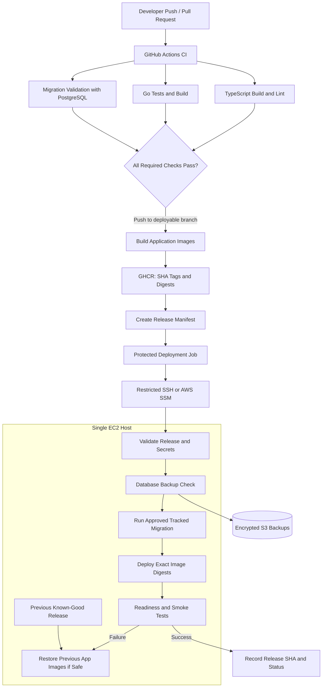

# EnvScale Deployment Architecture & Migration Plan

> **Purpose:** Replace the current ad-hoc EC2 deployment with a reproducible, secure, failure-aware release process while retaining the current low-cost single-EC2 architecture.
>
> **Scope:** GitHub Actions, GHCR, SSH/SSM access, Docker Compose, Caddy, PostgreSQL, Redis, K3s gateway, Terraform, secrets, migrations, health checks, backups, and rollback.
>
> **Operating principle:** Improve release correctness and security first. Do not introduce Kubernetes-based application orchestration, RDS, blue-green infrastructure, or other recurring cost until a concrete reliability or scale requirement justifies it.

---

## 1. Executive decision

Keep the current platform components for now:

- Terraform provisions the EC2 host and security group.
- GitHub Actions tests the repository and builds container images.
- GHCR stores release images.
- Docker Compose runs the web UI, API, Kubernetes streaming gateway, PostgreSQL, and Redis.
- Caddy terminates HTTP/HTTPS and routes requests.
- K3s remains responsible for the Kubernetes workloads that EnvScale specifically needs to manage or demonstrate.

Change the deployment contract:

1. **CI validates the exact commit.**
2. **Images are built once and tagged with the commit SHA.**
3. **The deployment selects those exact images, preferably by digest.**
4. **The host pulls only the selected release.**
5. **Database changes are explicit, tracked, and fail closed.**
6. **The application is promoted only after readiness checks pass.**
7. **A failed release is diagnosable and can restore the previous application version.**
8. **Database backups are stored off the EC2 instance and restoration is tested.**

Do not equate a successful `docker compose up -d` with a successful deployment.

## 2. Current-state findings

These findings come from the supplied `ci.yml`, `cd.yml`, `envscale.sh`, `docker-compose.prod.yml`, `docker-compose.dev.yml`, and Terraform files.

### 2.1 Release identity is inconsistent

The CD workflow builds images tagged with both `latest` and `${{ github.sha }}`. The deployment script pulls the Compose-configured images, which default to `latest`. The remote deployment also fetches and resets the EC2 checkout to `origin/develop`.

Consequences:

- The deployed image may not be the image built for the triggering workflow.
- Two closely spaced commits can overwrite the `latest` tag while another deployment is in progress.
- The EC2 source checkout and running container versions can diverge.

**Required change:** Pass the workflow commit SHA or, preferably, the published image digest to the deployment. Use explicit immutable image references for all application services. Do not deploy by `latest` in production. Do not `git reset --hard origin/develop` as part of the release path.

### 2.2 CI and CD are independent

The current `ci.yml` validates TypeScript and Go, but `cd.yml` triggers separately on `develop`. CD does not depend on the CI jobs passing for the same SHA. The database check verifies that a migration directory exists, rather than validating migrations against a real database.

**Required change:** Consolidate CI and CD into one workflow with explicit job dependencies, or make CD depend on a successful CI run for the same commit. Run migration validation against a disposable PostgreSQL service in CI.

### 2.3 SQL migration failures are ignored

`envscale.sh` concatenates SQL migration files and pipes them to `psql`, while suppressing stderr and using `|| true`. It also runs additional `CREATE TABLE` and `CREATE INDEX` statements with errors ignored.

Consequences:

- A migration can fail while the deployment reports success.
- Re-running every migration file can repeat non-idempotent SQL.
- There is no reliable applied-migration history in this shell path.
- Rolling back an image does not reverse database changes.

**Required change:** Stop applying raw concatenated SQL in `envscale.sh`. Use one tracked migration system, and fail deployment if migration application or verification fails. Confirm the repository's actual Drizzle setup before choosing the exact command. `drizzle-kit push` synchronizes schema and should not be treated as equivalent to a reviewed, versioned production migration history.

### 2.4 Secrets have insecure fallbacks

The production Compose file has default values for authentication secrets, a Kubernetes encryption key, and a PostgreSQL password. Those defaults make it possible for a misconfigured deployment to start with known credentials.

**Required change:** Remove production secret fallbacks. Validate required secrets before changing services. Store secrets in GitHub Actions Secrets and/or AWS Secrets Manager or SSM Parameter Store. Do not print secret values in logs.

Changing `POSTGRES_PASSWORD` in Compose does not change the password of an already-initialized PostgreSQL user. Rotate that credential deliberately using PostgreSQL itself and update every dependent service.

### 2.5 K3s gateway exposure needs review

The production Compose file publishes the streaming gateway on `8080:8080`, allows anonymous WebSocket access, allows wildcard origins, and mounts the host's K3s kubeconfig. The deployment script changes that kubeconfig to mode `0644`.

**Required change:**

- If Caddy is the only intended entry point, bind the gateway to loopback or keep it on an internal Compose network with an explicit proxy route.
- Remove wildcard origins and anonymous access unless a documented, narrowly scoped feature genuinely requires them.
- Do not make a privileged kubeconfig world-readable.
- Prefer a dedicated, least-privilege Kubernetes service account or an equivalent restricted identity.
- Inspect the current K3s permissions and gateway requirements before changing mounts; the correct solution depends on how the gateway authenticates to the Kubernetes API.

### 2.6 Host access and Terraform state require hardening

The Terraform configuration and helper script generate, store, copy, and restore an SSH private key. The helper script disables SSH host-key checking. The supplied Terraform state backup contains sensitive key material.

**Required change:**

- Prefer AWS Systems Manager Session Manager for host access and a narrowly scoped AWS identity for deployment, where feasible.
- If SSH remains, restrict inbound port 22 to a known CIDR or a controlled access path; never use `0.0.0.0/0` as the production default.
- Verify the EC2 host key using a managed `known_hosts` entry or another trusted host-identity mechanism.
- Protect Terraform state in an encrypted, access-controlled remote backend with versioning and locking.
- Never commit state files, state backups, private keys, or production `.env` files.
- If a private key or state file was exposed, rotate affected credentials and remove exposed artifacts from repository history where applicable.

### 2.7 PostgreSQL persistence is not the same as backup

Production Compose uses a named PostgreSQL volume, which is useful persistence. It still resides on the EC2 host's storage. A host or disk failure can take both the application and the only database copy offline.

**Required change:** Schedule encrypted PostgreSQL backups to S3 with restricted IAM permissions, retention, and versioning where appropriate. Test restores periodically. A dump stored only on the same EC2 volume is not a disaster-recovery plan.

### 2.8 Health and rollback behavior is insufficient

The current deployment restarts services and prints a success message without a mandatory application-level verification. It has no robust, recorded last-known-good release contract.

**Required change:** Add explicit readiness checks, a release record, logs on failure, deployment serialization, and rollback of application images when safe. Never automatically reverse database changes unless a specifically designed migration supports that operation.

---

## 3. Target architecture



This is the target release flow. It does not imply that the current repository already has every required migration, health endpoint, or AWS permission implemented.

---

## 4. Repository changes

Recommended layout:

```text
.github/
  workflows/
    deploy.yml                 # Single CI + image build + deployment workflow
deployment/
  docker-compose.prod.yml      # Runtime stack; no production secret defaults
  terraform/
    backend.tf                 # Remote state backend, if adopted
    ...
scripts/
  migrate.sh                   # Optional wrapper around the chosen migration tool
  backup-postgres.sh           # Optional scheduled backup helper
docs/
  deployment.md                # This runbook
```

Retire the old `ci.yml` and `cd.yml` only after the unified workflow has passed validation and a successful deployment. Keeping all three active can trigger duplicate builds and deployments.

Do not put the actual `.env`, credentials, private keys, Terraform state, or database dumps in the repository.

---

## 5. Unified GitHub Actions workflow requirements

The single `deploy.yml` should contain these jobs:

### Job A — Validate

Run on pull requests and pushes:

- Check out the commit.
- Install the exact pnpm version pinned by the repository.
- Run `pnpm install --frozen-lockfile`.
- Run the repository's actual build and lint commands.
- Run Go dependency verification, tests, and compilation.
- Start a disposable PostgreSQL service and test migration application against it.
- Fail if migration validation fails.
- Add secret scanning and dependency/image vulnerability scanning appropriate to the repository.

Pin third-party Actions to full commit SHAs as a supply-chain hardening step. Major-version tags are convenient but can move.

### Job B — Build and publish

Run only for a trusted push to the chosen deployment branch, after validation succeeds:

- Authenticate to GHCR using `GITHUB_TOKEN` and `packages: write`.
- Normalize the image owner to lowercase.
- Build the API, Kubernetes streamer, and web images.
- Publish each image with a unique commit SHA tag.
- Capture each image digest from the build output.
- Do not use `latest` as a deployment reference.
- Prefer deploying `image@sha256:...` references from the release manifest.

Build each image once. Do not rebuild it on EC2 or silently substitute a different tag during deployment.

### Job C — Deploy

Run only after the build/publish job succeeds:

- Use a protected GitHub Environment, for example `production`.
- Require all necessary deployment secrets; fail if any required secret is missing.
- Restrict the job to the intended branch.
- Serialize deployments using a production concurrency group.
- Prefer OIDC plus AWS Systems Manager where feasible. If SSH is retained, use a restricted key, verified host identity, and least-privilege access.
- Pass the release SHA and image references explicitly.
- Do not run `git reset --hard origin/develop` to determine which application image is deployed.
- Stop immediately if a pull, configuration validation, migration, or readiness check fails.
- Record the release SHA, image digests, deployment result, and failure diagnostics.

**Important:** Do not assume a workflow can safely pass a private GHCR credential to an EC2 host without considering its lifetime and scope. Prefer a dedicated read-only registry credential or another supported, least-privilege pull mechanism. The `GITHUB_TOKEN` used by a runner is not automatically a durable credential on EC2.

### Trigger policy

A practical starting policy is:

- Pull requests to `develop` and `main`: validation only.
- Push to `develop`: deploy to the integration/production host only if `develop` is intentionally the live branch.
- Push to `main`: do not deploy to the same production host automatically unless that is the explicit release policy.
- Manual deployment: permit only the intended branch and environment.

The current setup deploys `develop`. Keep that behavior until a separate staging/production promotion policy is deliberately adopted.

---

## 6. Docker Compose changes

The production Compose file should select image references explicitly from the release environment. Example pattern:

```yaml
services:
  postgres:
    image: postgres:16-alpine
    restart: unless-stopped
    environment:
      POSTGRES_USER: envscale
      POSTGRES_PASSWORD: ${POSTGRES_PASSWORD:?POSTGRES_PASSWORD must be set}
      POSTGRES_DB: envscale
    volumes:
      - postgres_data:/var/lib/postgresql/data
    healthcheck:
      test: ["CMD-SHELL", "pg_isready -U envscale -d envscale"]
      interval: 5s
      timeout: 5s
      retries: 5

  api-server:
    image: ${API_SERVER_IMAGE:?API_SERVER_IMAGE must be set}
    restart: unless-stopped
    environment:
      NODE_ENV: production
      DATABASE_URL: ${DATABASE_URL:?DATABASE_URL must be set}
      JWT_ACCESS_SECRET: ${JWT_ACCESS_SECRET:?JWT_ACCESS_SECRET must be set}
      JWT_REFRESH_SECRET: ${JWT_REFRESH_SECRET:?JWT_REFRESH_SECRET must be set}
      BETTER_AUTH_SECRET: ${BETTER_AUTH_SECRET:?BETTER_AUTH_SECRET must be set}
      KUBECONFIG_ENCRYPTION_KEY: ${KUBECONFIG_ENCRYPTION_KEY:?KUBECONFIG_ENCRYPTION_KEY must be set}
    depends_on:
      postgres:
        condition: service_healthy
      redis:
        condition: service_healthy

  # Keep redis, k8s-streamer, web and volumes here with the same
  # explicit image, secret, networking, health-check and mount policies.

volumes:
  postgres_data:
  redis_data:
```

This is a pattern to adapt, **not a complete drop-in replacement** for your current Compose file. Preserve required environment variables, Caddy routing, WebSocket behavior, application ports, and K3s gateway dependencies when applying it.

Additional requirements:

- Remove `build:` from the production Compose path if CI is the sole image builder.
- Use a consistent internal Compose network for services.
- Do not publish PostgreSQL or Redis publicly.
- Publish application ports only on loopback if host-based Caddy is the only ingress path.
- If Caddy is containerized instead, use an internal network and publish only Caddy's ports 80/443.
- Add health checks to application services where reliable health endpoints exist.
- Set resource limits only after measuring actual memory/CPU use, especially because K3s and PostgreSQL share this host.
- Keep development Compose separate from production and never expose development database ports on a public host.

### PostgreSQL password rotation

If PostgreSQL has already been initialized with `envscale_password`, changing the Compose variable alone will not rotate the existing database user's password. Plan a controlled password rotation:

1. Back up the database.
2. Change the PostgreSQL role password using a protected database session.
3. Update `POSTGRES_PASSWORD`, `DATABASE_URL`, and all dependent services together.
4. Restart/verify the services.
5. Test a new database connection before removing the old credential from secret stores.

---

## 7. Database migration strategy

This is one of the most important changes.

### Do not keep the current migration behavior

Remove the raw SQL concatenation and all `|| true` handling around database changes in `envscale.sh`. Do not run the same full set of migration SQL files on every release.

### Choose one authoritative migration system

The repository uses Drizzle-related tooling. Confirm the configured Drizzle version, config path, schema files, and generated migration format before choosing the command.

Preferred production model:

1. Generate and review versioned migrations during development.
2. Commit migration files with the application code.
3. Validate migrations against a clean disposable PostgreSQL database in CI.
4. Back up production before risky migrations.
5. Apply migrations once using the migration runner appropriate to the repository.
6. Verify success and record the applied migration version.
7. Deploy the compatible application image.
8. Stop the release if the migration fails.

If the project currently relies on `drizzle-kit push`, treat that as schema synchronization, not as a substitute for a reviewed, auditable migration history. Introduce a tracked migration workflow before relying on unattended schema changes.

### Use expand-and-contract for breaking changes

For changes that break compatibility:

- Release 1: add the new schema while keeping the old schema functional.
- Release 2: deploy code that supports both schemas and migrate/backfill data.
- Release 3: switch all reads/writes to the new schema.
- Release 4: remove obsolete schema only after verification.

A previous application image may not work against a newly changed database schema. Therefore, application rollback is safe only when the schema remains backward-compatible or the rollback procedure explicitly addresses the database state.

---

## 8. Deployment script behavior

Whether implemented inside the workflow or in a separately maintained host script, the deployment process should perform these steps in order:

1. Acquire a host-level lock to prevent concurrent deployments.
2. Validate the release SHA, image digests, required secrets, Compose configuration, and available disk space.
3. Pull the exact selected images. Fail if any pull fails.
4. Confirm PostgreSQL and Redis are healthy.
5. Check backup status and create a pre-migration backup when required.
6. Apply only the approved tracked migrations.
7. Deploy the exact image references with `docker compose up -d --no-build`.
8. Wait for readiness and run HTTP/API smoke tests.
9. On success, record the release SHA, digests, and deployment time.
10. On failure, capture logs and container status, then restore the previous application image references where safe.
11. Never automatically erase database data or blindly reverse a migration.
12. Clean up only old, unreferenced images after the release is verified.

### Health checks

Do not rely solely on HTTP status from `/`. Prefer dedicated endpoints such as:

- `/health/live`: process is alive.
- `/health/ready`: process can serve traffic and critical dependencies are available.

Use the actual routes implemented by the EnvScale services; do not add invented health endpoints to production configuration without implementing them in the application.

---

## 9. Caddy and networking

Caddy should be the only public HTTP/HTTPS entry point.

### Security group

Expected public ingress:

- TCP 80: public, for HTTP and certificate/redirect behavior.
- TCP 443: public, for HTTPS.
- TCP 22: preferably absent if using SSM; otherwise restricted to a known administrative CIDR.

Remove public ingress for PostgreSQL 5432, Redis 6379, frontend 3000, API 3001, and gateway 8080 unless there is a separately documented reason.

### Service binding

Because the current Caddyfile runs on the EC2 host and proxies to loopback ports, bind the relevant host ports to `127.0.0.1`. Confirm all Caddy upstream ports and WebSocket paths still match the Compose configuration after changing them.

### K3s gateway

The gateway accesses the K3s API and streams data. Treat it as a privileged control-plane-adjacent component:

- Do not use wildcard origins by default.
- Do not allow anonymous access unless the feature explicitly requires it and authorization is enforced elsewhere.
- Do not expose the gateway's host port publicly if Caddy can proxy it.
- Use the narrowest Kubernetes permissions that support the gateway's actual operations.
- Protect kubeconfig files and avoid mode `0644` for credentials.

---

## 10. Terraform and AWS operations

### Terraform state

Use a remote backend such as S3 with:

- Encryption at rest.
- Versioning.
- Restricted IAM access.
- State locking using a supported locking mechanism for the Terraform version.
- No public bucket access.
- A documented recovery process.

Do not use the helper script to copy raw state and private keys into a general-purpose bucket as a substitute for a proper backend and secrets management.

### EC2

- Encrypt EBS volumes.
- Require IMDSv2.
- Use a narrowly scoped instance role for S3 backups and any required AWS operations.
- Avoid storing AWS access keys on the host.
- Review the combined CPU and memory demand of PostgreSQL, Redis, Compose services, and K3s.
- Use a stable address strategy if public IP changes when stopping and starting EC2.
- Make the host bootstrap idempotent and log cloud-init failures clearly.

### Access path

Preferred future direction: GitHub Actions OIDC authenticates to AWS with a narrowly scoped role, and the deployment job uses Systems Manager to reach the target EC2 instance. This removes the need for a long-lived inbound SSH private key in GitHub Secrets, provided the instance, agent, IAM role, and network configuration support SSM.

If SSH is retained for the first implementation, harden it and verify host identity; do not disable host-key checking.

---

## 11. Backups and recovery

A local `pg_dump` under the application directory is useful for a quick recovery point, but not sufficient.

Minimum backup policy:

- Automated PostgreSQL dumps to an S3 bucket outside the EC2 instance.
- Encryption and restrictive bucket/role permissions.
- Retention rules appropriate to the data and cost budget.
- Versioning or other protection against accidental overwrite/deletion.
- A clear backup-success signal and alert on failure.
- Periodic restore tests into a separate temporary database.
- A documented recovery point objective (RPO) and recovery time objective (RTO).

Do not delete the only verified backup after a deployment. Do not assume that a successful `aws s3 cp` means the dump is restorable.

For `infra destroy`, require an explicit confirmation step, verify the off-instance backup, and only then destroy infrastructure. Avoid `terraform destroy -auto-approve` in any workflow that can be triggered accidentally.

---

## 12. Secrets inventory

Create these GitHub Environment secrets or manage them through AWS Secrets Manager/SSM where appropriate:

| Secret | Required? | Purpose |
|---|---|---|
| `EC2_HOST` | Yes if using SSH | Target host address |
| `SSH_PRIVATE_KEY` | Yes if using SSH | Restricted deployment key; eliminate if switching to SSM |
| `POSTGRES_PASSWORD` | Yes | Existing database role password |
| `DATABASE_URL` | Optional if derived safely | Runtime connection string; preferred when it contains special characters or nonstandard parameters |
| `BETTER_AUTH_SECRET` | Yes | Better Auth signing/secret material |
| `JWT_ACCESS_SECRET` | Yes | Access token signing |
| `JWT_REFRESH_SECRET` | Yes | Refresh token signing |
| `KUBECONFIG_ENCRYPTION_KEY` | Yes | Encryption key expected by the application |
| `DUCKDNS_DOMAIN` | Optional | DNS name |
| `DUCKDNS_TOKEN` | Optional | DNS update token |
| `GOOGLE_CLIENT_ID` | If OAuth is enabled | Google OAuth |
| `GOOGLE_CLIENT_SECRET` | If OAuth is enabled | Google OAuth |
| `CORS_ORIGIN` | Yes if not safely configured elsewhere | Exact allowed browser origins |

Never use sample values or known fallback secrets in production. Validate secret formats and lengths in the application or deployment preflight without printing the values.

Special characters in passwords must be URL-encoded if embedded in `DATABASE_URL`. Prefer constructing a connection string safely rather than interpolating arbitrary secrets into shell or URL syntax.

---

## 13. Rollout plan

### Phase 0 — Safety and inventory

- [ ] Back up the current database and verify the dump can be read.
- [ ] Identify current database password and rotation requirements.
- [ ] Inspect `.gitignore` and repository history for state, keys, `.env`, and dumps.
- [ ] Rotate credentials if exposed.
- [ ] Confirm the actual API and web health endpoints.
- [ ] Confirm the Drizzle migration command and whether production schema is currently managed by migration files or `push`.

### Phase 1 — Security hardening

- [ ] Remove known default secrets from production Compose.
- [ ] Restrict public security group ingress to 80/443 and the intended administration path.
- [ ] Close public PostgreSQL/Redis/application/gateway ports.
- [ ] Review gateway anonymous access, wildcard origins, and K3s credentials.
- [ ] Verify SSH host identity or prepare SSM.
- [ ] Secure Terraform state and generated credentials.

### Phase 2 — Release consistency

- [ ] Consolidate CI and CD into one workflow.
- [ ] Make image builds depend on all required CI checks.
- [ ] Publish immutable SHA tags and capture image digests.
- [ ] Deploy exact image references rather than `latest`.
- [ ] Remove `git reset --hard origin/develop` from the image deployment path.
- [ ] Add production deployment serialization and required-secret validation.

### Phase 3 — Database safety

- [ ] Choose one tracked migration mechanism.
- [ ] Validate migrations against a disposable PostgreSQL service in CI.
- [ ] Remove `|| true` from migration execution.
- [ ] Add a pre-migration backup policy.
- [ ] Verify schema compatibility for rollback.
- [ ] Configure automated encrypted S3 backups and test restoration.

### Phase 4 — Release verification

- [ ] Add application readiness endpoints or use existing verified endpoints.
- [ ] Test frontend, API, and gateway behavior after deployment.
- [ ] Record the successful release SHA and image digests.
- [ ] Capture logs and state when health checks fail.
- [ ] Test application rollback with a backward-compatible schema change.
- [ ] Test deployment failure deliberately in a non-production environment.

### Phase 5 — Operational improvements

- [ ] Add alerts for failed deployments and failed backups.
- [ ] Track disk, memory, CPU, container restarts, and PostgreSQL health.
- [ ] Add a staging host/environment if it is justified by release risk.
- [ ] Consider blue-green deployment only when uptime requirements justify it.
- [ ] Consider RDS or multi-instance hosting only when recovery and availability needs exceed what a single EC2 can provide.

---

## 14. Acceptance criteria

The migration is not complete until all of the following are true:

- [ ] A failed CI job cannot publish or deploy a release.
- [ ] The deployed image SHA/digest exactly matches the approved workflow run.
- [ ] Missing secrets cause deployment failure before services are changed.
- [ ] No production container starts with a known default authentication secret.
- [ ] PostgreSQL and Redis are not publicly reachable.
- [ ] The K3s gateway is not unintentionally public or anonymous.
- [ ] A migration failure causes deployment failure and is visible in logs.
- [ ] A failed health check prevents the release from being marked successful.
- [ ] The previous application release can be restored when the database schema is compatible.
- [ ] A recent database backup exists off-instance and has passed a restore test.
- [ ] Terraform state and private keys are not committed or publicly exposed.
- [ ] A concurrent deployment cannot overwrite a release in progress.
- [ ] The recovery process is documented and tested.

---

## 15. Final recommendation

For EnvScale today, the best return on effort is:

1. Secure the gateway, secrets, public ports, and Terraform state.
2. Deploy immutable, SHA-pinned images built only after successful CI.
3. Fix the migration system and stop ignoring database errors.
4. Add readiness checks, release recording, and safe application rollback.
5. Establish off-instance backups and restore tests.
6. Move host access toward AWS Systems Manager when feasible.
7. Revisit blue-green deployment, RDS, and multi-instance architecture only when requirements justify the cost.

**Do not begin by migrating the whole application to Kubernetes.** EnvScale already uses K3s for its gateway-related functionality. Keeping the application on Docker Compose while improving release discipline is the simpler and more appropriate next step for a single-EC2 deployment.
