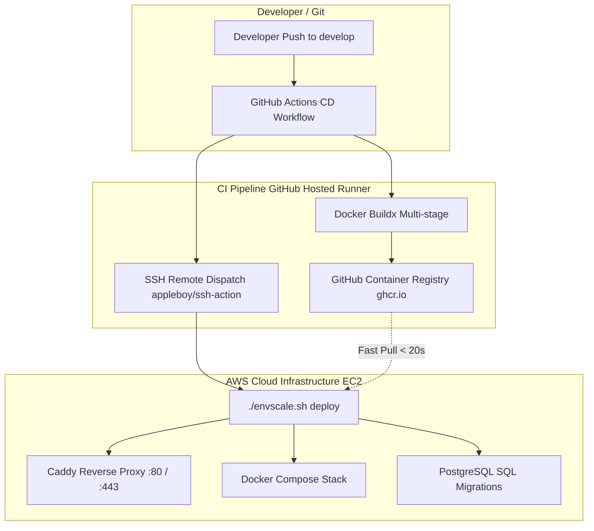
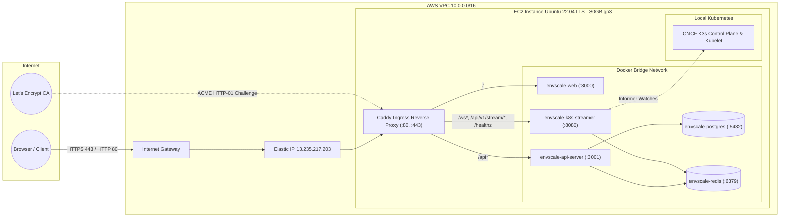

# EnvScale — Deployment Architecture & CI/CD Pipeline

> **Document Type:** Production Engineering & Operations Specification  
> **Target Audience:** DevOps Engineers, Team Developers (Pranav, Vinit, Neha, Ishika), CI/CD Runners  
> **Canonical Source:** [`docs/deployment.md`](file:///run/media/pranavissam/files%20and%20data/programming/mega%20projects/EnvScale/docs/deployment.md)

---

## 1. Architectural Philosophy: Decoupled Deployments (Relmonition Pattern)

Traditional microservice deployments often couple infrastructure creation with code updates, resulting in slow 15-minute builds, changing IP addresses, broken DNS/TLS records, and high cloud costs. 

**EnvScale** solves this by adopting a **decoupled deployment architecture** inspired by **Relmonition**:

1. **Infrastructure Lifecycle is Decoupled from Code Deployments:**
   - AWS cloud resources (VPC, Elastic IP, EC2, EBS, Security Groups) are provisioned once via Terraform.
   - When not in active testing, the EC2 instance is paused via `./envscale.sh infra stop`, dropping compute fees to **$0.00/hr** while preserving the static Elastic IP and database storage on EBS for ~$0.08/day.
   - An AWS S3 Cloud Vault (`s3://envscale-cloud-vault-<account>-<region>`) persistently stores Terraform state, SSH keys, and pre-destruction database backups.

2. **Artifact-Driven CI/CD (Zero Compilations on Cloud VM):**
   - GitHub Actions runners handle resource-intensive Docker image builds.
   - Built images are pushed to GitHub Container Registry (`ghcr.io`).
   - The production EC2 instance only pulls pre-built containers and applies database migrations, completing deployments in **< 45 seconds**.



---

## 2. Infrastructure Architecture (AWS & Host Configuration)

The infrastructure is declared in Terraform ([`deployment/terraform/`](file:///run/media/pranavissam/files%20and%20data/programming/mega%20projects/EnvScale/deployment/terraform)):



### Key Components

| Component | Technology | Configuration / Role |
| :--- | :--- | :--- |
| **Cloud Target** | AWS EC2 | Ubuntu 22.04 LTS (Jammy AMD64), 30 GB gp3 root disk (3000 IOPS, 125 MB/s) |
| **Networking** | AWS VPC + EIP | Custom VPC (`10.0.0.0/16`), public subnet (`10.0.1.0/24`), Internet Gateway, dedicated Elastic IP |
| **Local Cluster** | CNCF K3s | Installed via cloud-init with `--disable traefik`, providing native Kubernetes APIs without cloud EKS fees |
| **Reverse Proxy** | Caddy v2 | Automatic Let's Encrypt TLS/SSL termination, WebSocket proxying, and path-based routing |
| **Data Stores** | Postgres 16 & Redis 7 | Containerized with persistent Docker volumes (`postgres_data`, `redis_data`) |
| **State Vault** | AWS S3 | Encrypted permanent bucket storing `terraform.tfstate`, SSH private key, and database dumps |

---

## 3. Reverse Proxy & Path Routing (Caddy)

Caddy runs directly as a systemd service on the EC2 host. It binds to ports **80** (HTTP) and **443** (HTTPS), handling automatic SSL/TLS certificate issuance via ACME.

### Caddy Routing Table

```text
Incoming Traffic (:80 / :443)
│
├── /healthz                     ──> localhost:8080  (Streamer health check)
├── /ws*                         ──> localhost:8080  (WebSocket streaming & agent ingress)
├── /api/v1/stream/*             ──> localhost:8080  (Live topology SSE/stream endpoints)
├── /api/v1/clusters/snapshot*   ──> localhost:8080  (Cluster snapshot data)
├── /api/v1/clusters/register*   ──> localhost:8080  (Dynamic agent cluster registration)
├── /api/v1/logs/stream*         ──> localhost:8080  (Pod log tailing)
├── /api/v1/chaos/*              ──> localhost:8080  (Chaos engineering injection engine)
├── /api/v1/resource/*           ──> localhost:8080  (Resource metric evaluation)
├── /api/v1/evaluator/*          ──> localhost:8080  (Cluster health rule evaluator)
├── /api/v1/rollout/*            ──> localhost:8080  (Canary / Blue-Green rollout controller)
├── /api*                        ──> localhost:3001  (Node.js Express + Drizzle REST API)
└── /* (Default Fallback)        ──> localhost:3000  (Nginx serving React SPA)
```

---

## 4. Workload Services Specification (Docker Compose)

The production application stack is defined in [`deployment/docker-compose.prod.yml`](file:///run/media/pranavissam/files%20and%20data/programming/mega%20projects/EnvScale/deployment/docker-compose.prod.yml):

```yaml
services:
  postgres:
    image: postgres:16-alpine
    ports: ["127.0.0.1:5432:5432"]
    volumes: [postgres_data:/var/lib/postgresql/data]
    healthcheck: { test: ["CMD-SHELL", "pg_isready -U envscale"], interval: 5s }

  redis:
    image: redis:7-alpine
    ports: ["127.0.0.1:6379:6379"]
    volumes: [redis_data:/data]
    healthcheck: { test: ["CMD", "redis-cli", "ping"], interval: 5s }

  api-server:
    image: ghcr.io/p20000/envscale-api-server:latest
    ports: ["127.0.0.1:3001:3000"]
    depends_on: { postgres: { condition: service_healthy }, redis: { condition: service_healthy } }

  k8s-streamer:
    image: ghcr.io/p20000/envscale-k8s-streamer:latest
    ports: ["0.0.0.0:8080:8080"]
    volumes: ["/etc/rancher/k3s/k3s.yaml:/etc/rancher/k3s/k3s.yaml:ro"]
    depends_on: { redis: { condition: service_healthy } }

  web:
    image: ghcr.io/p20000/envscale-web:latest
    ports: ["127.0.0.1:3000:80"]
```

---

## 5. Continuous Integration & Deployment (CI/CD) Pipeline

The automated deployment pipeline is implemented in [`.github/workflows/cd.yml`](file:///run/media/pranavissam/files%20and%20data/programming/mega%20projects/EnvScale/.github/workflows/cd.yml).

### Workflow Trigger Rules
- **Automatic:** Push to `develop` branch.
- **Paths Ignored:** `deployment/terraform/**`, `docs/**`, `**.md`.
- **Manual:** `workflow_dispatch` button in GitHub Actions UI.

### Stage 1: Build & Push (`build-and-push`)
1. Spawns GitHub runner (`ubuntu-latest`).
2. Configures Docker Buildx with GitHub Actions Cache (`type=gha,mode=max`).
3. Logs in to GitHub Container Registry (`ghcr.io`) using `GITHUB_TOKEN`.
4. Builds 3 production container images in parallel:
   - `apps/api-server/Dockerfile` ➔ `ghcr.io/p20000/envscale-api-server:latest`
   - `apps/k8s-streamer/Dockerfile` ➔ `ghcr.io/p20000/envscale-k8s-streamer:latest`
   - `apps/web/Dockerfile` ➔ `ghcr.io/p20000/envscale-web:latest`

### Stage 2: Deploy to Integration Host (`deploy`)
1. Checks for required GitHub Repository Secrets (`SSH_PRIVATE_KEY` and `EC2_HOST`).
2. Dispatches an SSH session into the EC2 instance using `appleboy/ssh-action`.
3. Injects sensitive environment credentials into the remote shell session.
4. Fast-forwards the host Git checkout to latest `develop`:
   ```bash
   cd /opt/envscale
   git fetch origin develop && git reset --hard origin/develop
   ./envscale.sh deploy
   ```
5. The host executes `action_deploy()`:
   - Re-writes atomic, restricted-permission `/opt/envscale/.env` (`chmod 600`).
   - Updates DNS routing records (DuckDNS / sslip.io).
   - Generates and reloads `/etc/caddy/Caddyfile`.
   - Executes `docker compose pull` from GHCR.
   - Executes `docker compose up -d --remove-orphans`.
   - Executes database schema migrations (`*.sql` scripts into Postgres).
   - Restarts `api-server` and `k8s-streamer` for clean connections.

---

## 6. Unified CLI Orchestrator: `envscale.sh`

All deployment and infrastructure tasks are operated via [`envscale.sh`](file:///run/media/pranavissam/files%20and%20data/programming/mega%20projects/EnvScale/envscale.sh):

```bash
# Application Deployment (Invoked by CI/CD or CLI)
./envscale.sh deploy          # Pulls latest GHCR images, updates .env, reloads Caddy, runs migrations

# Infrastructure Lifecycle Management
./envscale.sh infra up        # Provisions AWS EC2 via Terraform, syncs GitHub secrets, bootstraps apps
./envscale.sh infra stop      # Pauses EC2 instance (Compute: $0.00/hr, preserves state on disk)
./envscale.sh infra start     # Resumes EC2 in ~20s, syncs GitHub secrets, redeploys containers
./envscale.sh infra destroy   # Takes automated pg_dump to S3 vault and tears down all AWS resources

# Diagnostics & Shell
./envscale.sh status          # Inspects running Docker containers and healthchecks
./envscale.sh logs [service]  # Tails production logs (e.g., ./envscale.sh logs k8s-streamer)
./envscale.sh ssh             # Opens direct interactive SSH terminal into EC2
```

---

## 7. Security, Secrets & DNS Governance

### Secret Injection Matrix

| Secret Name | Storage / Source | Injected Into | Description |
| :--- | :--- | :--- | :--- |
| `SSH_PRIVATE_KEY` | GitHub Secrets / S3 Vault | CI/CD Runner | Generated ED25519 key for passwordless EC2 SSH access |
| `EC2_HOST` | GitHub Secrets / Terraform | CI/CD Runner | Public Elastic IP address of the EC2 instance |
| `BETTER_AUTH_SECRET` | GitHub Secrets / `.env` | `api-server`, `web` | 32-byte session encryption key for Better Auth |
| `JWT_ACCESS_SECRET` | GitHub Secrets / `.env` | `api-server`, `streamer` | Shared HMAC secret for verifying token claims across Go & Node.js |
| `KUBECONFIG_ENCRYPTION_KEY` | GitHub Secrets / `.env` | `api-server` | 256-bit AES-GCM encryption key for cluster credentials in Postgres |
| `DUCKDNS_TOKEN` | GitHub Secrets / `.env` | Host script | API token for updating DuckDNS dynamic records |

### DNS & TLS Certificate Resolution

```text
Domain Resolution Options:
├── Option A (Default / Zero-Config):  <EC2_IP>.sslip.io
│   └── Resolves instantly to EC2 IP; Caddy auto-provisions Let's Encrypt TLS (no account needed).
├── Option B (Dynamic DNS):           <unique_name>.duckdns.org
│   └── Requires valid DUCKDNS_TOKEN and DUCKDNS_DOMAIN; updated via curl on host bootstrap.
└── Option C (Custom Domain):         envscale.yourdomain.com
    └── Requires A-record pointing to EC2 Elastic IP; TLS managed automatically by Caddy.
```
