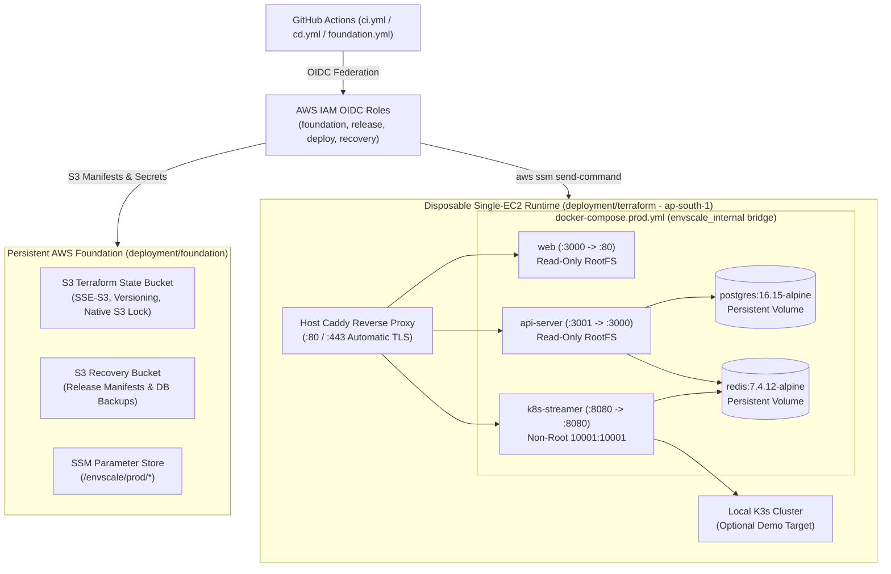

# EnvScale Production & Cloud Deployment Runbook

> **Document Scope:** As-built architecture and operational runbook for **EnvScale**'s AWS Persistent Foundation, single-EC2 Docker Compose + Caddy + K3s runtime, zero-SSH OIDC/SSM release cutover, database backups, and optional AWS EKS target cluster.
> **Companion Reference:** See [CI/CD Pipelines & Environment Reference](cicd-and-environment-reference.md) for GitHub Actions workflow jobs, script flags, and the complete environment variable matrix.

---

## 1. Architecture: Persistent Foundation vs. Disposable Runtime

EnvScale separates **persistent state, identity, and backups** from **disposable application compute** so the runtime EC2 host can be paused, rebuilt, or replaced without losing Terraform state, secrets, or PostgreSQL recovery points:



---

## 2. Day-0 Bootstrap & Foundation Layer

Managed in [`deployment/bootstrap/`](../deployment/bootstrap) and [`deployment/foundation/`](../deployment/foundation) (`ap-south-1`, Terraform `1.14.9` pinned in [`.terraform-version`](../.terraform-version)):

1. **State Bucket & Operator IAM Bootstrap ([`bootstrap-state.sh`](../deployment/bootstrap/bootstrap-state.sh)):**
   - Creates/reconciles the encrypted, versioned S3 Terraform state bucket (`use_lockfile = true` native S3 locking — zero DynamoDB tables).
   - Provides `--dry-run` (offline policy/JSON rendering), `--bootstrap-state-bucket`, `--init-bucket-policy`, `--bootstrap-foundation-iam`, and `--transition-operator-iam` modes protected by explicit confirmation tokens and [`day0_identity_guard.py`](../deployment/bootstrap/day0_identity_guard.py).
2. **SSM Secret Seeding ([`seed-parameters.sh`](../deployment/bootstrap/seed-parameters.sh)):**
   - Populates `/envscale/prod/*` `SecureString` parameters in AWS SSM Parameter Store before host cutover.
3. **Foundation Terraform Stack ([`deployment/foundation/`](../deployment/foundation)):**
   - Provisions GitHub Actions OIDC roles (`envscale-github-release-role`, `envscale-github-deploy-role`, `envscale-github-recovery-role`, `envscale-github-foundation-plan-role`, `envscale-github-foundation-role`), S3 recovery bucket, SSM parameter definitions, optional static EIP (`retain_static_eip`, default `false` for zero idle EIP charges), and MFA-enforced `envscale-foundation-admin-role`.
   - Executed safely via [`.github/workflows/foundation.yml`](../.github/workflows/foundation.yml) with S3 state fingerprint verification (`ETag|VersionId`) and plan allowlist checks ([`validate-foundation-plan.py`](../deployment/bootstrap/validate-foundation-plan.py)).

---

## 3. Single-EC2 Runtime Stack & Ingress Routing

Provisioned via [`deployment/terraform/`](../deployment/terraform) (`t3a.large` default, `30 GB` gp3 root volume, zero-SSH `envscale-ec2-runtime-profile`, DuckDNS / `sslip.io` domain support):

### Production Compose Contract ([`docker-compose.prod.yml`](../deployment/docker-compose.prod.yml))
- **Stateful Data Tier (`com.envscale.tier: "stateful-data"`):**
  - `postgres` (`postgres:16.15-alpine@sha256:...`) and `redis` (`redis:7.4.12-alpine@sha256:...`) attach exclusively to the internal `envscale_internal` bridge network with **zero published host ports** and persistent Docker volumes (`postgres_data`, `redis_data`).
- **Disposable Application Tier (`com.envscale.tier: "disposable-app"`):**
  - All three containers deploy exclusively from immutable `@sha256:` image digests (`API_SERVER_IMAGE`, `STREAMER_IMAGE`, `WEB_IMAGE`), run with `read_only: true`, `no-new-privileges:true`, bounded `tmpfs` mounts, mandatory `:?` variable validation (zero secret fallbacks), and loopback-only port bindings:
    - `web` → `127.0.0.1:3000:80`
    - `api-server` → `127.0.0.1:3001:3000`
    - `k8s-streamer` → `127.0.0.1:8080:8080` (runs as non-root `10001:10001` with `ALLOW_ANONYMOUS_WS="false"` and read-only kubeconfig mount)

### Host Caddy Reverse Proxy ([`Caddyfile.tpl`](../deployment/Caddyfile.tpl))
Caddy terminates HTTP (`:80`) and automatic Let's Encrypt HTTPS (`:443`) on the host and proxies strictly to `127.0.0.1`:
- `/health`, `/api/health`, `/api/v1/health`, `/api*` → `api-server` (`127.0.0.1:3001`)
- `/healthz`, `/ws*`, `/api/v1/stream/*`, `/api/v1/clusters/snapshot*`, `/api/v1/clusters/metrics/*`, `/api/v1/clusters/register*`, `/api/v1/clusters/unregister-all*`, `/api/v1/clusters/*/rollout/*`, `/api/v1/clusters/rollout/*`, `/api/v1/logs/stream*`, `/api/v1/chaos/*`, `/api/v1/resource/*`, `/api/v1/evaluator/*`, `/api/v1/rollout/*` → `k8s-streamer` (`127.0.0.1:8080`, `flush_interval -1`)
- All remaining routes (`/`) → `web` (`127.0.0.1:3000`)

---

## 4. Release Cutover, Verification & Rollback

[`envscale.sh`](../envscale.sh) acts as a dual-mode entrypoint: inside `/opt/envscale` on the EC2 host it dispatches `deploy`, `rollback`, and `verify` directly to [`deployment/scripts/`](../deployment/scripts); on developer workstations it delegates to [`scripts/test-center`](../scripts/test-center) `--cli`.

1. **Build & Publish ([`cd.yml`](../.github/workflows/cd.yml)):**
   - Builds `linux/amd64` images for `api-server`, `k8s-streamer`, and `web`, pushes `sha-<commit>` tags to GHCR, and runs [`generate-release-manifest.py`](../deployment/scripts/generate-release-manifest.py) + [`validate-release-manifest.py`](../deployment/scripts/validate-release-manifest.py) (rejecting `:latest`/floating tags, `*.example.json`, and migration hash mismatches).
   - Uploads `release-manifest.json` to the S3 recovery bucket and invokes `aws ssm send-command` against `EC2_INSTANCE_ID` (zero SSH).
2. **8-Step Host Cutover ([`host-runtime.sh`](../deployment/scripts/host-runtime.sh)):**
   - Acquires exclusive `flock` on FD `9`, validates manifest digests & `0600` secrets synced via [`sync-ssm-secrets.py`](../deployment/scripts/sync-ssm-secrets.py), pre-pulls all 3 `@sha256` images before touching running containers, validates Caddy config (`caddy validate`), ensures `postgres`/`redis` health, verifies pre-deploy backup metadata (when required) and applies tracked Drizzle migrations (`node dist/db/migrate.js`), promotes Caddy and `rendered.compose.env`, cuts over containers (`--pull never`), and runs [`verify.sh`](../deployment/scripts/verify.sh).
3. **Verification & Automatic Rollback ([`verify.sh`](../deployment/scripts/verify.sh), [`rollback.sh`](../deployment/scripts/rollback.sh)):**
   - `verify.sh` confirms all 5 Compose containers report `running:healthy`, verifies `RepoDigests` match the manifest, asserts Drizzle migrations and all 12 canonical PostgreSQL tables exist, and executes HTTP/Redis/`401` smoke tests.
   - If verification fails, `host-runtime.sh` passes inherited FD `9` to `rollback.sh --from-failed-deploy` to restore the disposable application tier to `last-known-good` (failing closed if schema migrations diverged unless `--allow-schema-divergent-rollback` is explicitly passed).

---

## 5. Optional AWS EKS Target Cluster (`deployment/terraform-eks/`)

For observing and stress-testing a managed Kubernetes target cluster alongside local `Minikube`/`K3s`:

- **Terraform Stack ([`deployment/terraform-eks/`](../deployment/terraform-eks)):** Provisions `envscale-todo-eks` in `ap-south-1` running Kubernetes `1.32` with `t3.medium` Spot worker nodes inside a dedicated VPC.
- **Sample Workloads ([`eks-todo-app.yaml`](../deployment/eks-todo-app.yaml)):** Deploys the 3-tier Todo benchmark app and Ingress for live topology, metrics, and chaos demonstrations.
- **CLI Automation:**
  ```bash
  pnpm test-center --cli eks up       # Provision EKS cluster & export /tmp/envscale-eks-kubeconfig.yaml
  pnpm test-center --cli eks deploy   # Install metrics-server & eks-todo-app.yaml
  pnpm test-center --cli eks status   # Inspect cluster & nodegroup status
  pnpm test-center --cli eks destroy  # Delete workloads, run terraform destroy, clean kubeconfig
  ```

---

## 6. Backups, Disaster Recovery & Pre-Deploy Validation

- **Local & Pre-Deploy Backups:** [`scripts/db-backup.sh`](../scripts/db-backup.sh) creates gzipped custom-format PostgreSQL dumps (`--backup`), lists archives (`--list`), and performs safe restores (`--restore <file>`). Production cutovers with schema changes validate `RESTORE_VERIFIED` backup manifests via [`runtime-guards.py`](../deployment/scripts/runtime-guards.py) (`verify-pre-deploy-backup`).
- **Off-Instance S3 Archival:** `pnpm test-center --cli infra destroy` archives the PostgreSQL database dump to the persistent S3 recovery bucket before tearing down the disposable EC2 compute instance.
- **Contract Test Suite:** Run offline validation before any deployment or Terraform change:
  ```bash
  python3 deployment/scripts/validate-release-manifest.py --manifest deployment/release/release-manifest.example.json --allow-example
  python3 -m unittest discover -s testing/deployment -p "test_*.py" -v
  ```
