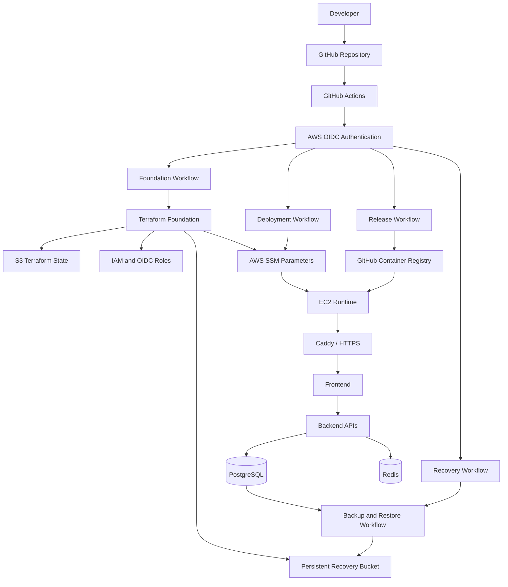

# EnvScale — Final Architecture, Implementation & Deployment Master Plan

**Document type:** Engineering handoff and execution specification  
**Project:** EnvScale  
**Repository:** `P20000/EnvScale`  
**Primary branch:** `develop`  
**Target environment:** AWS, `ap-south-1`  
**Infrastructure approach:** Terraform + AWS + GitHub Actions + OIDC + SSM + Docker Compose  
**Execution agent:** Argon 4  
**Objective:** Complete implementation, deploy the application, and demonstrate reliable infrastructure lifecycle automation.

---

# 1. Executive Summary

EnvScale is an infrastructure orchestration and deployment platform designed to automate the lifecycle of cloud-hosted applications.

Its purpose is not simply to provision an EC2 instance or execute a deployment script. It should provide a repeatable workflow to:

1. Provision cloud infrastructure.
2. Build and publish application releases.
3. Deploy immutable application versions.
4. Monitor application health.
5. Perform controlled updates.
6. Create and validate database backups.
7. Destroy disposable runtime infrastructure.
8. Recreate the runtime environment.
9. Restore application data from persistent backups.
10. Return the application to a healthy operational state.

The central architectural principle is:

**The application runtime should be disposable, while the infrastructure state and recovery foundation must remain persistent.**

The project has already undergone substantial implementation and security hardening. Do not restart the architecture from scratch.

The immediate objective is to resolve the remaining implementation blockers, validate the existing work, deploy the Foundation, deploy the application, and prove the complete lifecycle.

The project is now moving from architecture and security development into practical deployment and operational validation.

---

# 2. Project Objectives

## 2.1 Primary objectives

EnvScale must demonstrate:

- Infrastructure as Code using Terraform.
- Automated provisioning and destruction.
- CI/CD through GitHub Actions.
- AWS authentication through GitHub OIDC.
- Remote instance management through AWS Systems Manager.
- Containerized application deployment.
- Immutable release identification.
- Database backup and recovery.
- Persistent Terraform state.
- Idempotent deployment operations.
- Runtime recreation without losing persistent application data.

## 2.2 Non-goals for the current release

The following are explicitly outside the current implementation scope:

- Multi-region disaster recovery.
- Full enterprise-grade multi-account architecture.
- Multi-AZ production high availability.
- Kubernetes-based runtime deployment.
- Complex service mesh architecture.
- Excessive IAM abstraction and custom security frameworks.
- Unnecessary infrastructure monitoring complexity.
- Building a generalized cloud platform supporting every possible deployment topology.

These may be considered future improvements, but they must not delay the current working deployment.

## 2.3 Success definition

EnvScale is considered successfully implemented when the following sequence works:

**Provision → Deploy → Verify → Backup → Destroy Runtime → Recreate → Restore → Verify**

A successful Terraform apply alone does not establish project completion.

---

# 3. Target Architecture

## 3.1 High-level architecture

The intended deployment architecture consists of four major layers:

1. Developer and source-control layer.
2. CI/CD and release-management layer.
3. Persistent AWS Foundation layer.
4. Disposable application runtime layer.

### Logical architecture diagram



This is the intended logical architecture. Actual resource names, workflow responsibilities, and service composition must be verified against the repository before implementation.

---

# 4. Infrastructure Architecture

## 4.1 AWS region and account

Previously used configuration:

- AWS account: `982534376726`
- Region: `ap-south-1`
- Terraform state bucket: `envscale-tfstate-982534376726-ap-south-1`
- Legacy recovery bucket: `envscale-cloud-vault-982534376726-ap-south-1`

These are historical configuration values, not proof that the resources currently exist or are correctly configured.

Before any AWS operation, inspect the active AWS caller identity and confirm the intended account and region.

Do not assume that old EC2 instances, IAM roles, buckets, or networking resources still exist.

## 4.2 Persistent Foundation

The Foundation contains resources that must survive application runtime destruction.

Expected responsibilities:

| Component | Purpose | Persistence |
|---|---|---|
| Terraform state bucket | Stores infrastructure state | Persistent |
| S3 state lock | Prevents concurrent Terraform state modifications | Persistent mechanism |
| Recovery bucket | Stores database backups and recovery artifacts | Persistent |
| IAM roles | Authorize CI/CD and infrastructure operations | Persistent |
| GitHub OIDC provider | Enables short-lived GitHub authentication | Persistent |
| SSM parameters | Stores application configuration and secrets | Persistent |
| Release metadata | Tracks deployment and release information | Persistent where configured |
| Optional EIP | Stable public address if required | Depends on configuration |

The Foundation must be managed independently of the runtime.

Runtime destruction must not delete:

- Terraform state.
- Recovery backups.
- Recovery manifests.
- Required IAM identities.
- GitHub OIDC configuration.
- Persistent SSM configuration.
- Other explicitly protected Foundation resources.

## 4.3 Disposable Runtime

The runtime contains the resources required to execute the application.

Expected components:

| Component | Responsibility |
|---|---|
| VPC | Network isolation |
| Subnets | Runtime network placement |
| Internet gateway | Internet connectivity |
| Route tables | Network routing |
| Security groups | Traffic restrictions |
| EC2 | Application host |
| EBS | Runtime storage |
| Instance profile | EC2 permissions |
| Docker | Container runtime |
| Docker Compose | Multi-container orchestration |
| Caddy | HTTPS and reverse proxy |
| PostgreSQL | Relational database |
| Redis | Cache or supporting service |
| Frontend | User interface |
| Backend APIs | Application services |

Runtime resources should be recreatable through Terraform and the deployment workflow.

Do not couple persistent backup storage or Terraform state to disposable EC2 storage.

## 4.4 Terraform state separation

The project should retain the existing separation between:

- Foundation Terraform state.
- Runtime Terraform state.

Expected logical structure:

```text
deployment/
├── foundation/
│   ├── backend.tf
│   ├── providers.tf
│   ├── variables.tf
│   ├── outputs.tf
│   ├── iam.tf
│   ├── iam_admin.tf
│   ├── iam_cicd.tf
│   ├── iam_foundation.tf
│   ├── iam_foundation_plan.tf
│   ├── iam_boundary.tf
│   └── ...
│
├── terraform/
│   └── Existing or legacy runtime configuration
│
└── bootstrap/
    ├── bootstrap-state.sh
    ├── validate-foundation-plan.py
    ├── validate-foundation-security.py
    ├── day0_identity_guard.py
    ├── foundation_workflow_guard.py
    └── ...
```

This is an illustrative map. Inspect the current repository and preserve its actual structure.

Do not create a second competing Terraform configuration if an existing runtime configuration already provides the required functionality.

---

# 5. CI/CD and Identity Architecture

## 5.1 Authentication model

GitHub Actions should authenticate with AWS using OIDC.

Avoid long-lived AWS access keys in GitHub repository secrets.

The intended authentication sequence:

1. GitHub Actions starts a workflow.
2. The job requests an OIDC token.
3. AWS STS validates the token.
4. AWS returns temporary credentials.
5. The workflow assumes only the IAM role authorized for that operation.
6. Terraform or deployment commands execute with temporary credentials.

## 5.2 IAM role responsibilities

The repository has previously introduced or planned the following identities.

Names must be verified against the current Terraform source and actual AWS environment.

| Role | Intended responsibility |
|---|---|
| `envscale-github-foundation-plan-role` | Read-only Foundation planning |
| `envscale-github-foundation-role` | Foundation Terraform operations |
| `envscale-github-release-role` | Publishing application releases |
| `envscale-github-deploy-role` | Deploying application releases |
| `envscale-github-recovery-role` | Recovery and backup-pointer operations |
| `envscale-ec2-runtime-role` | Permissions required by the EC2 runtime |
| `envscale-foundation-admin-role` | Human break-glass administration |
| `envscale-day0-initial-seal` | Initial state-bucket policy sealing |
| `envscale-day0-bootstrap` | Restricted state-bucket bootstrap operations |

### Important ownership rule

Do not combine all these permissions into one administrator role.

Keep role permissions aligned with actual workflow responsibilities.

However, do not spend time designing additional identity layers unless a concrete missing permission or privilege-escalation issue is demonstrated.

## 5.3 Workflow responsibilities

Expected workflow separation:

### Release workflow

- Build application images.
- Run build and test checks.
- Publish images to GHCR.
- Record immutable image digests.
- Publish release metadata.

### Foundation workflow

- Validate Terraform configuration.
- Generate Foundation plan.
- Validate the plan.
- Require appropriate protected approval for apply.
- Apply the validated plan.
- Confirm that a subsequent plan shows no unexpected changes.

### Deployment workflow

- Authenticate using OIDC.
- Identify the intended release.
- Validate deployment prerequisites.
- Connect through SSM.
- Execute the deployment on EC2.
- Verify application health.
- Record deployment status.

### Recovery workflow

- Identify the latest verified backup.
- Validate the backup metadata.
- Execute the intended restore operation.
- Validate the restored database.
- Verify application health.

### Destroy workflow

- Confirm the target runtime.
- Validate the Terraform destroy plan.
- Verify backup readiness.
- Destroy only disposable runtime resources.
- Preserve the Foundation and recovery data.

Do not assume that every workflow currently exists or is fully operational. Inspect `.github/workflows/` and reconcile this specification with the implementation.

---

# 6. Deployment Runtime

## 6.1 Deployment approach

Use the existing Docker Compose architecture for the initial runtime.

Do not migrate to Kubernetes simply for architectural complexity.

The intended deployment flow:

```text
GitHub Actions
      |
      v
AWS OIDC
      |
      v
Deployment IAM Role
      |
      v
SSM Command Execution
      |
      v
EC2 Host
      |
      v
Docker Compose
      |
      +--> Frontend
      +--> Backend APIs
      +--> PostgreSQL
      +--> Redis
      +--> Supporting Services
      |
      v
Caddy / HTTPS
      |
      v
Application Health Verification
```

## 6.2 Container image strategy

Use immutable release references.

Preferred:

- Image digest references.
- Explicit release identifiers.
- No deployment based only on mutable `latest` tags.
- Release metadata that records the actual deployed image versions.

Example:

```text
ghcr.io/owner/envscale-api@sha256:...
ghcr.io/owner/envscale-frontend@sha256:...
```

The actual image names must be derived from the repository's current configuration.

## 6.3 SSM-based deployment

Use AWS Systems Manager rather than exposing SSH for routine deployment.

The deployment system must:

1. Confirm that the instance is registered with SSM.
2. Confirm the instance profile is attached.
3. Verify SSM connectivity.
4. Transfer or retrieve the deployment script.
5. Pull the intended immutable images.
6. Execute Docker Compose.
7. Check service health.
8. Return execution results to GitHub Actions.

Do not report a successful deployment merely because an SSM command was accepted. Wait for the command result and verify application health.

## 6.4 Network exposure

Only expose services that need public access.

Expected public ingress:

- HTTP for redirect or certificate issuance where required.
- HTTPS for the application.

Do not expose PostgreSQL, Redis, Docker management interfaces, or internal APIs directly to the public internet.

Do not leave SSH open to `0.0.0.0/0`.

If SSH is required temporarily for debugging, make it restricted and remove it afterward.

---

# 7. Database Backup and Recovery

Recovery is one of the most important features of EnvScale.

A disposable runtime must not imply disposable application data.

## 7.1 Backup process

The intended process:

1. Confirm PostgreSQL is accessible.
2. Create a PostgreSQL custom-format dump using `pg_dump -Fc`.
3. Generate a checksum.
4. Upload the dump to the persistent recovery bucket.
5. Upload the corresponding manifest.
6. Validate object integrity.
7. Restore the backup into an isolated PostgreSQL environment.
8. Run restore validation.
9. Promote the latest-valid backup pointer only after successful verification.

## 7.2 Backup metadata

The backup manifest should identify:

- Backup ID.
- Creation timestamp.
- Database name.
- PostgreSQL version.
- Dump format.
- S3 object key.
- File size.
- SHA-256 checksum.
- Restore-validation result.
- Validation timestamp.
- Application release or schema version where available.

Do not store database passwords or other credentials in plaintext manifests.

## 7.3 Recovery storage

Keep recovery artifacts independent of EC2.

Illustrative structure:

```text
backups/
└── postgres/
    ├── archive/
    │   ├── backup-<id>.dump
    │   └── backup-<id>.json
    │
    └── latest-valid.json
```

Use the actual existing naming convention if one already exists.

The `latest-valid.json` pointer must not reference an unverified backup.

## 7.4 Restore process

A restore must:

1. Select a verified backup.
2. Verify the manifest.
3. Verify the checksum.
4. Provision or identify the target PostgreSQL instance.
5. Restore the database.
6. Validate database availability.
7. Validate expected schema and application compatibility.
8. Start the application.
9. Execute application health checks.

A successful upload is not a successful backup.

A successful `pg_restore` exit code is not sufficient proof of full application recovery.

---

# 8. Current Implementation Status

The project has undergone several iterations of IAM, bootstrap, Terraform-plan validation, and GitHub Actions hardening.

The latest supplied review report describes the following work.

**Important:** These are reported implementation and validation results. They must be reconciled against the current Git working tree and AWS environment before being treated as current live facts.

## 8.1 Day-0 bootstrap

Previously implemented:

- Dedicated initial-seal identity.
- Dedicated steady-state bootstrap identity.
- Separate break-glass administration.
- Live trust-policy validation.
- IAM permissions-boundary verification.
- Identity policy verification.
- Restrictions against state-object and recovery-bucket access during bootstrap.
- Bucket policy sealing and reconciliation checks.

Files previously involved:

```text
deployment/bootstrap/bootstrap-state.sh
deployment/bootstrap/day0_identity_guard.py
deployment/bootstrap/day0-bootstrap-policy.json
deployment/bootstrap/day0-initial-policy-seal.json
deployment/bootstrap/day0-bootstrap-permissions-boundary.json
deployment/bootstrap/day0-initial-seal-permissions-boundary.json
```

## 8.2 Foundation IAM

Previously implemented:

- Foundation OIDC plan role.
- Foundation OIDC apply role.
- Workload permissions boundary.
- Restricted PassRole.
- Protection against Foundation self-modification.
- Explicit separation of human break-glass access.
- Recovery resource protection.

Files previously involved:

```text
deployment/foundation/iam_foundation.tf
deployment/foundation/iam_foundation_plan.tf
deployment/foundation/iam_boundary.tf
deployment/foundation/iam_admin.tf
deployment/foundation/iam_cicd.tf
deployment/foundation/iam_locals.tf
```

## 8.3 Terraform plan validation

Previously implemented:

- Initial and update plan modes.
- Resource allowlisting.
- Destroy and replacement rejection.
- IAM semantic safety checks.
- Recovery-bucket protection.
- Terraform plan integrity validation.
- Self-tests and negative test cases.

Important files:

```text
deployment/bootstrap/validate-foundation-plan.py
deployment/bootstrap/plan_iam_safety.py
```

## 8.4 Foundation workflow

Previously implemented:

- Separate plan and apply jobs.
- Separate GitHub Environments.
- OIDC authentication.
- Saved-plan artifact.
- Plan hashes and attestation.
- Repository and commit binding.
- Workflow run binding.
- State fingerprint verification.
- Artifact expiration.
- State-keyed concurrency checks.
- Post-apply plan verification.

File:

```text
.github/workflows/foundation.yml
```

## 8.5 Security validation

Previously reported validation:

| Check | Reported result |
|---|---:|
| Terraform format and validation | PASS |
| Plan validator self-tests | 48/48 |
| Day-0 dry-run | PASS |
| Deployment and hardening unit tests | 22/22 |
| Live IAM simulation vectors | 116/116 |
| Local trust-policy harness | 7/7 |
| IAM Access Analyzer validations | 21/21 |
| Monorepo build | PASS |
| Monorepo lint | PASS |

The report also stated that no AWS mutations or Git operations were executed.

These results must not be assumed to cover code changes made after that report.

---

# 9. Immediate Remaining Blockers

The latest review identified four specific issues.

Resolve these before attempting Foundation deployment.

## 9.1 Bootstrap circular dependency

The Foundation workflow depends on OIDC roles that Foundation Terraform itself creates.

This creates a first-deployment circular dependency.

The initial setup needs a one-time bootstrap path.

Expected solution:

1. Use the separately provisioned and restricted human bootstrap/break-glass identity.
2. Create or verify the state bucket.
3. Provision the minimum required IAM and OIDC resources for the first Foundation plan/apply.
4. Verify their trust policies and permissions.
5. Transition to the normal GitHub OIDC plan/apply workflow.
6. Do not use the break-glass identity for routine Foundation changes.

The bootstrap procedure must be documented and repeatable.

Do not make the Foundation role depend on itself for its initial creation.

## 9.2 Permissions-boundary creation

The Foundation apply role currently appears unable to create the workload permissions-boundary IAM policy that Foundation Terraform declares.

Resolve ownership explicitly.

Preferred approach:

- Create the initial boundary policy through the one-time bootstrap path.
- Let Foundation Terraform subsequently reference and manage only the operations it is authorized to perform.
- Preserve protection against removing or weakening the boundary.

Do not grant unrestricted IAM policy-management access just to make the first apply succeed.

## 9.3 Terraform state-key consistency

The workflow previously accepted a configurable state key, while IAM permissions were scoped to a fixed key:

```text
foundation/terraform.tfstate
```

Choose one approach.

Recommended for the current project:

- Fix the Foundation state key.
- Remove unnecessary configurability.
- Ensure the workflow, backend configuration, IAM policy, concurrency group, and attestation all use the same value.

A state-key mismatch should fail before Terraform attempts infrastructure changes.

## 9.4 Archive consistency

The previous review archive contained a Git status report referencing an untracked `review/` directory that was not included in the archive.

Clean up the archive-generation process.

The final archive must accurately represent:

- Tracked changes.
- Untracked source files.
- Git status.
- Diff statistics.
- File manifest.
- Validation report.

Do not silently omit implementation files.

---

# 10. Final Implementation Execution Plan

Follow the phases in order.

## Phase 1 — Repository inspection and baseline

Before editing:

1. Inspect current Git branch.
2. Inspect Git status.
3. Inspect the complete current diff.
4. Identify all untracked implementation files.
5. Inspect Terraform Foundation configuration.
6. Inspect bootstrap scripts.
7. Inspect GitHub workflows.
8. Inspect runtime Terraform configuration.
9. Inspect deployment scripts.
10. Inspect backup and restore scripts.
11. Identify the existing application services and their build processes.

Record:

- Current commit SHA.
- Current branch.
- Modified files.
- Untracked files.
- Existing validation results.
- Any mismatch between the previous review report and current code.

Do not overwrite existing work.

Do not assume the latest archive is the same as the current working tree.

## Phase 2 — Resolve the four blockers

Fix only:

1. Initial Foundation bootstrap dependency.
2. Permissions-boundary ownership.
3. State-key consistency.
4. Archive generation consistency.

Keep the existing architecture and security controls.

Do not introduce new frameworks or broad redesigns.

## Phase 3 — Local validation

Execute:

```bash
terraform fmt -check deployment/foundation
```

Run Terraform initialization and validation in an isolated manner using the appropriate backend configuration.

Execute:

```bash
python3 deployment/bootstrap/validate-foundation-plan.py --self-test
```

Execute:

```bash
bash deployment/bootstrap/bootstrap-state.sh --dry-run
```

Execute:

```bash
python3 deployment/bootstrap/foundation_workflow_guard.py check-branch
python3 deployment/bootstrap/foundation_workflow_guard.py check-concurrency
```

Execute the existing deployment test suite:

```bash
python3 -m unittest discover -s testing/deployment -p "test_*.py" -v
```

Execute the existing IAM validation:

```bash
python3 deployment/bootstrap/validate-foundation-security.py
```

Then:

```bash
pnpm build
pnpm lint
```

Use the actual repository scripts if command paths have changed.

Do not report a command as passed if it was not executed.

## Phase 4 — Final source review

Inspect the final diff.

Verify:

- No accidental deletion of existing files.
- No unrelated application changes.
- No secrets committed.
- No static AWS access keys.
- No broad public database or Redis access.
- No accidental runtime destruction permissions in deploy role.
- No Foundation deletion permissions in runtime destroy role.
- No weakening of recovery protections.
- No state-key mismatch.
- No missing scripts or workflows.

Produce a concise final validation report.

## Phase 5 — Final review archive

Create a new archive containing:

```text
envscale-final-review/
├── tracked-changes.patch
├── untracked-files.txt
├── git-status.txt
├── git-diff-stat.txt
├── file-manifest.txt
├── validation-report.md
└── untracked/
    └── [all required untracked source files]
```

Exclude:

- AWS credentials.
- Private SSH keys.
- Terraform state files.
- Terraform saved plans.
- Secrets.
- Local environment files containing credentials.
- Temporary build artifacts.
- Large generated dependencies.

The archive is for source review, not a deployment package.

---

# 11. AWS Deployment Plan

No AWS mutations are authorized merely by this document.

The following operations are the intended execution sequence after local validation and explicit approval.

## Phase 6 — Account and environment preflight

Read-only checks:

- Confirm AWS caller identity.
- Confirm region.
- Inspect relevant existing IAM roles.
- Inspect existing OIDC provider.
- Inspect state bucket existence.
- Inspect recovery bucket existence.
- Inspect GitHub workflow configuration.
- Inspect GitHub Environment configuration.
- Inspect current Terraform state and backend configuration.
- Inspect any existing runtime resources.

Do not modify existing resources during this preflight.

Identify whether the environment is greenfield or partially provisioned.

Never assume that a failed earlier Terraform attempt left no resources behind.

## Phase 7 — Day-0 state bucket bootstrap, safe IAM transition & Foundation IAM bootstrap

After explicit human approval, execute the exact refactored lifecycle sequence in order:

1. **Day-0 S3 State Bucket Bootstrap (`DEV-user-alpha` with administrative CLI credentials)**:
   - Run:
     ```bash
     bash deployment/bootstrap/bootstrap-state.sh \
       --bootstrap-state-bucket \
       --confirm-bootstrap BOOTSTRAP-TFSTATE-982534376726
     ```
   - This idempotently detects `envscale-tfstate-982534376726-ap-south-1`. If absent, it creates it in `ap-south-1` with `BucketOwnerEnforced`, 4/4 Public Access Block, versioning=Enabled, pure SSE-S3 (`AES256`), multipart-abort lifecycle (7 days), project tags, and applies the hardened bucket policy (`tfstate-bucket-policy.json`). If already present, it validates region, ownership, encryption, versioning, and policy equality without blind overwrite. It verifies the `foundation/` prefix and generates atomic `deployment/foundation/backend.hcl` (`use_lockfile = true`).

2. **Verify State Bucket & Prefix Readiness**:
   - Run:
     ```bash
     python3 deployment/bootstrap/day0_bucket_bootstrap.py check-bucket \
       --bucket envscale-tfstate-982534376726-ap-south-1 \
       --account-id 982534376726 \
       --region ap-south-1 \
       --policy-file <(python3 deployment/bootstrap/day0_bucket_bootstrap.py generate-artifacts --account-id 982534376726 --bucket envscale-tfstate-982534376726-ap-south-1 --policy-out /tmp/p.json --lifecycle-out /tmp/l.json --enc-out /tmp/e.json && cat /tmp/p.json)
     python3 deployment/bootstrap/day0_bucket_bootstrap.py check-prefix \
       --bucket envscale-tfstate-982534376726-ap-south-1 \
       --prefix "foundation/" \
       --account-id 982534376726
     ```

3. **Verify Customer-Managed Operator Bootstrap Policy**:
   - Verify `arn:aws:iam::982534376726:policy/envscale-foundation-iam-bootstrap-policy` exists and is attached to `DEV-user-alpha`:
     ```bash
     aws iam list-attached-user-policies --user-name DEV-user-alpha
     ```

4. **Explicit, Safeguarded Operator IAM Transition**:
   - Verify an independent administrative recovery path (e.g. an independent admin user or assumed admin role) distinct from `DEV-user-alpha`. Root password/MFA presence alone is NOT sufficient.
   - Run:
     ```bash
     bash deployment/bootstrap/bootstrap-state.sh \
       --transition-operator-iam \
       --confirm-iam-transition TRANSITION-DEV-USER-ALPHA-982534376726 \
       --recovery-admin-principal <recovery-admin-principal-arn>
     ```
   - This executes preflight checks on policy canonicality, state bucket readiness, and independent recovery verification before detaching `AdministratorAccess`. If independent recovery cannot be verified, it aborts safely and retains `AdministratorAccess`.

5. **One-time Foundation IAM & Boundary Bootstrap**:
   - Run:
     ```bash
     bash deployment/bootstrap/bootstrap-state.sh \
       --bootstrap-foundation-iam \
       --confirm-bootstrap BOOTSTRAP-TFSTATE-982534376726
     ```
   - This checks bucket and `foundation/` prefix readiness, verifies the non-CI `DEV-user-alpha` caller carrying exclusively `envscale-foundation-iam-bootstrap-policy`, safely `terraform import`s pre-existing resources, applies the 7 protected Foundation IAM resources via a validated plan, and verifies live AWS trust policies, MFA conditions on `envscale-foundation-admin-role`, and the workload boundary.

6. **Normal Foundation & Runtime Lifecycle Provisioning**:
   - Subsequent Foundation provisioning reuses `s3://envscale-tfstate-982534376726-ap-south-1` without recreation.
   - Runtime disposable infrastructure (`deployment/terraform/`) remains isolated from Foundation state and S3 buckets during destroy and recreate cycles.

Preserve existing state objects.

Do not delete or overwrite an existing state bucket or pre-existing drifted IAM roles/policies blindly to achieve a clean setup.

If an unexpected bucket policy, state object, or resource is found, stop and investigate.

## Phase 8 — GitHub Environment configuration

The previous report indicated that these GitHub Environments were absent:

```text
foundation-plan
foundation
```

Check their current status.

Configure the minimum necessary environment protection:

- `foundation-plan`: plan identity and plan-only workflow.
- `foundation`: protected Foundation apply.

Use appropriate reviewer protection for the destructive or privileged apply stage where available.

Do not hard-code arbitrary reviewer counts or make manual approval a requirement for every ordinary application deployment.

Confirm repository variables and required environment values exist.

Expected variables may include:

```text
AWS_FOUNDATION_PLAN_ROLE_ARN
AWS_FOUNDATION_ROLE_ARN
```

Use the actual variable names in the workflow.

Do not put AWS access keys in GitHub secrets.

## Phase 9 — Foundation plan and apply

1. Run the Foundation workflow in plan-only mode.
2. Verify the OIDC identity.
3. Verify the Terraform backend.
4. Inspect the generated plan.
5. Confirm no unexpected deletes or replacements.
6. Confirm only approved Foundation resources are affected.
7. Confirm the plan artifact and attestation match the intended repository and commit.
8. Approve the exact protected apply workflow.
9. Apply the validated plan.
10. Run a subsequent plan.
11. Confirm no unexpected drift.

Verify that:

- Foundation IAM roles exist.
- OIDC trust is correct.
- State bucket is functional.
- Recovery bucket is functional.
- SSM parameters are present.
- Permissions boundaries are attached where intended.

If the saved plan is stale or its state fingerprint changes, regenerate the plan rather than bypassing the check.

## Phase 10 — Runtime provisioning

Only after Foundation is functional:

1. Inspect runtime Terraform configuration.
2. Confirm the EC2 instance profile exists.
3. Confirm the runtime role has required SSM permissions.
4. Validate networking and security groups.
5. Generate the runtime plan.
6. Inspect the plan.
7. Apply the approved runtime configuration.
8. Verify EC2 instance health.
9. Verify SSM registration.
10. Verify Docker installation.
11. Verify the intended storage mounts.

The previously observed runtime failures included:

- A missing `host-runtime.sh` during deployment.
- A missing `envscale-ec2-runtime-profile` during Terraform provisioning.
- Partial networking resources created before a failed apply.

These are historical failure reports. Recheck the actual source and AWS environment rather than assuming the same problem remains.

Do not repeat a failed apply without inspecting the partial state and current AWS resources.

## Phase 11 — Application deployment

1. Build the application.
2. Run tests.
3. Publish immutable images to GHCR.
4. Record image digests.
5. Execute the deployment workflow.
6. Authenticate through OIDC.
7. Connect through SSM.
8. Pull the intended image digests.
9. Configure environment variables from approved configuration sources.
10. Start Docker Compose.
11. Wait for services to become healthy.
12. Validate frontend and API accessibility.
13. Validate database connectivity.
14. Validate Redis connectivity where required.
15. Validate HTTPS.
16. Record the deployed release identifier.

Do not expose internal service ports.

Do not store secrets in deployment logs.

## Phase 12 — Backup verification

Before any destructive runtime operation:

1. Generate a fresh database backup.
2. Calculate its checksum.
3. Upload it to persistent S3 storage.
4. Generate the manifest.
5. Verify the uploaded artifacts.
6. Restore the backup in an isolated environment.
7. Verify database integrity.
8. Promote the latest-valid pointer only after successful validation.

A backup must be verified before relying on it.

If the application is running, use the existing backup freshness policy where implemented. The previous design targeted a backup no older than approximately 15 minutes before runtime destruction. Confirm the current implementation and policy before enforcing it.

## Phase 13 — Destroy and recreate runtime

This is a critical EnvScale demonstration.

### Before destruction

- Verify the correct Terraform workspace/state.
- Verify the target runtime.
- Verify backup integrity and freshness.
- Inspect the destroy plan.
- Confirm only disposable runtime resources are included.
- Confirm Foundation resources are protected.

### During destruction

- Execute only the approved runtime destroy operation.
- Preserve Foundation state.
- Preserve the recovery bucket.
- Preserve backup artifacts.
- Preserve the necessary IAM and OIDC identities.

### During recreation

- Recreate runtime infrastructure.
- Reattach or create runtime storage as appropriate.
- Reconfigure Docker and application services.
- Deploy the selected immutable release.
- Restore the verified database backup when required.
- Validate application health.

The system should return to a functional state without manually reconstructing the entire Foundation.

---

# 12. Testing and Acceptance Criteria

The following tests define completion.

| ID | Test | Acceptance criteria |
|---|---|---|
| T01 | Terraform validation | No configuration errors |
| T02 | Foundation plan | Only intended Foundation resources |
| T03 | Foundation apply | Foundation successfully provisioned |
| T04 | Idempotency | Second plan has no unexpected changes |
| T05 | Runtime provisioning | EC2 and networking healthy |
| T06 | SSM connectivity | Instance accepts and completes commands |
| T07 | Image publishing | Immutable image digests available |
| T08 | Application deployment | All required services healthy |
| T09 | HTTPS | Application accessible over HTTPS |
| T10 | Database | Application can read and write data |
| T11 | Backup | Database dump uploaded and checksum verified |
| T12 | Restore | Isolated restore passes validation |
| T13 | Runtime destroy | Only disposable resources removed |
| T14 | Foundation persistence | State and recovery data remain accessible |
| T15 | Runtime recreation | Runtime successfully recreated |
| T16 | Recovery | Database restored successfully |
| T17 | Redeployment | Application returns to healthy state |
| T18 | Workflow repeatability | CI/CD can repeat operations without manual patching |

Do not mark a test as passed based only on a Terraform plan or a successful command submission.

Record actual execution results.

---

# 13. Security Scope — Frozen

Security is important, but it must remain proportional to the current project's objectives.

Preserve the controls already implemented.

Do not reopen the architecture for another broad hardening cycle.

## Required controls

- Private S3 buckets.
- S3 Block Public Access.
- Encryption at rest.
- S3 versioning for persistent state and recovery data.
- Native Terraform S3 locking.
- GitHub OIDC authentication.
- Short-lived AWS credentials.
- Scoped IAM permissions.
- Separate deployment and destructive runtime responsibilities.
- SSM rather than public SSH for normal operations.
- Restricted public ingress.
- Immutable release references.
- Database backups independent of runtime.
- Restore verification before relying on backups.
- Terraform plan review before privileged infrastructure changes.

## Explicitly avoid further scope expansion

Unless an actual vulnerability or functional blocker is demonstrated, do not add:

- Another custom IAM framework.
- Another layer of permissions boundaries.
- New policy simulators.
- New attestation systems.
- Additional approval gates for every deployment.
- Multi-region architecture.
- Enterprise HA infrastructure.
- New security abstractions that do not directly enable deployment or recovery.

If an existing control is broken, fix that control. Do not redesign unrelated components.

---

# 14. Cost and Operational Strategy

The initial deployment should remain cost-conscious.

Preferred direction:

- One EC2 runtime where practical.
- Docker Compose instead of Kubernetes.
- S3 for Terraform state and recovery storage.
- GitHub Actions for CI/CD.
- GHCR for container images.
- SSM for remote operations.
- Avoid always-on managed services unless required.
- Avoid unnecessary NAT Gateway costs.
- Avoid unnecessary multi-AZ resources.
- Use lifecycle and cleanup policies carefully for disposable resources.

Do not introduce a cost optimization that deletes required recovery artifacts or Terraform state.

Provide a realistic cost estimate based on the actual region, instance type, EBS capacity, storage volume, and traffic assumptions before the final deployment.

---

# 15. Observability and Operational Verification

Keep monitoring practical for the initial release.

Minimum operational checks:

- EC2 instance status.
- SSM online status.
- Docker container status.
- Application health endpoints.
- PostgreSQL readiness.
- Redis readiness if used.
- Caddy/HTTPS health.
- Deployment command result.
- Backup job result.
- Restore verification result.

Use existing Prometheus/Grafana components only if they are already integrated or can be enabled without delaying the deployment.

Do not create an extensive monitoring stack before the application is running.

---

# 16. Repository and Change Management Rules

Argon 4 must follow these constraints.

## 16.1 Preserve existing work

- Do not restart from scratch.
- Do not overwrite existing implementation without inspecting it.
- Do not delete existing scripts because they appear redundant without verifying their callers.
- Do not replace existing architecture with a different framework.
- Do not silently change resource names or state paths.
- Do not migrate or destroy legacy resources without approval.

## 16.2 Git restrictions

Unless explicitly instructed:

- Do not commit.
- Do not push.
- Do not merge.
- Do not change branches.
- Do not force-reset.
- Do not discard user changes.

The default expectation is a reviewed working-tree implementation.

## 16.3 AWS restrictions

This document does not grant blanket authorization to mutate AWS.

Before explicit approval:

- Read-only AWS inspection is permitted.
- Local Terraform validation is permitted.
- Terraform plan generation is permitted when it does not mutate infrastructure.
- Dry-runs are permitted.

Do not execute:

- `bootstrap-state.sh --apply`
- `bootstrap-state.sh --init-bucket-policy`
- `bootstrap-state.sh --reconcile-bucket-policy`
- `terraform apply`
- `terraform destroy`
- IAM policy or trust changes
- S3 bucket policy changes
- GitHub environment mutations
- Workflow dispatches that perform infrastructure changes

without explicit authorization.

Do not run destructive commands merely to test a workflow.

## 16.4 Secret handling

Never include the following in reports or archives:

- AWS credentials.
- Access keys.
- Secret access keys.
- Session tokens.
- Private SSH keys.
- TOTP secrets.
- Database passwords.
- Terraform state containing sensitive values.
- Saved plans containing sensitive values.
- Unredacted environment files.

Use local secure configuration and appropriate secret stores.

---

# 17. Required Final Deliverables

Argon 4 must produce the following.

## A. Implementation

A working implementation that resolves the four outstanding blockers and preserves the existing architecture.

## B. Validation report

Include:

- Commands executed.
- Exit codes.
- Tests passed.
- Tests failed.
- Tests skipped.
- Known limitations.
- Any external dependency not yet configured.

Distinguish local validation from live AWS validation.

## C. Architecture report

Include:

- Foundation architecture.
- Runtime architecture.
- IAM identity responsibilities.
- Workflow responsibilities.
- Terraform state layout.
- Backup and recovery data flow.
- Deployment sequence.

## D. Git report

Include:

- Branch.
- Commit SHA.
- Modified files.
- Untracked files.
- Diff statistics.
- Confirmation that no user changes were discarded.

## E. Deployment readiness report

Clearly state:

- What is ready.
- What is not ready.
- What AWS resources already exist.
- What AWS resources still need creation.
- What GitHub configuration is missing.
- Which exact operation should be approved next.

## F. Final review archive

Create:

```text
envscale-final-review.tar.gz
```

Include the implementation patch, all required untracked source files, manifest, status, diff statistics, and validation report.

Do not include sensitive runtime artifacts.

---

# 18. Execution Discipline

Use this sequence:

```text
INSPECT
  |
  v
RESOLVE FOUR BLOCKERS
  |
  v
LOCAL VALIDATION
  |
  v
SOURCE REVIEW
  |
  v
FINAL REVIEW ARCHIVE
  |
  v
AWS PREFLIGHT
  |
  v
DAY-0 BOOTSTRAP
  |
  v
FOUNDATION DEPLOYMENT
  |
  v
RUNTIME PROVISIONING
  |
  v
APPLICATION DEPLOYMENT
  |
  v
BACKUP VERIFICATION
  |
  v
RUNTIME DESTROY
  |
  v
RUNTIME RECREATE
  |
  v
RESTORE AND HEALTH CHECK
  |
  v
FINAL DEMONSTRATION
```

Do not skip phases.

Do not continue past a failed phase by assuming it is harmless.

Do not repeatedly revisit completed architecture decisions unless a concrete defect is found.

---

# 19. Instructions to Argon 4

You are taking over an existing infrastructure project, not starting a new one.

Your task is to execute the finalized plan above.

**Your first action must be repository inspection.**

Specifically:

1. Inspect the current working tree.
2. Inspect the latest implementation of the Day-0 bootstrap.
3. Inspect the Foundation IAM resources and permission boundaries.
4. Inspect the Foundation GitHub Actions workflow.
5. Inspect the Terraform backend and state-key configuration.
6. Inspect the runtime Terraform configuration.
7. Inspect the deployment scripts and Docker Compose configuration.
8. Inspect the backup and restore implementation.
9. Compare the actual source with the latest review findings.
10. Confirm whether the four remaining blockers still exist.

Then provide a concise baseline report before making changes.

After baseline confirmation:

- Fix only the four identified blockers.
- Preserve existing security controls.
- Run the complete local validation suite.
- Generate the final review archive.
- Stop before AWS mutations and request explicit authorization.

Once approved, proceed through Day-0 bootstrap, Foundation deployment, runtime provisioning, application deployment, and lifecycle testing in sequence.

### Final engineering principle

Do not optimize for theoretical perfection.

Optimize for a working, reproducible, cost-conscious, secure-enough infrastructure platform whose deployment, destruction, recreation, and recovery processes can be demonstrated and verified.

**The next milestone is a successfully deployed EnvScale application—not another architecture redesign.**
