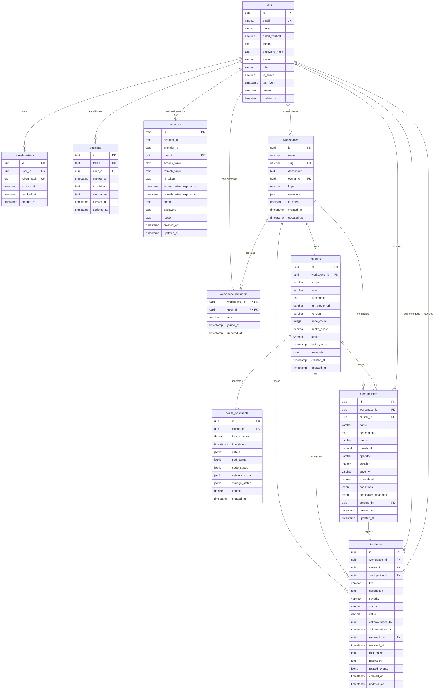
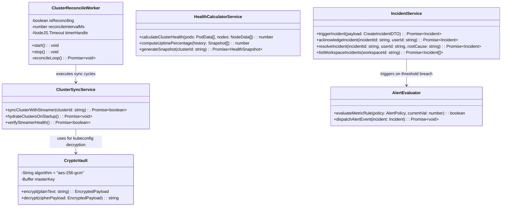
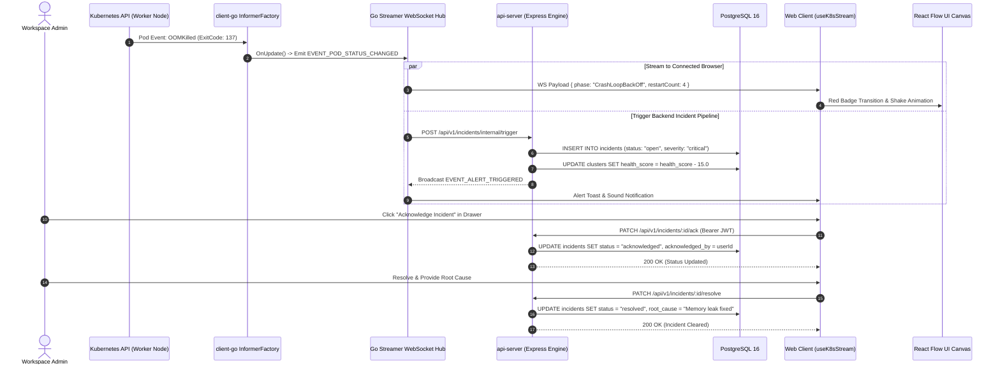
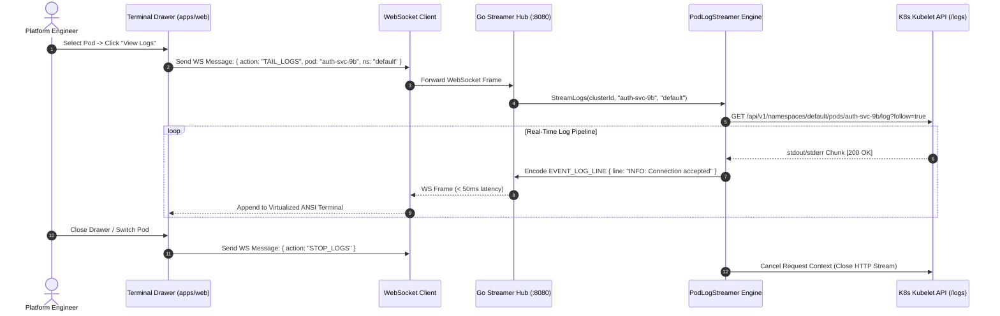
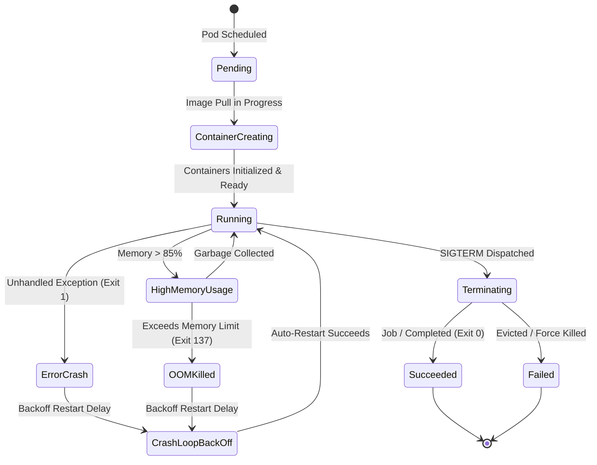
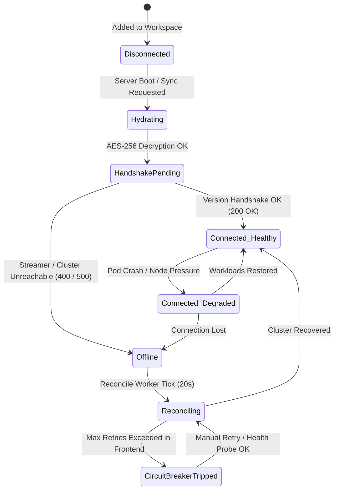
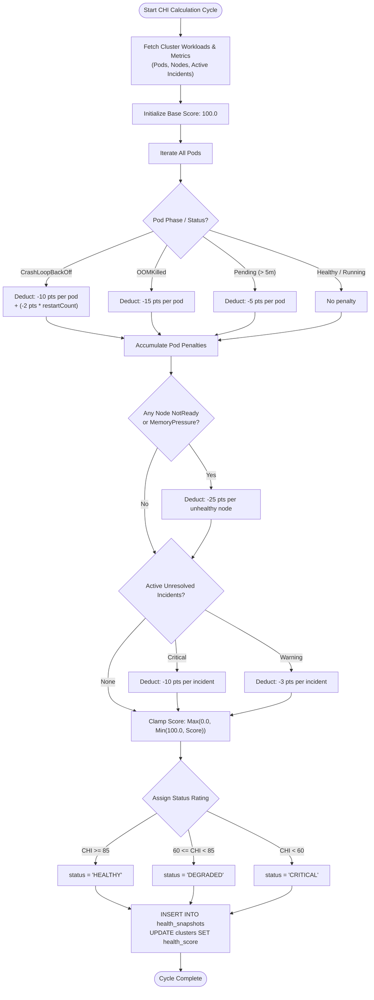
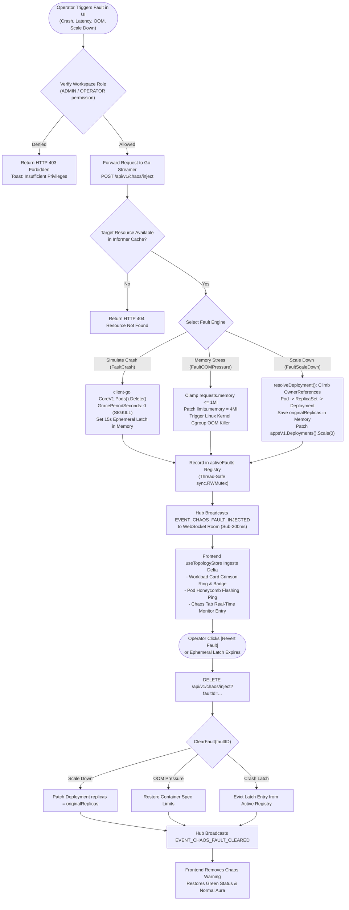

# EnvScale — Detailed Design Specification (UML, Flowcharts & ER Diagrams)

> **Document Purpose:** Detailed technical design specification for **EnvScale**, presenting formal Entity-Relationship (ER) diagrams, UML class and sequence models, statecharts, and algorithmic flowcharts.  
> **Audience:** Core System Developers (Pranav, Vinit, Neha, Ishika), Technical Leads, and System Evaluators.  
> **Traceability:** Aligns with [`docs/system-architecture.md`](file:///run/media/pranavissam/files%20and%20data/programming/mega%20projects/EnvScale/docs/system-architecture.md), [`apps/api-server/src/db/schema.ts`](file:///run/media/pranavissam/files%20and%20data/programming/mega%20projects/EnvScale/apps/api-server/src/db/schema.ts), and [`packages/types/src/index.ts`](file:///run/media/pranavissam/files%20and%20data/programming/mega%20projects/EnvScale/packages/types/src/index.ts).

---

## 1. Entity-Relationship (ER) Architecture

The database persistence layer is implemented in PostgreSQL via Drizzle ORM ([`apps/api-server/src/db/schema/`](file:///run/media/pranavissam/files%20and%20data/programming/mega%20projects/EnvScale/apps/api-server/src/db/schema)). The following diagram illustrates all relational entities, column types, primary/foreign keys, and constraints.



---

## 2. UML Class Diagrams

### 2.1 Backend Services & Data Access Model (`apps/api-server`)

The REST backend encapsulates business rules within decoupled controllers, cryptographic helpers, and background workers.



### 2.2 Go Kubernetes Streaming Gateway Architecture (`apps/k8s-streamer`)

The high-throughput Go gateway manages concurrent WebSocket clients, Informer subscriptions, and the chaos engine.

```mermaid
classDiagram
    class Hub {
        -clients: map[*Client]bool
        -rooms: map[string]map[*Client]bool
        -broadcast: chan WSEventPayload
        -register: chan *Client
        -unregister: chan *Client
        +Run(): void
        +BroadcastToRoom(roomID: string, event: WSEventPayload): void
        +SetPublisher(publisher: RedisPublisher): void
    }
    class Client {
        -hub: *Hub
        -conn: *websocket.Conn
        -send: chan []byte
        -userID: string
        -clusterID: string
        +ReadPump(): void
        +WritePump(): void
    }
    class ClusterManager {
        -clusters: map[string]*InformerManager
        -mu: sync.RWMutex
        +RegisterCluster(clusterID: string, rawKubeconfig: []byte): error
        +GetCluster(clusterID: string): (*InformerManager, error)
        +RemoveCluster(clusterID: string): void
    }
    class InformerManager {
        -clientset: *kubernetes.Clientset
        -factory: informers.SharedInformerFactory
        -stopCh: chan struct{}
        +StartInformers(): void
        +Stop(): void
        +GetPodTopology(): []PodTopologyData
        +GetNodeTopology(): []NodeTopologyData
    }
    class PodLogStreamer {
        -hub: *Hub
        +StreamLogs(ctx: Context, clusterID: string, podName: string, ns: string): error
    }
    class ChaosManager {
        +SimulatePodCrash(clusterID: string, podName: string, ns: string): error
        +InjectNetworkLatency(clusterID: string, podName: string, delayMs: int): error
        +TriggerOOM(clusterID: string, podName: string): error
    }

    Hub "1" *-- "many" Client : manages
    ClusterManager "1" *-- "many" InformerManager : registers
    InformerManager ..> Hub : emits state deltas
    PodLogStreamer ..> Hub : pipes log lines
    ChaosManager ..> ClusterManager : targets clusters
```

---

## 3. UML Sequence Diagrams

### 3.1 Live Pod Anomaly Detection & Incident Resolution Pipeline



### 3.2 Real-Time Pod Log Streaming Multiplexing



---

## 4. UML State Machine Diagrams

### 4.1 Kubernetes Pod Workload Lifecycle State Transitions



### 4.2 Resilient Cluster Connectivity Statechart



---

## 5. Algorithmic Flowcharts

### 5.1 Dynamic Cluster Health Index (CHI) Calculation Engine

The Cluster Health Index ($CHI \in [0, 100]$) assesses cluster stability dynamically.

$$\text{CHI} = 100 - \sum \text{PodPenalties} - \sum \text{NodePenalties} - \sum \text{AlertPenalties}$$



### 5.2 Chaos Fault Injection & Reversible Resolution Pipeline



---

## 6. Codebase Traceability Matrix

| Architectural Construct | Source Implementation Link | Domain Owner |
| :--- | :--- | :--- |
| **Relational Schemas** | [`apps/api-server/src/db/schema/`](file:///run/media/pranavissam/files%20and%20data/programming/mega%20projects/EnvScale/apps/api-server/src/db/schema) | **Vinit** |
| **Crypto AES-256 Vault** | [`crypto.ts`](file:///run/media/pranavissam/files%20and%20data/programming/mega%20projects/EnvScale/apps/api-server/src/utils/crypto.ts) | **Vinit** |
| **Health Calculation** | [`health-calculator.service.ts`](file:///run/media/pranavissam/files%20and%20data/programming/mega%20projects/EnvScale/apps/api-server/src/services/health-calculator.service.ts) | **Vinit** |
| **Cluster Reconciler** | [`cluster-reconcile.worker.ts`](file:///run/media/pranavissam/files%20and%20data/programming/mega%20projects/EnvScale/apps/api-server/src/workers/cluster-reconcile.worker.ts) | **Vinit** |
| **WebSocket Streaming Hub** | [`hub.go`](file:///run/media/pranavissam/files%20and%20data/programming/mega%20projects/EnvScale/apps/k8s-streamer/pkg/websocket/hub.go) | **Pranav** |
| **Informer Manager** | [`cluster_manager.go`](file:///run/media/pranavissam/files%20and%20data/programming/mega%20projects/EnvScale/apps/k8s-streamer/pkg/k8s/cluster_manager.go) | **Pranav** |
| **Config & Secret Informers** | [`config_informer.go`](file:///run/media/pranavissam/files%20and%20data/programming/mega%20projects/EnvScale/apps/k8s-streamer/pkg/k8s/config_informer.go) | **Pranav** |
| **Chaos Testing Engine** | [`injector.go`](file:///run/media/pranavissam/files%20and%20data/programming/mega%20projects/EnvScale/apps/k8s-streamer/pkg/chaos/injector.go) | **Pranav** |
| **Streaming UI Hook** | [`useK8sStream.ts`](file:///run/media/pranavissam/files%20and%20data/programming/mega%20projects/EnvScale/apps/web/src/hooks/useK8sStream.ts) | **Neha** |
| **Topology Graph Store** | [`useTopologyStore.ts`](file:///run/media/pranavissam/files%20and%20data/programming/mega%20projects/EnvScale/apps/web/src/store/useTopologyStore.ts) | **Neha** |
| **Chaos Store Slice & Helpers** | [`topologyWsSlice.ts`](file:///run/media/pranavissam/files%20and%20data/programming/mega%20projects/EnvScale/apps/web/src/store/slices/topologyWsSlice.ts), [`chaosHelpers.ts`](file:///run/media/pranavissam/files%20and%20data/programming/mega%20projects/EnvScale/apps/web/src/store/helpers/chaosHelpers.ts) | **Neha** |
| **Dynamic Edge Routing** | [`K8sEdge.tsx`](file:///run/media/pranavissam/files%20and%20data/programming/mega%20projects/EnvScale/apps/web/src/components/canvas/K8sEdge.tsx), [`layout.ts`](file:///run/media/pranavissam/files%20and%20data/programming/mega%20projects/EnvScale/apps/web/src/utils/layout.ts) | **Neha** |
| **Micro-Honeycomb & Nodes** | [`K8sGroup.tsx`](file:///run/media/pranavissam/files%20and%20data/programming/mega%20projects/EnvScale/apps/web/src/components/canvas/K8sGroup.tsx), [`K8sPod.tsx`](file:///run/media/pranavissam/files%20and%20data/programming/mega%20projects/EnvScale/apps/web/src/components/canvas/K8sPod.tsx) | **Neha** |
| **UI Primitives & Modals** | [`components/ui/`](file:///run/media/pranavissam/files%20and%20data/programming/mega%20projects/EnvScale/apps/web/src/components/ui) | **Ishika** |
| **Config & Drawer Overview** | [`ConfigOverviewSection.tsx`](file:///run/media/pranavissam/files%20and%20data/programming/mega%20projects/EnvScale/apps/web/src/components/drawer/inspector/ConfigOverviewSection.tsx) | **Ishika** |

---

## 7. Granular Technical Mechanics: Elementary-to-Minute Architecture

This section documents the foundational operating principles, minute implementation mechanics, and boundary failure prevention strategies for recent subsystems across the repository.

```
┌──────────────────────────────────────────────────────────────────────────────────────────────────┐
│                                     ENVSCALE REAL-TIME ARCHITECTURE                              │
├──────────────────────────────┬──────────────────────────────────┬────────────────────────────────┤
│ 1. Chaos Engine              │ 2. Dynamic Visual Topology       │ 3. Zero-Leak Config Informers  │
│ - OwnerReference Climbing    │ - 4-Cardinal Handle Routing      │ - Key Metadata Extraction Only │
│ - Cgroup OOM Request Clamp   │ - Vertical Drop PVC Clearance    │ - No Secrets over the Wire     │
│ - 15s Ephemeral Latch        │ - Micro-Honeycomb Pulsing Ping   │ - Pod Spec Mount Correlation   │
│ - Bidirectional Reversibility│ - Dynamic Dagre Layout Slicing   │ - Drawer Inspector Integration │
└──────────────────────────────┴──────────────────────────────────┴────────────────────────────────┘
```

### 7.1 Chaos Fault Engine Mechanics (`apps/k8s-streamer/pkg/chaos/injector.go`)

The chaos engine allows platform engineers to inject synthetic disruptions into target Kubernetes clusters to validate alerting, self-healing, and visual observability pipelines.

#### 7.1.1 Target Hierarchy Resolution (`resolveDeployment`)
* **The Problem:** In Kubernetes, users view Workloads (Deployments) or individual Pods. If an operator triggers a `FaultScaleDown` on an individual pod (e.g., `backend-6b87645cf4-xk92m`), calling the Kubernetes Deployment API directly with the pod name fails with `404 Not Found`, because the Deployment name is simply `backend`.
* **The Minute Mechanic:** The engine implements recursive hierarchical resolution via `pod.OwnerReferences`:
  1. Inspects the target pod's `OwnerReferences`. Identifies the parent `ReplicaSet` (e.g., `backend-6b87645cf4`, Kind: `ReplicaSet`).
  2. Executes `clientset.AppsV1().ReplicaSets(namespace).Get(ctx, rsName, metav1.GetOptions{})`.
  3. Inspects the ReplicaSet's `OwnerReferences`. Identifies the root `Deployment` (e.g., `backend`, Kind: `Deployment`).
  4. Returns the resolved Deployment name and its namespace. If the input name is already a Deployment, it validates its existence directly.

#### 7.1.2 Scale-Down Fault & Reversibility (`FaultScaleDown`)
* **Mechanism:** 
  1. Reads `deployment.Spec.Replicas` and caches `originalReplicas: int32` in the active fault record.
  2. Patches the target deployment using `clientset.AppsV1().Deployments(ns).UpdateScale(...)` setting `replicas = 0`.
  3. Generates a unique fault identifier `chaos-<uuid>`.
  4. Broadcasts `EVENT_CHAOS_FAULT_INJECTED` containing `{ faultId, faultType: "scale_down", targetName, targetNamespace, originalReplicas }`.
* **Reversal (`ClearFault`):**
  When the operator clicks `[Revert Fault]` or sends `DELETE /api/v1/chaos/inject?faultId=...`, the engine retrieves the cached record, patches `replicas = originalReplicas`, evicts the record from the in-memory map, and broadcasts `EVENT_CHAOS_FAULT_CLEARED`.

#### 7.1.3 Cgroup Memory Pressure & Admission Clamping (`FaultOOMPressure`)
* **Elementary Concept:** In Linux containers, memory consumption is capped via cgroups. When container memory exceeds `resources.limits.memory`, the Linux kernel triggers the Out-Of-Memory (OOM) killer, terminating the container process with exit status `137` (`SIGKILL = 128 + 9`).
* **The Admission Rejection Trap:** Kubernetes API validation enforces `requests.memory <= limits.memory`. If a container originally defined `requests: { memory: "64Mi" }` and the chaos injector attempts to patch `limits: { memory: "4Mi" }`, the Kubernetes admission controller rejects the request with HTTP 422 (`Invalid value: 4Mi: must be greater than or equal to request 64Mi`).
* **The Minute Solution (`recreatePodWithMemoryLimit`):**
  1. Clamps `requests.memory` to `1Mi` (or $\le 1\text{Mi}$) alongside `limits.memory = "4Mi"`.
  2. Because Kubernetes Pod specs do not permit in-place mutation of container resource limits on running pods in standard clusters, the injector reads the existing Pod definition, strips cluster-assigned metadata (`UID`, `ResourceVersion`), injects the clamped resource constraints, force-deletes the old pod, and creates the replacement pod.
* **Status Preservation in Informer Handlers (`informer_handlers.go`):**
  When a container is killed by OOM, kubelet quickly places the container into a restart backoff wait (`Waiting.Reason = "CrashLoopBackOff"`). To prevent the UI from masking the real failure cause, the informer handler checks:
  ```go
  if cs.LastTerminationState.Terminated != nil && cs.LastTerminationState.Terminated.Reason == "OOMKilled" {
      phase = "OOMKilled"
  }
  ```
  This guarantees that OOM events remain explicitly visible on the visual canvas.

#### 7.1.4 Ephemeral Crash Latch Window (`FaultCrash`)
* **The Self-Healing Dilemma:** When `clientset.CoreV1().Pods(ns).Delete(ctx, podName, metav1.DeleteOptions{GracePeriodSeconds: &zero})` is executed, the Kubernetes ReplicaSet controller reconciles the desired replica count and boots a replacement pod in under $300\text{ms}$. If the streaming gateway only forwarded raw pod lifecycles, the crash would vanish before a human operator or the frontend could perceive the failure.
* **The Minute Solution:**
  1. The injector force-deletes the pod.
  2. It installs an **ephemeral latch** in the active fault registry with an expiration deadline of $T_{\text{latch}} = 15\text{ seconds}$.
  3. A background Go goroutine arms a timer:
     ```go
     time.AfterFunc(15*time.Second, func() {
         injector.ClearFault(faultID)
     })
     ```
  4. The frontend canvas highlights the workload in a pulsing crimson warning state throughout the entire latch window, ensuring human visibility even during lightning-fast sub-second controller recovery.

#### 7.1.5 Cross-Origin Resource Sharing (CORS) Preflight Protocol
* **Elementary Concept:** Modern browsers enforce the Same-Origin Policy. When the frontend on `http://localhost:5173` sends a `DELETE` request with custom headers to the Go gateway on `http://localhost:8080`, the browser dispatches an HTTP `OPTIONS` preflight request.
* **The Failure Mode:** If the server returns a wildcard `Access-Control-Allow-Origin: *` while the client specifies `credentials: "include"`, or omits `DELETE` from `Access-Control-Allow-Methods`, the browser rejects the network call with a silent `"Failed to fetch"`.
* **The Resolution:**
  - In `cmd/server/main.go`, `corsHandler` dynamically reflects the client's `Origin` header (`w.Header().Set("Access-Control-Allow-Origin", origin)`), specifies `Access-Control-Allow-Credentials: true`, and permits methods `GET, POST, PUT, DELETE, OPTIONS`.
  - In `InspectorDrawer.tsx` and `ChaosTab.tsx`, requests target `STREAMER_BASE_URL` directly without conflicting credentials configurations.

---

### 7.2 Frontend Reactive State Management & Visual Cues (`apps/web`)

```
┌────────────────────────────────────────────────────────────────────────────────────────┐
│                                 REACT FLOW WORKLOAD CARD                               │
├────────────────────────────────────────────────────────────────────────────────────────┤
│  ⚡ CHAOS: SCALE_DOWN (ACTIVE)                  [0/0 Replicas]                         │
│  ┌──────────────────────────────────────────────────────────────────────────────────┐  │
│  │ Pod Glyphs Heatmap:                                                              │  │
│  │   [●] healthy (emerald)       [⚡] chaos target (rose-600 animate-ping)          │  │
│  └──────────────────────────────────────────────────────────────────────────────────┘  │
│  Crimson Glow: border-rose-500 shadow-rose-950/40 ring-1 ring-rose-500/30              │
└────────────────────────────────────────────────────────────────────────────────────────┘
```

#### 7.2.1 Zustand Store Architecture (`useTopologyStore.ts`, `topologyWsSlice.ts`)
* **State Declaration:**
  `activeChaosFaults: Record<string, ChaosFaultRecord>` maintains a synchronized client-side dictionary of all live disruptions.
* **Delta Reducers (`chaosHelpers.ts`):**
  - `addChaosFault`: Pure function that merges an incoming `EVENT_CHAOS_FAULT_INJECTED` payload into `activeChaosFaults` without mutating existing state.
  - `removeChaosFault`: Pure function that creates a shallow clone, deletes the specified `faultId`, and returns the pruned dictionary.

#### 7.2.2 Micro-Honeycomb Heatmap Glyphs (`K8sGroup.tsx`, `K8sPod.tsx`)
* **Glyph State Machine:**
  Each pod glyph inside a workload container reflects its operational state through a 3-tier visual hierarchy:
  1. **Healthy:** `bg-emerald-500/80 hover:bg-emerald-400`
  2. **Active Chaos Injection:** `bg-rose-600 animate-ping ring-2 ring-rose-400` with an outer glowing crimson aura (`shadow-rose-950/40`).
  3. **Organic Error / CrashLoop:** `bg-rose-500` (static) or `bg-amber-500` (pending/terminating).
* **Workload Card Dynamics:**
  When a child pod or the parent deployment matches an entry in `activeChaosFaults`:
  - The card header renders a prominent badge: `⚡ CHAOS: [FAULT_TYPE]`.
  - If replicas are scaled to zero, the card renders a dedicated notice: `[0/0 REPLICAS] - SCALED DOWN BY CHAOS INJECTOR`.
  - The card container transitions its borders to `border-rose-500` with an animated pulse.

#### 7.2.3 One-Click Fault Healing (`ChaosTab.tsx`)
* The Inspector Drawer renders an "Active Faults (Real-Time)" monitor.
* For every active fault in the store, it displays:
  - Fault ID and target resource identifier.
  - Formatted elapsed duration since injection.
  - A `[Revert Fault]` button that dispatches `DELETE /api/v1/chaos/inject?faultId=...`, which triggers instantaneous cluster reconciliation and clears the visual warning upon receiving `EVENT_CHAOS_FAULT_CLEARED`.

---

### 7.3 Dynamic Canvas Edge Routing & Cardinal Handles (`layout.ts`, `K8sEdge.tsx`)

#### 7.3.1 4-Cardinal Handle Geometry
* **The Visual Challenge:** Standard graph edges between Services, Workloads, and Storage Volumes frequently produced crossing lines and 300px S-curves because nodes only possessed single left/right connection anchors.
* **The Cardinal System:**
  Every node primitive (`K8sGroup`, `K8sPod`, `K8sService`, `K8sPVC`, `K8sIngress`, `K8sWorkload`) now exposes 8 discrete handle anchors:
  - **Targets:** `target-left`, `target-right`, `target-top`, `target-bottom`.
  - **Sources:** `source-left`, `source-right`, `source-top`, `source-bottom`.

#### 7.3.2 Storage Vertical Drop Heuristic
* **The Route:** Workloads connecting to Persistent Volume Claims (PVCs) route strictly from `source-bottom` to `target-top`.
* **The Layout Sort (`layout.ts`):**
  To prevent storage nodes from rendering directly beneath intermediate compute nodes and causing vertical edge crossings:
  1. Workloads are partitioned into pure-compute and storage-backed workloads.
  2. Storage-backed workloads and their attached PVCs are shifted to the right flank of the layout.
  3. Sibling horizontal clearance is set to $\ge 100\text{px}$, allowing vertical drop lines to descend cleanly without intersecting adjacent workload bounding boxes.

#### 7.3.3 Dynamic Cubic Bezier Smoothing (`K8sEdge.tsx`)
* The custom edge component calculates dynamic curvature $\kappa$:
  $$\kappa = \min\left(0.5, \frac{|\Delta X| + |\Delta Y|}{800}\right)$$
* Calculates the geometric apex $(X_{\text{mid}}, Y_{\text{mid}})$ to position traffic badges and protocol tags (`TCP`, `HTTP`, `gRPC`) directly on the edge curve without clipping node boundaries.

---

### 7.4 Zero-Leak Configuration & Secret Topology (`pkg/k8s/config_informer.go`)

```
┌────────────────────────────────────────────────────────────────────────────────────────┐
│                       ZERO-LEAK KUBERNETES CONFIGURATION INFORMER                      │
├────────────────────────────────────────────────────────────────────────────────────────┤
│  K8s API Server (Secrets / ConfigMaps)                                                 │
│       │                                                                                │
│       ▼ client-go Informer                                                             │
│  [config_informer.go]                                                                  │
│  ┌──────────────────────────────────────────────────────────────────────────────────┐  │
│  │ Sanitization Engine:                                                             │  │
│  │   - Extracts: Name, Namespace, CreationTimestamp, SecretType                     │  │
│  │   - Extracts: []Keys (e.g. ["DATABASE_URL", "JWT_SECRET"])                       │  │
│  │   - PURGES: All Data values, base64 payloads, and binary blocks                  │  │
│  └──────────────────────────────────────────────────────────────────────────────────┘  │
│       │                                                                                │
│       ▼ WebSocket Event: EVENT_CONFIG_TOPOLOGY_UPDATED (Metadata Only)                 │
│  Web UI (Inspector Drawer - ConfigOverviewSection)                                    │
│  - Displays mounted keys, secret classifications, and volume attachments               │
│  - ZERO sensitive credentials stored or transmitted over the wire                      │
└────────────────────────────────────────────────────────────────────────────────────────┘
```

#### 7.4.1 Zero-Leak Security Architecture
* **The Principle of Least Privilege:** Operators require architectural visibility into which configuration sources and credentials are bound to specific microservices, but observability tools must NEVER expose raw passwords, private keys, or API tokens.
* **Sanitization in Go (`config_informer.go`):**
  When `ConfigMapInformer` or `SecretInformer` triggers an event (`OnAdd`, `OnUpdate`), the handler constructs a sanitized descriptor:
  ```go
  type SanitizedConfigResource struct {
      Name              string    `json:"name"`
      Namespace         string    `json:"namespace"`
      Type              string    `json:"type"`              // e.g., "Opaque", "kubernetes.io/tls"
      Keys              []string  `json:"keys"`              // Extracted key names ONLY
      CreationTimestamp time.Time `json:"creationTimestamp"`
      ResourceVersion   string    `json:"resourceVersion"`
  }
  ```
  `Data` and `StringData` maps are completely omitted from the serialization schema. Only the alphabetical key names are transmitted.

#### 7.4.2 Workload-to-Configuration Correlation
* The engine parses Pod container specifications:
  1. **Volume Mounts:** Inspects `pod.Spec.Volumes[*].ConfigMap.Name` and `pod.Spec.Volumes[*].Secret.SecretName`.
  2. **Environment Variable References:** Inspects `container.Env[*].ValueFrom.ConfigMapKeyRef` and `container.Env[*].ValueFrom.SecretKeyRef`.
  3. **Whole-Object Environment Injections:** Inspects `container.EnvFrom[*].ConfigMapRef` and `container.EnvFrom[*].SecretRef`.
* Correlates these references against sanitized Informer caches to assemble an aggregated configuration dependency graph.

#### 7.4.3 Inspector Drawer Visualization (`ConfigOverviewSection.tsx`)
* The Overview tab in the Inspector Drawer renders a dedicated configuration breakdown:
  - **ConfigMaps Panel:** Lists attached configuration volumes and environment keys with descriptive tags.
  - **Secrets Panel:** Identifies bound secrets, their Kubernetes type (`Opaque`, `kubernetes.io/tls`, `kubernetes.io/service-account-token`), and exposed key identifiers.
  - Guarantees zero credential leakage while delivering complete architectural visibility for debugging configuration drift and missing environment variables.

