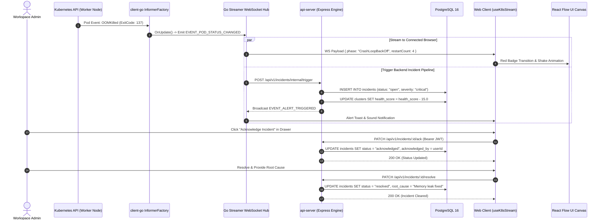
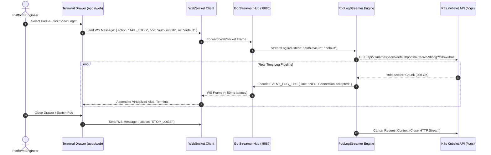
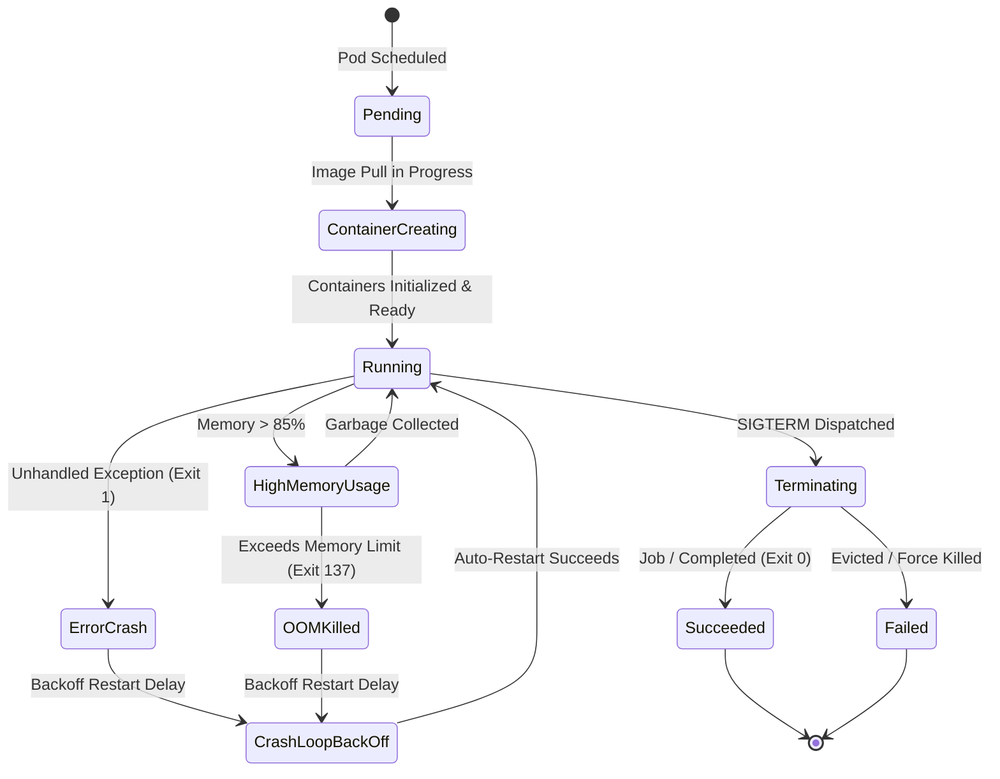
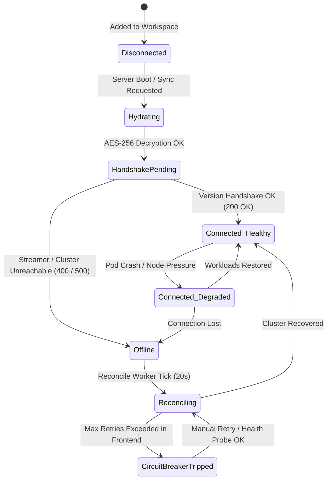
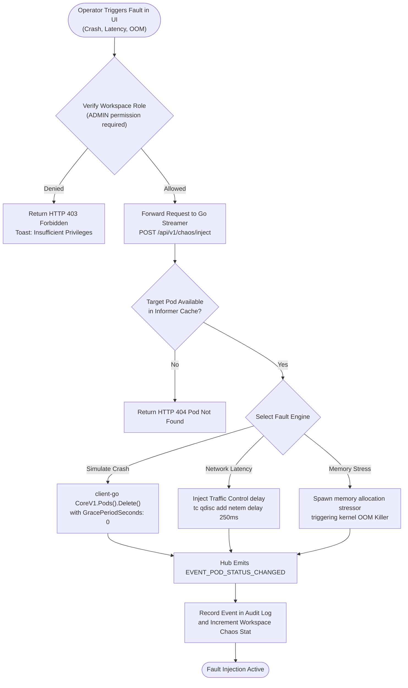

# EnvScale — Detailed Design Specification (UML, Flowcharts & ER Diagrams)

> **Document Purpose:** Detailed technical design specification for **EnvScale**, presenting formal Entity-Relationship (ER) diagrams, UML class and sequence models, statecharts, and algorithmic flowcharts.  
> **Audience:** Core System Developers (Pranav, Vinit, Neha, Ishika), Technical Leads, and System Evaluators.  
> **Traceability:** Aligns with [`docs/system-architecture.md`](file:///run/media/pranavissam/files%20and%20data/programming/mega%20projects/EnvScale/docs/system-architecture.md), [`apps/api-server/src/db/schema.ts`](file:///run/media/pranavissam/files%20and%20data/programming/mega%20projects/EnvScale/apps/api-server/src/db/schema.ts), and [`packages/types/src/index.ts`](file:///run/media/pranavissam/files%20and%20data/programming/mega%20projects/EnvScale/packages/types/src/index.ts).

---

## 1. Entity-Relationship (ER) Architecture

The database persistence layer is implemented in PostgreSQL via Drizzle ORM ([`apps/api-server/src/db/schema/`](file:///run/media/pranavissam/files%20and%20data/programming/mega%20projects/EnvScale/apps/api-server/src/db/schema)). The following diagram illustrates all relational entities, column types, primary/foreign keys, and constraints.


---

## 2. UML Class Diagrams

### 2.1 Backend Services & Data Access Model (`apps/api-server`)

The REST backend encapsulates business rules within decoupled controllers, cryptographic helpers, and background workers.


### 2.2 Go Kubernetes Streaming Gateway Architecture (`apps/k8s-streamer`)

The high-throughput Go gateway manages concurrent WebSocket clients, Informer subscriptions, and the chaos engine.

```mermaid
classDiagram
    class Hub {
        -clients: map[*Client]bool
        -rooms: map[string]map[*Client]bool
        -broadcast: chan WSEventPayload
        -register: chan *Client
        -unregister: chan *Client
        +Run(): void
        +BroadcastToRoom(roomID: string, event: WSEventPayload): void
        +SetPublisher(publisher: RedisPublisher): void
    }
    class Client {
        -hub: *Hub
        -conn: *websocket.Conn
        -send: chan []byte
        -userID: string
        -clusterID: string
        +ReadPump(): void
        +WritePump(): void
    }
    class ClusterManager {
        -clusters: map[string]*InformerManager
        -mu: sync.RWMutex
        +RegisterCluster(clusterID: string, rawKubeconfig: []byte): error
        +GetCluster(clusterID: string): (*InformerManager, error)
        +RemoveCluster(clusterID: string): void
    }
    class InformerManager {
        -clientset: *kubernetes.Clientset
        -factory: informers.SharedInformerFactory
        -stopCh: chan struct{}
        +StartInformers(): void
        +Stop(): void
        +GetPodTopology(): []PodTopologyData
        +GetNodeTopology(): []NodeTopologyData
    }
    class PodLogStreamer {
        -hub: *Hub
        +StreamLogs(ctx: Context, clusterID: string, podName: string, ns: string): error
    }
    class ChaosManager {
        +SimulatePodCrash(clusterID: string, podName: string, ns: string): error
        +InjectNetworkLatency(clusterID: string, podName: string, delayMs: int): error
        +TriggerOOM(clusterID: string, podName: string): error
    }

    Hub "1" *-- "many" Client : manages
    ClusterManager "1" *-- "many" InformerManager : registers
    InformerManager ..> Hub : emits state deltas
    PodLogStreamer ..> Hub : pipes log lines
    ChaosManager ..> ClusterManager : targets clusters
```

---

## 3. UML Sequence Diagrams

### 3.1 Live Pod Anomaly Detection & Incident Resolution Pipeline



### 3.2 Real-Time Pod Log Streaming Multiplexing



---

## 4. UML State Machine Diagrams

### 4.1 Kubernetes Pod Workload Lifecycle State Transitions



### 4.2 Resilient Cluster Connectivity Statechart



---

## 5. Algorithmic Flowcharts

### 5.1 Dynamic Cluster Health Index (CHI) Calculation Engine

The Cluster Health Index ($CHI \in [0, 100]$) assesses cluster stability dynamically.

$$\text{CHI} = 100 - \sum \text{PodPenalties} - \sum \text{NodePenalties} - \sum \text{AlertPenalties}$$


### 5.2 Chaos Fault Injection Pipeline



---

## 6. Codebase Traceability Matrix

| Architectural Construct | Source Implementation Link | Domain Owner |
| :--- | :--- | :--- |
| **Relational Schemas** | [`apps/api-server/src/db/schema/`](file:///run/media/pranavissam/files%20and%20data/programming/mega%20projects/EnvScale/apps/api-server/src/db/schema) | **Vinit** |
| **Crypto AES-256 Vault** | [`crypto.ts`](file:///run/media/pranavissam/files%20and%20data/programming/mega%20projects/EnvScale/apps/api-server/src/utils/crypto.ts) | **Vinit** |
| **Health Calculation** | [`health-calculator.service.ts`](file:///run/media/pranavissam/files%20and%20data/programming/mega%20projects/EnvScale/apps/api-server/src/services/health-calculator.service.ts) | **Vinit** |
| **Cluster Reconciler** | [`cluster-reconcile.worker.ts`](file:///run/media/pranavissam/files%20and%20data/programming/mega%20projects/EnvScale/apps/api-server/src/workers/cluster-reconcile.worker.ts) | **Vinit** |
| **WebSocket Streaming Hub** | [`hub.go`](file:///run/media/pranavissam/files%20and%20data/programming/mega%20projects/EnvScale/apps/k8s-streamer/pkg/websocket/hub.go) | **Pranav** |
| **Informer Manager** | [`cluster_manager.go`](file:///run/media/pranavissam/files%20and%20data/programming/mega%20projects/EnvScale/apps/k8s-streamer/pkg/k8s/cluster_manager.go) | **Pranav** |
| **Chaos Testing Engine** | [`chaos`](file:///run/media/pranavissam/files%20and%20data/programming/mega%20projects/EnvScale/apps/k8s-streamer/pkg/chaos) | **Pranav** |
| **Streaming UI Hook** | [`useK8sStream.ts`](file:///run/media/pranavissam/files%20and%20data/programming/mega%20projects/EnvScale/apps/web/src/hooks/useK8sStream.ts) | **Neha** |
| **Topology Graph Store** | [`useTopologyStore.ts`](file:///run/media/pranavissam/files%20and%20data/programming/mega%20projects/EnvScale/apps/web/src/store/useTopologyStore.ts) | **Neha** |
| **UI Primitives & Modals** | [`components/ui/`](file:///run/media/pranavissam/files%20and%20data/programming/mega%20projects/EnvScale/apps/web/src/components/ui) | **Ishika** |
