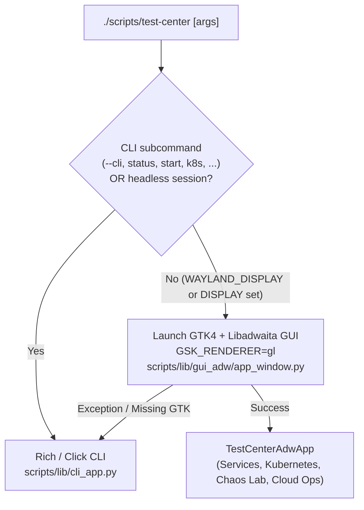

# Developer Control Center (`test-center`) & Operational Tooling

> **Document Scope:** Python GTK4/Libadwaita & Rich CLI Developer Control Center (`pnpm test-center`), local stack & Kubernetes orchestration modules, chaos test runners, AWS EC2/EKS/SSM deployers, database backup utilities, and Git governance hooks.
> **Primary Modules:** [`scripts/test-center`](../scripts/test-center), [`scripts/lib/`](../scripts/lib), [`scripts/lib/gui_adw/`](../scripts/lib/gui_adw), [`scripts/db-backup.sh`](../scripts/db-backup.sh), [`scripts/hooks/pre-push`](../scripts/hooks/pre-push)

---

## 1. Dual-Mode Control Center Entrypoint

Invoked from the monorepo root via `pnpm test-center` ([`package.json`](../package.json#L12)) or `./scripts/test-center` ([`scripts/test-center`](../scripts/test-center)):

- **Recognized CLI Commands:** `status`, `start`, `stop`, `restart`, `logs`, `test`, `k8s`, `chaos`, `config`, `infra`, `deploy`, `eks`, `--help`, `-h`, `--cli`.
- **Automatic Fallback:** If GTK4 / PyGObject / Libadwaita fails to load or no graphical display (`WAYLAND_DISPLAY` or `DISPLAY`) is present, `scripts/test-center` prints a fallback notice and invokes `cli()`.

---

## 2. GTK4 / Libadwaita Desktop GUI (`scripts/lib/gui_adw/`)

Launched via `launch_adw_gui()` in [`app_window.py`](../scripts/lib/gui_adw/app_window.py):

- **Window & Shell (`MainWindow` / `TestCenterAdwApp`):**
  - Registered under application ID `io.envscale.testcenter` with default dimensions `1120x780`, dark/light theme switcher (`Adw.StyleManager`), `StdoutStderrRedirector` forwarding output to the internal log bus, and graceful `pm.stop_all()` on window close.
- **Persistent Step-Based Terminal History ([`step_row.py`](../scripts/lib/gui_adw/step_row.py) & [`log_storage.py`](../scripts/lib/gui_adw/log_storage.py)):**
  - `HeadingLogPanel` renders expandable `Adw.ExpanderRow` `StepRow` accordions showing timestamps, commands, live spinners (`RUNNING` / `Completed` / `Failed`), and auto-scrolling monospace terminal views.
  - `LogStorage` persists up to `50` recent step records per tab atomically as JSON files inside `.envscale_test_center_logs/<tab_name>.json` and supports `Toggle All` and `Clear History`.

| View Tab | Module | Capabilities & Controls |
| :--- | :--- | :--- |
| **Services** | [`view_services.py`](../scripts/lib/gui_adw/view_services.py) | `Launch Full Stack`, `Stop All`, `Open Web UI` (`http://localhost:5173`), `Seed Database` (`npx tsx src/db/seed.ts`), per-service `Start` / `Restart` / `Stop` action rows, and `4000ms` health/latency polling. |
| **Kubernetes** | [`view_k8s.py`](../scripts/lib/gui_adw/view_k8s.py) | Active `kubectl` context selector dropdown, `8000ms` reachability badge (`ONLINE`/`OFFLINE`), `Deploy Workloads` (`testing/k8s/`, 15 manifests) & `Teardown Workloads` with progress bar, and `Open Ingress`. |
| **Chaos Lab** | [`view_chaos.py`](../scripts/lib/gui_adw/view_chaos.py) | Lists all entries in `CHAOS_SCENARIOS` with background-threaded `Inject Fault` and `Recover` buttons. |
| **Cloud Ops** | [`view_cloud.py`](../scripts/lib/gui_adw/view_cloud.py) | **EC2 Host Controls:** `Provision Host`, `Pause Host`, `Resume Host`, `Deploy Stack`, `Open Cloud URL` (`https://envscale.duckdns.org`), `Destroy Host`. **EKS Controls:** `Provision EKS Cluster`, `Deploy Todo Workloads`, `Destroy EKS Cluster`. |

---

## 3. Rich / Click CLI Reference (`scripts/lib/cli_app.py`)

Implemented with `click` and `rich` in [`cli_app.py`](../scripts/lib/cli_app.py):

| Command | Flags / Arguments | Purpose |
| :--- | :--- | :--- |
| `status` *(default)* | — | Prints service port, status, latency table + Kubernetes context health panel. |
| `start` | `--service` / `-s`, `--all` | Syncs `.env` files, boots Docker Compose infra (`postgres`, `redis`), and starts `api`, `streamer`, and `web`. |
| `stop` | `--service` / `-s`, `--all` | Stops a single service (`SIGTERM` -> `SIGKILL`) or tears down all services + Compose containers. |
| `restart` | `<service>` | Restarts `postgres`, `redis`, `api`, `streamer`, or `web`. |
| `logs` | `<service>`, `--follow` / `-f` | Displays buffered logs (`1000` lines max) or tails live output. |
| `test` | — | Executes the 3-stage monorepo test suite via `TestRunner`. |
| `k8s deploy` / `teardown` | — | Deploys or deletes the 15 benchmark manifests in `testing/k8s/`. |
| `chaos list` / `inject` / `recover` | `<scenario_id>` | Lists or executes `crashloop`, `oom`, or `pod_kill` chaos scenarios. |
| `config sync` / `check` | — | Generates missing `.env` files and validates `JWT_ACCESS_SECRET` parity. |
| `infra up\|stop\|start\|destroy\|status` | — | Full AWS EC2 Terraform + SSM + DuckDNS + S3 state vault lifecycle (with S3 pre-destroy DB archival and confirmation prompt). |
| `deploy` / `rollback` | `--prod`, `--dev`, `--sha <sha>` | Triggers SSM exact-SHA deployment (`release-manifest.json` verified) or SSM rollback via `CloudDeployer`. |
| `eks status\|up\|destroy\|deploy` | — | Manages AWS EKS (`envscale-todo-eks` in `ap-south-1`), Spot worker nodegroup, `metrics-server`, and Todo benchmark workloads. |

---

## 4. Python Orchestration & Cloud Deployment Modules (`scripts/lib/`)

### Local Runtime, Env Sync & Testing Modules
- **[`config.py`](../scripts/lib/config.py) & [`process_manager.py`](../scripts/lib/process_manager.py):**
  - Defines `SERVICE_ORDER`: `postgres` (`5432`), `redis` (`6379`), `api` (`3000`, `npx tsx watch src/index.ts`), `streamer` (`8080`, `go run ./cmd/server/main.go`), and `web` (`5173`, `npx vite`).
  - Launches Compose infra from `docker-compose.dev.yml` (`postgres`, `redis`, waiting up to 15s for port `5432`), spawns local app processes in isolated process groups (`os.setsid`) reading service `.env` files, tears down via `SIGTERM` (`2.5s` timeout) then `SIGKILL`, and maintains thread-safe `deque(maxlen=1000)` log buffers.
- **[`health_checker.py`](../scripts/lib/health_checker.py):**
  - Implements three probe strategies: TCP socket connect (`postgres`, `web`), raw RESP `*1\r\n$4\r\nPING\r\n` checking `PONG` (`redis`), and HTTP JSON `GET` measuring latency (`api` `/health`, `streamer` `/healthz`).
- **[`env_sync.py`](../scripts/lib/env_sync.py):**
  - Copies missing `.env` files from `.env.example` (or synthesizes local defaults) for `apps/api-server`, `apps/k8s-streamer`, and `apps/web`, and enforces `JWT_ACCESS_SECRET` parity across `api-server` and `k8s-streamer`.
- **[`k8s_manager.py`](../scripts/lib/k8s_manager.py):**
  - Checks active `kubectl` context reachability and falls back automatically to `minikube` if offline, enables Minikube `ingress`, builds `todo-backend:latest` (`testing/app/backend`) and `todo-frontend:latest` (`testing/app/frontend`) via `minikube image build`, applies `testing/k8s/` (recovering automatically from conflicting `ingress-nginx-admission` webhooks with `--validate=false`), and exports `/tmp/envscale-kubeconfig.yaml`.
- **[`chaos_runner.py`](../scripts/lib/chaos_runner.py) & [`test_runner.py`](../scripts/lib/test_runner.py):**
  - `ChaosRunner` injects/clears `crashloop` (`simulated-crashloop-app`), `oom` (`simulated-oom-app`), and `pod_kill` in namespace `testing-todo`.
  - `TestRunner` runs `npx tsc -b && npx eslint .` (`apps/web`), `npx tsc --noEmit` (`apps/api-server`), and `go test -v ./pkg/chaos/... && go build -o /dev/null ./cmd/server/main.go` (`apps/k8s-streamer`).

### AWS EC2, SSM & EKS Orchestration Modules
- **[`cloud_deployer.py`](../scripts/lib/cloud_deployer.py) & [`ssm_deployer.py`](../scripts/lib/ssm_deployer.py):**
  - Zero-SSH orchestration using `aws ssm send-command` (`AWS-RunShellScript`), managing Terraform state in a versioned S3 bucket (`envscale-cloud-vault-<account_id>-<region>`), preflight IAM checks (`envscale-ec2-runtime-profile`), DuckDNS updates (`<domain>.duckdns.org` or `<ip>.sslip.io` fallback), and `gh secret set` synchronization (`EC2_HOST`, `EC2_INSTANCE_ID`).
  - `deploy()` resolves and validates `release-manifest.json` against the target commit SHA (locally or from S3), dispatches exact-SHA checkout + `sync-ssm-secrets.py` + `envscale.sh deploy --manifest` via SSM, runs post-deploy health checks, and triggers automatic `rollback()` if verification fails.
  - `infra_stop()` stops the EC2 instance (`0.00 USD/hr` compute billing); `infra_destroy()` archives PostgreSQL to S3 via `pg_dump`, destroys Terraform resources, and cleans DNS/GitHub references (`cleanup_external_references`).
- **[`eks_deployer.py`](../scripts/lib/eks_deployer.py):**
  - Automates provisioning `envscale-todo-eks` (`ap-south-1`, VPC `10.100.0.0/16`, `t3.medium` Spot nodes) from `deployment/terraform-eks/`, updates `kubeconfig`, deploys Kubernetes `metrics-server` and `deployment/eks-todo-app.yaml`, and exports `/tmp/envscale-eks-kubeconfig.yaml`. On `eks_destroy()`, deletes workloads, runs `terraform destroy`, prunes dead kubeconfig contexts, and switches context back to `minikube`.

---

## 5. Database Backup Utility & Git Governance Hook

- **PostgreSQL Backup & Restore ([`scripts/db-backup.sh`](../scripts/db-backup.sh)):**
  - Sources `apps/api-server/.env` (parsing `DATABASE_URL` or `POSTGRES_*` fallbacks) and writes backups to `<repo>/backups/`.
  - `--backup`: Runs `pg_dump --format=custom --no-owner --no-privileges | gzip` into `envscale_backup_<YYYYMMDD_HHMMSS>.sql.gz` and deletes/fails on 0-byte dumps.
  - `--restore <file>`: Pauses `3s` for abort safety, then streams `gunzip -c` into `pg_restore --clean --if-exists --no-owner --no-privileges`.
  - `--list`: Prints filename, size, and modification timestamp for all archives.
- **Git Pre-Push Hook ([`scripts/hooks/pre-push`](../scripts/hooks/pre-push)):**
  - Inspects pushed refs and rejects any push targeting `refs/heads/main` with exit code `1`, enforcing the `feature/* -> develop -> main` PR workflow in [`GIT_GUIDE.md`](GIT_GUIDE.md).

