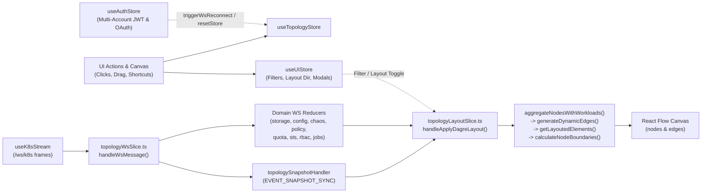

# Frontend State Architecture: Zustand Stores, Slices & Helpers

> **Document Scope:** Client-side state management inside `apps/web/src/store/`: the 5 Zustand stores, 6 modular topology slices, and 16 domain transformation/WebSocket reducer helpers.
> **Primary Modules:** [`apps/web/src/store/`](../apps/web/src/store), [`apps/web/src/store/slices/`](../apps/web/src/store/slices), [`apps/web/src/store/helpers/`](../apps/web/src/store/helpers)

---

## 1. Client-Side State & Data Flow Architecture

---

## 2. The Five Zustand Stores (`apps/web/src/store/`)

### 1. [`useTopologyStore.ts`](../apps/web/src/store/useTopologyStore.ts)
Central source of truth for real-time cluster topology, Graph state, and operational history:
- **Tracked Kubernetes State:** `clusters`, `activeCluster`, `clusterCpuCores`, `clusterMemoryGB`, `rawNodes`, `nodes`, `edges`, `services`, `pods`, `ingresses`, `replicaSets`, `deployments`, `daemonSets`, `cronJobs`, `jobs`, `pvcs`, `statefulSets`, `pvs`, `volumeSnapshots`, `volumeSnapshotContents`, `configMaps`, `secrets`, `hpas`, `networkPolicies`, `pdbs`, `resourceQuotas`, `limitRanges`, `serviceAccounts`, `roleBindings`, `clusterRoleBindings`, `roles`, and `clusterRoles`.
- **Operational & Interaction State:** `incidents`, `activeChaosFaults`, `selectedNode`, `tokens`, `notifications` (max `50`), `userNodePositions`, `undoStack` / `redoStack` (max `20`), `wsStatus`, `wsLatencyMs` (filtered to `< 200ms` or `8ms` default), and `wsReconnectTick`.
- **Persistence Guardrails:** Persisted under `localStorage` key `envscale-topology-storage-v2` (partialized to `tokens`, `notifications`, and `userNodePositions`). On rehydration, clears live cluster lists/nodes if no auth JWT exists; `deleteCluster()` clears all stale state when removing the active cluster; `resetStore()` wipes storage on logout or account switch.

### 2. [`useAuthStore.ts`](../apps/web/src/store/useAuthStore.ts) & [`accountStorage.ts`](../apps/web/src/lib/accountStorage.ts)
Multi-account authentication and session-switching engine:
- **Stored Accounts & Medium Detection:** Maintains `savedAccounts: StoredAccount[]` grouped by `AuthMedium` (`google`, `github`, `credentials`), hydrating user metadata from JWT payloads (`parseTokenPayload`) and `localStorage` (`envscale_auth_token`, `envscale_access_token`, `envscale_user`).
- **Self-Healing `checkAuth()`:** Validates JWT expiration, auto-heals stale/missing JWTs via `apiSwitchSession` or Better Auth `authClient.getSession()` + `getStreamerToken()`, and restores the most recent saved account if a pending OAuth flow was cancelled.
- **Session Switching & Sign-Out:**
  - `switchAccount(accountId)`: Calls `apiSwitchSession`, swaps stored credentials, wipes topology state (`resetStore()`), and triggers `triggerWsReconnect()`.
  - `logoutCurrentAccount()`: Removes only the active account and switches automatically to the next most recently active session (or falls back to full logout).
  - `logoutAll()`: Fires non-blocking `POST /api/v1/clusters/unregister-all` to `k8s-streamer`, clears all local storage keys, resets topology state, and calls `authClient.signOut()`.

### 3. [`useUIStore.ts`](../apps/web/src/store/useUIStore.ts)
Persists canvas preferences and drawer settings under `envscale-ui-storage`:
- **Visibility & Layout Toggles:** `showCompletedPods`, `showCompletedJobs`, `showStorage` (default `true`), `showSystemNamespaces`, `selectedNamespaces`, `layoutDirection` (`"TB"` | `"LR"`), `expandedWorkloads`, and `showNodeBoundaries` (default `true`). Changing any of these automatically invokes `useTopologyStore.getState().applyDagreLayout()`.
- **Transient & Integration Controls:** `hoveredNodeName`, `deleteModal`, `logBufferLimit` (`500` default), `alertWebhookUrl`, and `alertWebhookCriticalOnly`.

### 4. [`useMetricsStore.ts`](../apps/web/src/store/useMetricsStore.ts) & [`useAlertStore.ts`](../apps/web/src/store/useAlertStore.ts)
- **`useMetricsStore`:** Maintains the 60-point rolling `history: ClusterMetricPoint[]` (`setMetricsHistory` with `padHistory`, `appendMetricPoint`, and `fetchMetricsHistory`).
- **`useAlertStore`:** Persists user-created alert rule definitions under `envscale-alert-rules` (`addAlertRule`, `updateAlertRule`, `deleteAlertRule`, `toggleAlertRule`, `selectedAlertRule`).

---

## 3. Modular Topology Slices (`apps/web/src/store/slices/`)

| Slice | Key Functions | Responsibility |
| :--- | :--- | :--- |
| **[`topologyWsSlice.ts`](../apps/web/src/store/slices/topologyWsSlice.ts)** | `handleWsMessage` | Central router for incoming WS frames (`EVENT_BATCH_COMPLETE`, `EVENT_SNAPSHOT_SYNC`, core Pod/Node/Service/Ingress/RS/Deployment/DaemonSet/CronJob deltas, plus delegation to Job, Storage, Config, Chaos, HPA/NetPol/PDB, Quota, StatefulSet, and RBAC handlers). |
| **[`topologySnapshotHandler.ts`](../apps/web/src/store/slices/topologySnapshotHandler.ts)** | `handleSnapshotSync` | Hydrates all 25+ Kubernetes resource collections on connect/resync, populates `useMetricsStore`, calculates cluster CPU/RAM capacity, auto-selects non-system namespaces on first load or cluster swap, and triggers Dagre layout. |
| **[`topologyLayoutSlice.ts`](../apps/web/src/store/slices/topologyLayoutSlice.ts)** | `handleApplyDagreLayout` | Executes the graph build pipeline: `aggregateNodesWithWorkloads()` -> `filterPVCsForDisplay()` / `createPVCReactFlowNodes()` -> preserves live canvas drag coordinates -> `generateDynamicEdges()` -> `getLayoutedElements()` -> optionally prepends `calculateNodeBoundaries()`. |
| **[`topologyActionsSlice.ts`](../apps/web/src/store/slices/topologyActionsSlice.ts)** | `handleUndoAction`, `handleRedoAction`, `handleRemoveTarget`, `handleCreateNode` | Dispatches live `POST /api/v1/resource/delete` mutations on delete/redo with JWT Bearer auth, snapshots sanitized manifests (`sanitizeManifestSnapshot`) onto `undoStack`/`redoStack`, and appends notification alerts. *(Note: `handleUndoAction` fires `POST /api/v1/resource/apply`, which is not yet implemented on `k8s-streamer`, so undo currently restores optimistic UI state only.)* |
| **[`topologyCrudSlice.ts`](../apps/web/src/store/slices/topologyCrudSlice.ts)** | `handleUpsertService`, `handleUpsertPod`, `handleSetServices` | Upserts synthetic/delta Service and Pod nodes into `rawNodes`, keeps extracted arrays & `selectedNode` synced, and re-runs layout. |
| **[`topologyNotifSlice.ts`](../apps/web/src/store/slices/topologyNotifSlice.ts)** | `handleAddToken`, `handleAddNotification` | Generates local API tokens, appends UI alerts (`toast.error`/`warning`/`info`), and fires non-blocking `no-cors` JSON webhooks to `alertWebhookUrl` when severity rules match. |

---

## 4. Domain Transformation & Reducer Helpers (`apps/web/src/store/helpers/`)

| Helper File | Exported Symbols | Role in State Pipeline |
| :--- | :--- | :--- |
| **[`topologyHelpers.ts`](../apps/web/src/store/helpers/topologyHelpers.ts)** | `aggregateNodesWithWorkloads`, `getPodPrefix`, `syncSelectedNode`, `sanitizeManifestSnapshot` | Groups Pods into Deployment/ReplicaSet `k8sGroup` or `k8sStatefulSet` nodes, excludes DaemonSet/Job pods from root deployment grouping, collapses finished Jobs into `k8sCompletedJobs`, enriches Worker nodes with resident DaemonAgents, and strips K8s server-managed metadata for undo snapshots. |
| **[`edgeHelpers.ts`](../apps/web/src/store/helpers/edgeHelpers.ts)** | `generateDynamicEdges`, `calculateEdgeHealth`, `isPodReady` | Wires Ingress-to-Service edges, namespace-strict Service-to-Workload label-selector edges, cross-workload Redis/DB dependency arcs (`e-dep-*`), and computes healthy (`#6DD6A8`), degraded (`#F4C26B`), broken (`#F2B8B5`), or draining (`#777D87`) colors. |
| **[`storageHelpers.ts`](../apps/web/src/store/helpers/storageHelpers.ts)** | `filterPVCsForDisplay`, `createPVCReactFlowNodes`, `generateStorageEdges`, `handleStorageEventDispatch` | Handles PVC, PV, VolumeSnapshot, and VolumeSnapshotContent WS events and generates dashed cyan/amber storage edges (`e-storage-*`) labeled with container mount paths. |
| **[`capacityHelpers.ts`](../apps/web/src/store/helpers/capacityHelpers.ts)** | `parseK8sCpuCapacity`, `parseK8sMemoryCapacity`, `calculateClusterCapacity` | Converts Kubernetes resource unit strings (`m`, `Ki`, `Mi`, `Gi`, `Ti`, SI `K`/`M`/`G`) into cluster-wide CPU core and GiB totals. |
| **[`configHelpers.ts`](../apps/web/src/store/helpers/configHelpers.ts)** | `handleConfigMapWsEvent`, `handleSecretWsEvent`, `findMissingConfigReferences`, `aggregatePodConfigs` | Maintains sanitized ConfigMap/Secret key inventories and runs pre-flight audits flagging missing required ConfigMaps/Secrets (`CreateContainerConfigError` detection). |
| **[`chaosHelpers.ts`](../apps/web/src/store/helpers/chaosHelpers.ts)** | `handleChaosWsEvent`, `getActiveWorkloadFault`, `getActivePodFault` | Indexes active chaos injections by `faultId` and resolves fault overlays on workloads and pods. |
| **[`layoutStorage.ts`](../apps/web/src/store/helpers/layoutStorage.ts)** | `loadLocalLayout`, `saveLocalLayout`, `clearLocalLayout` | Caches manual drag coordinates per `(userId, clusterId)` under `envscale-layout-user-<user>-<cluster>` alongside PostgreSQL persistence. |
| **[`policyHpaHelpers.ts`](../apps/web/src/store/helpers/policyHpaHelpers.ts)** | `handlePolicyHpaWsEvent`, `findWorkloadHPA`, `findWorkloadPDB`, `findWorkloadNetworkPolicies`, `calculateClusterHealthScore`, `calculateWorkloadCpuUsage` | Correlates HPA/PDB/NetPol rules to workloads, computes real-time cluster health score (`0–100`) and letter grade (`A`–`F`), and strictly returns `0%` CPU for dead/unready workloads. |
| **[`quotaHelpers.ts`](../apps/web/src/store/helpers/quotaHelpers.ts)** | `handleQuotaWsEvent`, `findNamespaceQuota`, `findNamespaceLimitRanges`, `getQuotaUtilizationSummary` | Tracks ResourceQuota/LimitRange updates and computes max namespace quota utilization (`normal`, `warning`, `breached`). |
| **[`rbacHelpers.ts`](../apps/web/src/store/helpers/rbacHelpers.ts)** & **[`rbacWsHelpers.ts`](../apps/web/src/store/helpers/rbacWsHelpers.ts)** | `resolvePodRBAC`, `handleRBACWsEvent` | Reduces ServiceAccount/Role/Binding events and resolves a Pod's privilege level (`ClusterAdmin`, `Elevated`, `ReadOnly`, `Restricted`). |
| **[`rolloutHelpers.ts`](../apps/web/src/store/helpers/rolloutHelpers.ts)** | `calculateRolloutInfo`, `getTemplateHash` | Sorts Deployment ReplicaSets by revision/creation time and classifies rolling update states. |
| **[`statefulSetHelpers.ts`](../apps/web/src/store/helpers/statefulSetHelpers.ts)** | `extractOrdinalIndex`, `isStatefulSetPod`, `generateOrdinalFqdn`, `handleStatefulSetWsEvent`, `buildStatefulSetNode` | Builds expandable `k8sStatefulSet` control board nodes with deterministic ordinal DNS FQDNs. |
| **[`wsEventHandlers.ts`](../apps/web/src/store/helpers/wsEventHandlers.ts)** | `handleReplicaSetWsEvent`, `handleDeploymentWsEvent`, `handleDaemonSetWsEvent`, `handleCronJobWsEvent`, `handleJobWsEvent` | Typed WebSocket mutation/deletion array reducers for compute and batch workloads. |

