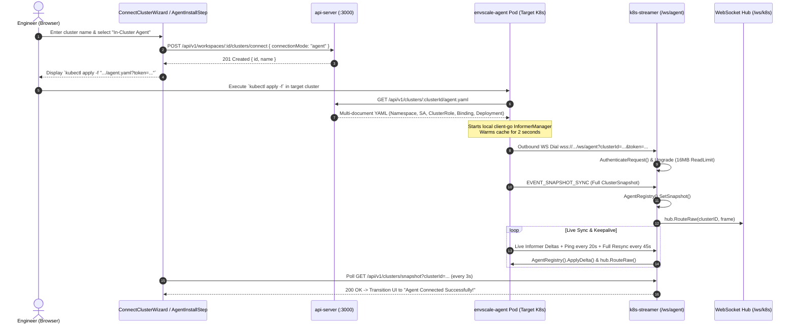

# Dual-Mode Cluster Onboarding & Outbound In-Cluster Agent

> **Document Scope:** Cluster onboarding workflows (`agent` and `direct` modes), dynamic Kubernetes manifest generation, outbound WebSocket streaming agent runner, and inbound snapshot/delta ingestion.
> **Primary Modules:** [`apps/web/src/components/onboarding/`](../apps/web/src/components/onboarding), [`apps/api-server/src/services/agent-manifest.service.ts`](../apps/api-server/src/services/agent-manifest.service.ts), [`apps/k8s-streamer/pkg/agent/runner.go`](../apps/k8s-streamer/pkg/agent/runner.go), [`apps/k8s-streamer/pkg/server/agent_receiver.go`](../apps/k8s-streamer/pkg/server/agent_receiver.go)

---

## 1. Dual-Mode Connection Architecture

EnvScale supports two distinct cluster connectivity topologies selected in Step 1 of [`ConnectClusterWizard.tsx`](../apps/web/src/components/onboarding/ConnectClusterWizard.tsx):

| Connection Mode | Transport Direction | Credential Storage | Best Fit |
| :--- | :--- | :--- | :--- |
| **`agent` (In-Cluster Agent — Default)** | **Outbound** (`Cluster → EnvScale /ws/agent`) | No Kubeconfig uploaded; uses in-cluster `ServiceAccount` + 365-day cluster-scoped HS256 JWT (`CLUSTER_TOKEN`) | Private Minikube, KinD, K3s, NAT/firewalled clusters, or on-prem clusters without public API exposure. |
| **`direct` (Kubeconfig Upload)** | **Inbound** (`EnvScale k8s-streamer → K8s API :6443`) | Raw YAML encrypted via AES-256-GCM in PostgreSQL `clusters.kubeconfig` | Publicly reachable control planes (AWS EKS, GKE, AKS) or co-hosted local clusters. |

---

## 2. Outbound In-Cluster Agent Sequence

---

## 3. Dynamic Agent Manifest Generator

Located in [`apps/api-server/src/services/agent-manifest.service.ts`](../apps/api-server/src/services/agent-manifest.service.ts) and served by `getAgentManifest` in [`cluster.controller.ts`](../apps/api-server/src/controllers/cluster.controller.ts):

- **Endpoints:**
  - `GET /api/v1/clusters/:clusterId/agent.yaml`
  - `GET /api/v1/workspaces/:id/clusters/:clusterId/agent.yaml`
- **Response Headers:** `Content-Type: application/yaml`, `Content-Disposition: inline; filename="envscale-agent-<clusterName>.yaml"`.
- **Optional Query Parameter:** `?serverUrl=` overrides the WebSocket target (used when tunneling from local development via ngrok/Cloudflare to a remote EKS/GKE cluster).
- **Default Target URL Resolution:**
  - In `production`: defaults to `wss://envscale.duckdns.org/ws/agent` (or `STREAMER_WS_URL`).
  - In `development`: defaults to `LOCAL_STREAMER_WS_URL` (`ws://host.minikube.internal:8080/ws/agent`) or dynamically inferred `${protocol}://${host}/ws/agent`.

### Generated Least-Privilege Kubernetes Resources
1. **`Namespace`**: `envscale-agent` (labeled `app.kubernetes.io/part-of: envscale`).
2. **`ServiceAccount`**: `envscale-agent` inside namespace `envscale-agent`.
3. **`ClusterRole` (`envscale-agent-role`)**: Strict read-only verbs (`get`, `list`, `watch`) across:
   - `""` (core): `pods`, `pods/log`, `nodes`, `services`, `endpoints`, `persistentvolumeclaims`, `persistentvolumes`, `configmaps`, `secrets`, `events`
   - `apps`: `deployments`, `replicasets`, `statefulsets`, `daemonsets`
   - `batch`: `jobs`, `cronjobs`
   - `networking.k8s.io`: `ingresses`, `networkpolicies`
   - `autoscaling`: `horizontalpodautoscalers`
   - `policy`: `poddisruptionbudgets`
   - `metrics.k8s.io`: `pods`, `nodes` (`get`, `list`)
4. **`ClusterRoleBinding` (`envscale-agent-binding`)**: Binds `envscale-agent` ServiceAccount to `envscale-agent-role`.
5. **`Deployment` (`envscale-agent`)**: Runs 1 replica of `ghcr.io/p20000/envscale-k8s-streamer:latest` (configurable via `AGENT_IMAGE`) with environment variables `MODE=agent`, `CLUSTER_ID`, `SERVER_URL`, and `CLUSTER_TOKEN` (signed via `createAgentToken`), bounded to `50m`/`64Mi` requests and `300m`/`256Mi` limits.

> [!NOTE]
> The generated `envscale-agent-role` grants read-only verbs across core, `apps`, `batch`, `networking.k8s.io`, `autoscaling`, `policy`, and `metrics.k8s.io`. It does **not** yet include rules for `resourcequotas`, `limitranges`, `rbac.authorization.k8s.io` (`roles`, `rolebindings`, `clusterroles`, `clusterrolebindings`), or `snapshot.storage.k8s.io` CRDs; similarly, `BuildClusterSnapshot` in `agent_snapshot.go` populates 18 core/workload/storage/policy slices on initial connect.

---

## 4. In-Cluster Agent Runner (`pkg/agent/runner.go`)

When `k8s-streamer` boots with `MODE=agent`, [`runner.go`](../apps/k8s-streamer/pkg/agent/runner.go) executes the standalone outbound agent pipeline:

1. **Configuration (`LoadConfigFromEnv`)**: Reads `CLUSTER_ID` (or `ENVSCALE_CLUSTER_ID`), `SERVER_URL` (or `ENVSCALE_SERVER_URL`), `CLUSTER_TOKEN` (or `ENVSCALE_TOKEN`), and `KUBECONFIG`.
2. **Client Resolution (`buildKubernetesClient`)**: Attempts `rest.InClusterConfig()` first using the mounted ServiceAccount token; falls back to `KUBECONFIG` or `~/.kube/config` for local CLI execution.
3. **Local Informer & Channel Publisher**:
   - Initializes a local `ws.Hub` paired with a `wsSender` (`ws.EventPublisher`) backed by a 1024-message buffered channel (`msgCh`). Full queue frames are dropped non-blockingly to prevent memory leaks.
   - Starts `k8s.NewInformerManagerWithClientset` and sleeps 2 seconds to warm the initial informer cache before emitting the baseline snapshot.
4. **Resilient Outbound Streaming (`runStreamingPipeline`)**:
   - Dials `SERVER_URL` with `clusterId` and `token` query parameters (`HandshakeTimeout: 15s`, `TLSClientConfig{InsecureSkipVerify: true}` for custom/DuckDNS certs).
   - Transmits an immediate baseline `EVENT_SNAPSHOT_SYNC` via `sendBaselineSnapshot` -> `k8s.BuildClusterSnapshot(im)`.
   - Runs a 45-second `resyncTicker` (periodic full snapshot resync) and 20-second `pingTicker` (WebSocket ping keepalive).
   - Reconnects automatically with exponential backoff starting at `2s`, doubling up to `30s`.

---

## 5. Server-Side Agent Receiver & Registry

Implemented in [`agent_receiver.go`](../apps/k8s-streamer/pkg/server/agent_receiver.go) and [`agent_snapshot.go`](../apps/k8s-streamer/pkg/k8s/agent_snapshot.go):

- **Endpoint:** `/ws/agent` handled by `HandleAgentWebSocket`.
- **Safety Limits:** `1MB` read/write upgrader buffers, `16MB` max WebSocket message size (`conn.SetReadLimit`), and `60s` read deadline refreshed on messages and `Pong` frames.
- **State Ingestion (`AgentRegistry`):**
  - On `EVENT_SNAPSHOT_SYNC`: stores the `types.ClusterSnapshot` in `AgentRegistry().SetSnapshot(clusterID, snapshot)`, marks `Connected = true`, and relays the raw frame to browser clients via `hub.RouteRaw(clusterID, message)`.
  - On live delta events (`EVENT_POD_STATUS_CHANGED`, `EVENT_POD_DELETED`, `EVENT_NODE_MUTATED`, `EVENT_DEPLOYMENT_MUTATED`, `EVENT_DEPLOYMENT_DELETED`, `EVENT_SERVICE_MUTATED`): updates the cached snapshot incrementally via `AgentRegistry().ApplyDelta(...)` before calling `hub.RouteRaw`.
  - On `ping`: replies immediately with `{"event":"pong"}`.
  - On disconnect: calls `AgentRegistry().MarkDisconnected(clusterID)`.

---

## 6. Direct Kubeconfig Flow & Onboarding UI Components

The frontend onboarding modal ([`ConnectClusterWizard.tsx`](../apps/web/src/components/onboarding/ConnectClusterWizard.tsx)) guards access with [`WizardAuthRequiredModal.tsx`](../apps/web/src/components/onboarding/WizardAuthRequiredModal.tsx) when unauthenticated and orchestrates both paths:

1. **Step 1 (Identity & Mode):** Validates unique non-empty cluster name, selects environment (`development`, `staging`, `production`), and picks `agent` (2-step flow) or `direct` (3-step flow).
2. **Step 2 (`agent` mode — [`AgentInstallStep.tsx`](../apps/web/src/components/onboarding/AgentInstallStep.tsx)):**
   - Displays the copyable `kubectl apply -f "<host>/api/v1/clusters/<id>/agent.yaml?token=..."` command.
   - In local dev (`localhost` / `127.0.0.1`), offers an optional tunnel URL input (`?serverUrl=wss://...`) for cloud clusters.
   - Polls `GET /api/v1/clusters/snapshot?clusterId=...` every 3 seconds until `200 OK`, then enables **Open Canvas**.
3. **Step 2 (`direct` mode — [`KubeconfigUploadStep.tsx`](../apps/web/src/components/onboarding/KubeconfigUploadStep.tsx)):**
   - Drag-and-drop and file picker restricted to `.yaml` / `.yml`.
   - Validates payload structure via `connectClusterSchema` in [`wizardHelpers.ts`](../apps/web/src/components/onboarding/wizardHelpers.ts) (requires `apiVersion` and `clusters` blocks).
4. **Step 3 (`direct` mode — [`DirectReviewStep.tsx`](../apps/web/src/components/onboarding/DirectReviewStep.tsx) & [`ConnectSuccessScreen.tsx`](../apps/web/src/components/onboarding/ConnectSuccessScreen.tsx)):**
   - Submits to `apiConnectCluster`, which persists the AES-256-GCM encrypted kubeconfig in PostgreSQL and triggers immediate registration with `k8s-streamer`.
   - `formatConnectionError` maps raw TLS/x509, `connection refused`, DNS (`dial tcp` / `no such host`), `unauthorized`/`forbidden`, and `timeout` strings into user-friendly guidance with an expandable technical log.

