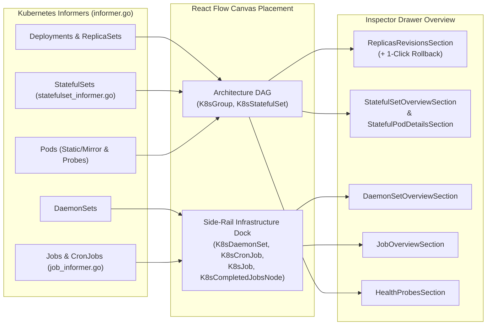

# Compute Workloads, StatefulSets, Batch Jobs & Rollback Engine

> **Document Scope:** Real-time observation, visualization, and lifecycle control for Kubernetes `Deployment`, `ReplicaSet`, `StatefulSet`, `DaemonSet`, `Job`, `CronJob`, `Static Mirror Pod`, and container health probes.
> **Primary Modules:** [`apps/k8s-streamer/pkg/k8s/`](../apps/k8s-streamer/pkg/k8s), [`apps/k8s-streamer/pkg/server/rollback_handler.go`](../apps/k8s-streamer/pkg/server/rollback_handler.go), [`apps/web/src/components/canvas/`](../apps/web/src/components/canvas), [`apps/web/src/components/drawer/inspector/`](../apps/web/src/components/drawer/inspector)

---

## 1. Workload Informer-to-Canvas Architecture

---

## 2. Deployments, ReplicaSets & 1-Click Rollback Engine

### Dual-Revision Tracking & Rollout Diffing
- **Informers:** `extractDeploymentDelta` and `extractReplicaSetDelta` in [`informer_handlers.go`](../apps/k8s-streamer/pkg/k8s/informer_handlers.go) capture `MaxSurge`, `MaxUnavailable`, `MinReadySeconds`, `deployment.kubernetes.io/revision`, `OwnerReferences`, and container images.
- **Frontend State Diffing:** [`rolloutHelpers.ts`](../apps/web/src/store/helpers/rolloutHelpers.ts) classifies revisions (`Active (Current)`, `Scaling Up`, `Scaling Down`, `Scaled Down (Old)`) and signals rolling updates on [`K8sGroup.tsx`](../apps/web/src/components/canvas/K8sGroup.tsx) with an animated `Rolling` indicator.

### Conflict-Safe Authenticated Rollback Engine
Implemented in [`apps/k8s-streamer/pkg/server/rollback_handler.go`](../apps/k8s-streamer/pkg/server/rollback_handler.go) and invoked by [`ReplicasRevisionsSection.tsx`](../apps/web/src/components/drawer/inspector/ReplicasRevisionsSection.tsx) via `apiRollbackDeployment` ([`api.ts`](../apps/web/src/config/api.ts)):

1. **Routes:**
   - `POST /api/v1/clusters/{clusterId}/rollout/rollback`
   - `POST /api/v1/clusters/rollout/rollback`
   - `POST /api/v1/rollout/rollback`
2. **Authentication & Cluster Scope Guard:** Calls `websocket.AuthenticateRequest(r)` and `websocket.CheckClusterAuthorization(claims, req.ClusterID)` (unless `ALLOW_ANONYMOUS_WS=true`), returning `401` or `403` on failure.
3. **Target Revision Resolution:** Lists `ReplicaSets` owned by `DeploymentName` and matches by explicit `replicaSetName`, `deployment.kubernetes.io/revision`, or `pod-template-hash` to locate `targetPodTemplateSpec`.
4. **Optimistic Concurrency Safe Patch:** Uses `retry.RetryOnConflict(retry.DefaultRetry, ...)` with a 15-second context timeout to fetch a fresh `Deployment`, assign `freshDep.Spec.Template = *targetPodTemplateSpec`, and record an audit annotation:
   - `kubernetes.io/change-cause`: `EnvScale Rollback by <user> to revision #<hash> at <timestamp>`
5. **Audit & Real-Time Broadcast:** Logs `[Rollout Audit]` and emits `EVENT_ROLLOUT_ROLLBACK` across the cluster's WebSocket room.

---

## 3. StatefulSets Digital Infrastructure Control Board

Stateful workloads require strict ordinal startup ordering, persistent 1:1 storage claims, and deterministic network identities.

### Backend & Helper Extraction
- **Informer ([`statefulset_informer.go`](../apps/k8s-streamer/pkg/k8s/statefulset_informer.go)):** `extractStatefulSetDelta` extracts `Replicas`, `ReadyReplicas`, `CurrentReplicas`, `UpdatedReplicas`, `ServiceName` (headless service), `CurrentRevision`, `UpdateRevision`, `UpdateStrategy`, `RollingUpdate.Partition`, and `VolumeClaimTemplates` (name, storage request, access modes). Broadcasts `EVENT_STATEFUL_SET_MUTATED` and `EVENT_STATEFUL_SET_DELETED` through FNV-1a deduplication.
- **Frontend Helper ([`statefulSetHelpers.ts`](../apps/web/src/store/helpers/statefulSetHelpers.ts)):** Identifies StatefulSet-managed pods via `ownerKind === "StatefulSet"`, ordinal naming suffixes (`-(0|[1-9]\d*)$`), and fallback heuristics (`db`, `redis`, `stateful`, `kafka`, `postgres`), then builds `k8sStatefulSet` nodes.

### Visual Canvas & Inspector Components
| Component | Purpose |
| :--- | :--- |
| [`K8sStatefulSet.tsx`](../apps/web/src/components/canvas/K8sStatefulSet.tsx) | Renders an expandable controller board (`width = max(260, slotCount * 125 + 20)px`, `height = 132px`) with `STS` badge, headless service subtitle, chaos highlight, and `ready/total` pill. |
| [`StatefulOrdinalBlade.tsx`](../apps/web/src/components/canvas/statefulset/StatefulOrdinalBlade.tsx) | Renders each ordinal bay (`#0`, `#1`, ...) sorted by ordinal index, showing pod phase, active chaos status, and its bound 1:1 PVC (`<vctName>-<podName>`) status (`Bound`/`Pend`). |
| [`StatefulDnsDirectory.tsx`](../apps/web/src/components/canvas/statefulset/StatefulDnsDirectory.tsx) | Displays copyable deterministic headless DNS records (`<podName>.<serviceName>.<namespace>.svc.cluster.local:<port>`). |
| [`StatefulSetOverviewSection.tsx`](../apps/web/src/components/drawer/inspector/StatefulSetOverviewSection.tsx) | Inspector view detailing replica counts, rollout strategy & canary partition, copyable FQDN directory, VCT storage specs, and clickable ordinal pod fleet. |
| [`StatefulPodDetailsSection.tsx`](../apps/web/src/components/drawer/inspector/StatefulPodDetailsSection.tsx) | Pod-level inspector card surfacing `BAY #<ordinal>`, copyable pod FQDN, and 1:1 bound PVC affinity. |

---

## 4. DaemonSets & Resident Host Agents

- **Informer ([`informer_handlers.go`](../apps/k8s-streamer/pkg/k8s/informer_handlers.go)):** `extractDaemonSetDelta` records `DesiredNumberScheduled`, `CurrentNumberScheduled`, `NumberReady`, `NumberUnavailable`, and container images, emitting `EVENT_DAEMONSET_MUTATED` and `EVENT_DAEMONSET_DELETED`.
- **Canvas & Worker Node Integration:** [`K8sDaemonSet.tsx`](../apps/web/src/components/canvas/K8sDaemonSet.tsx) renders as a Tier-2 side-rail dock card (`ready/desired Nodes`), while [`OverviewTab.tsx`](../apps/web/src/components/drawer/inspector/OverviewTab.tsx) surfaces `Resident Daemon Agents` when inspecting worker nodes.
- **Inspector ([`DaemonSetOverviewSection.tsx`](../apps/web/src/components/drawer/inspector/DaemonSetOverviewSection.tsx)):** Displays desired/current/ready/updated counts and a per-worker-node distribution matrix (`1 Pod Per Host`) with host IP and CPU load.

---

## 5. Batch Jobs, CronJobs & Completed Job Aggregation

- **CronJob Informer ([`informer_handlers.go`](../apps/k8s-streamer/pkg/k8s/informer_handlers.go)):** `extractCronJobDelta` tracks `Schedule`, `Suspend`, `ActiveJobsCount`, `LastScheduleTime`, `LastSuccessfulTime`, and `Images`, emitting `EVENT_CRONJOB_MUTATED` / `EVENT_CRONJOB_DELETED`. [`K8sCronJob.tsx`](../apps/web/src/components/canvas/K8sCronJob.tsx) translates 5-part cron strings into human cadence pills (`every 1m`, `every 1h`, `daily`, `weekly`, `monthly`) and displays an animated `ACTIVE` radar chip when jobs are executing.
- **Job Informer ([`job_informer.go`](../apps/k8s-streamer/pkg/k8s/job_informer.go)):**
  - **CronJob Ownership Filter:** `extractJobDelta` inspects `job.OwnerReferences`; jobs owned by a `CronJob` return `isStandalone = false` so transient scheduled child pods do not pollute the root topology graph.
  - Captures `Completions`, `Parallelism`, `Succeeded`, `Failed`, `Active`, `StartTime`, `CompletionTime`, and live `DurationSeconds`, emitting `EVENT_JOB_MUTATED` / `EVENT_JOB_DELETED`.
- **Canvas & Inspector:** [`K8sJob.tsx`](../apps/web/src/components/canvas/K8sJob.tsx) renders active/failed/done states (`FAILED`, `RUNNING`, `<succeeded>/<completions> DONE`), [`K8sCompletedJobsNode.tsx`](../apps/web/src/components/canvas/K8sCompletedJobsNode.tsx) collapses finished jobs into a single expandable dock summary (`setShowCompletedJobs(true)`), and [`JobOverviewSection.tsx`](../apps/web/src/components/drawer/inspector/JobOverviewSection.tsx) shows progress bars, concurrency, execution timestamps, and condition messages.

---

## 6. Static Mirror Pods & Container Health Probes

- **Static & Control-Plane Pod Detection (`extractPodDelta` in [`informer_handlers.go`](../apps/k8s-streamer/pkg/k8s/informer_handlers.go#L73-L96)):**
  - Flags `IsStaticPod = true` when annotations contain `kubernetes.io/config.mirror` or `kubernetes.io/config.source == "file"`.
  - Flags `IsControlPlane = true` for `tier=control-plane` or core components (`kube-apiserver`, `etcd`, `kube-scheduler`, `kube-controller-manager`).
  - Surfaced in [`InspectorDrawer.tsx`](../apps/web/src/components/drawer/InspectorDrawer.tsx) (`STATIC MIRROR POD` badge) and [`OverviewTab.tsx`](../apps/web/src/components/drawer/inspector/OverviewTab.tsx) (noting `/etc/kubernetes/manifests` kubelet management and hiding `ReplicasRevisionsSection`).
- **Container Health Probes (`ExtractPodProbes` in [`policy_hpa_informer.go`](../apps/k8s-streamer/pkg/k8s/policy_hpa_informer.go#L190-L229)):**
  - Parses the primary container's `LivenessProbe` and `ReadinessProbe` (`http`, `tcp`, `exec`, `Path`, `Port`, `InitialDelaySeconds`, `PeriodSeconds`, `TimeoutSeconds`, `FailureThreshold`).
  - Rendered side-by-side in [`HealthProbesSection.tsx`](../apps/web/src/components/drawer/inspector/HealthProbesSection.tsx) with `Probes Passing` vs `Probe Check Unready` status badges, while [`K8sGroup.tsx`](../apps/web/src/components/canvas/K8sGroup.tsx#L316-L324) surfaces a probe warning chip whenever a running pod fails readiness.

