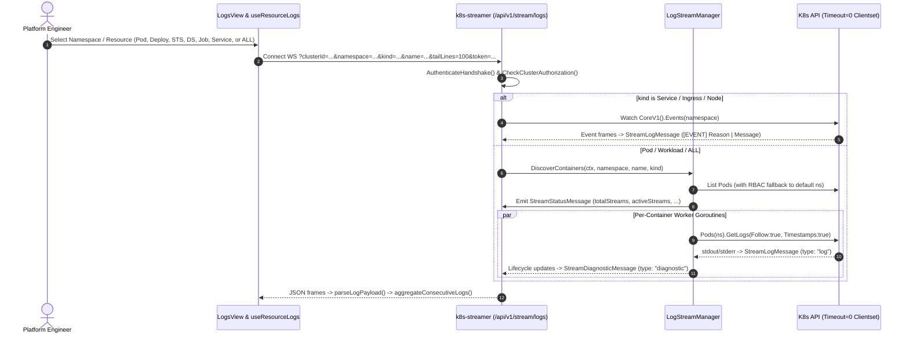

# Universal Log Multiplexing, Stream Diagnostics & Continuous Metrics

> **Document Scope:** Universal multi-container WebSocket log streaming (`/ws/logs`, `/api/v1/stream/logs`), per-container stream diagnostics & backoff recovery, client-side log parsing/compression, and the 1-second continuous cluster metrics pipeline (`informer_metrics.go` & `MetricsView.tsx`).
> **Primary Modules:** [`apps/k8s-streamer/pkg/server/stream_logs_handler.go`](../apps/k8s-streamer/pkg/server/stream_logs_handler.go), [`apps/k8s-streamer/pkg/server/stream_logs_manager.go`](../apps/k8s-streamer/pkg/server/stream_logs_manager.go), [`apps/k8s-streamer/pkg/k8s/informer_metrics.go`](../apps/k8s-streamer/pkg/k8s/informer_metrics.go), [`apps/web/src/components/views/LogsView.tsx`](../apps/web/src/components/views/LogsView.tsx), [`apps/web/src/components/views/MetricsView.tsx`](../apps/web/src/components/views/MetricsView.tsx)

---

## 1. Universal Log & Telemetry Streaming Pipeline

---

## 2. Universal Multi-Resource Log Multiplexer (`k8s-streamer`)

Mounted across `/api/v1/stream/logs`, `/ws/logs`, and `/ws/stream/logs` in [`routes.go`](../apps/k8s-streamer/pkg/server/routes.go#L74-L82), plus REST control endpoints `POST`/`DELETE /api/v1/logs/stream` backed by [`pkg/k8s/logs.go`](../apps/k8s-streamer/pkg/k8s/logs.go).

### Key Server Mechanics ([`stream_logs_handler.go`](../apps/k8s-streamer/pkg/server/stream_logs_handler.go) & [`stream_logs_manager.go`](../apps/k8s-streamer/pkg/server/stream_logs_manager.go))
1. **Zero-Timeout Clientset:** Uses `clusterManager.GetStreamClientset(clusterID)` (`Timeout = 0`) so long-lived `Follow: true` HTTP chunked streams do not drop on REST request deadlines.
2. **Target & Container Discovery (`DiscoverContainers`):**
   - **Namespace Scope:** Supports a single namespace or cluster-wide (`all` / `_all` / empty). If listing all namespaces returns `403 Forbidden`, emits a `permission_denied` diagnostic and falls back gracefully to the `default` namespace.
   - **Resource Kind Scope:** Matches `ALL` (`all-resources`), exact `Pod`, or prefix/substring matches for `Deployment`, `StatefulSet`, `DaemonSet`, and `Job`.
   - **Init Container Awareness:** Automatically tails `Spec.InitContainers` that are currently `Running` or `Terminated` with non-zero exit codes.
   - **Dynamic Tail Cap:** Caps initial `TailLines` to `30` lines per container when multiplexing multiple targets (`len(targets) > 1`).
3. **Kubernetes Event Fallback (`streamResourceEvents`):** When `kind` is `service`, `ingress`, or `node`, lists and watches `CoreV1().Events(namespace)` matching `InvolvedObject.Name`, translating `Warning` events to `WARN` and `Normal` events to `INFO`.
4. **Resilient Per-Container Workers (`runContainerWorker`):**
   - Inspects container status via [`stream_logs_helpers.go`](../apps/k8s-streamer/pkg/server/stream_logs_helpers.go): drains unread logs cleanly (`drainContainerLogs`) when a container exits `0`, stops on `RestartPolicyNever` failures, and backs off (`1s` to `30s` with jitter, up to 15 waiting retries / 20 stream retries) when containers are waiting (`CrashLoopBackOff`, `ImagePullBackOff`).
   - Tracks `lastTimestamp` (`SinceTime = lastTimestamp + 1ns`) to prevent duplicate log lines across reconnects.
   - Supports 1 MiB log lines (`bufio.Scanner`) and infers `ERROR`, `WARN`, `INFO`, and `DEBUG` levels (`parseLogTimestamp`).

### Diagnostic & Status Wire Types ([`stream_logs_types.go`](../apps/k8s-streamer/pkg/server/stream_logs_types.go))
- `StreamLogMessage` (`type: "log"`): `timestamp`, `namespace`, `pod`, `container`, `source`, `level`, `message`, `stream`, `kind`.
- `StreamDiagnosticMessage` (`type: "diagnostic"`): `source`, `status` (`active` | `retrying` | `backoff` | `failed` | `terminated` | `permission_denied`), `reason`, `retryCount`, `nextRetryMs`.
- `StreamStatusMessage` (`type: "status"`): `totalStreams`, `activeStreams`, `retryingStreams`, `failedStreams`, `scope`.

---

## 3. Standalone Logs View & Stream Diagnostics UI

### Full-Screen Logs Explorer ([`LogsView.tsx`](../apps/web/src/components/views/LogsView.tsx) & [`LogsToolbar.tsx`](../apps/web/src/components/views/LogsToolbar.tsx))
- **Hook:** [`useResourceLogs.ts`](../apps/web/src/hooks/useResourceLogs.ts) authenticates via `getStreamerToken()`, subscribes to `/api/v1/stream/logs`, and separates `diagnostic`, `status`, and `log` frames (capped at `maxLogs = 1000`).
- **Controls (`LogsToolbar.tsx`):**
  - Namespace selector (`All Namespaces (Cluster-Wide)` or per-namespace).
  - Grouped Resource dropdown (`All Resources`, `Pods`, `Deployments`, `StatefulSets`, `DaemonSets`, `Jobs`, `Services`).
  - Real-time text search across messages, timestamps, sources, and JSON attributes.
  - Level filter pills with live counts (`ALL`, `ERROR`, `WARN`, `INFO`, `DEBUG`).
  - `Pause`/`Resume` tailing, `Clear`, `Copy`, and `Export` (downloads `.log` text file).
- **Client-Side Parsing & Compression:** [`logParser.ts`](../apps/web/src/utils/logParser.ts) strips ANSI codes and parses JSON logs; [`logAggregator.ts`](../apps/web/src/utils/logAggregator.ts) runs consecutive duplicate compression (`aggregateConsecutiveLogs`).
- **Smart Auto-Scroll:** Detects manual scroll-up (`distanceFromBottom > 50`) and displays a floating `↓ Jump to bottom (+N)` pill for unread lines.

### Stream Diagnostics Panel ([`LogDiagnosticsPanel.tsx`](../apps/web/src/components/views/LogDiagnosticsPanel.tsx))
Slide-over drawer toggled from the toolbar health button (`activeStreams/totalStreams Streams`):
- **Summary Cards:** `Total Streams`, `Active`, and `Retrying / Issues`.
- **Filtering:** Tabs for `All`, `Issues` (`retrying`, `backoff`, `failed`, `permission_denied`), and `Active`, plus search by source/reason/status.
- **Per-Stream Cards:** Shows `namespace/pod/container`, status badge, diagnostic reason, last update time, `retryCount`, and `nextRetryMs` countdown.

---

## 4. Continuous Cluster Metrics Pipeline

### 1-Second Backend Pulse (`informer_metrics.go`)
[`apps/k8s-streamer/pkg/k8s/informer_metrics.go`](../apps/k8s-streamer/pkg/k8s/informer_metrics.go) runs `startMetricsPulse` on a 1-second `time.Ticker`:
1. Queries `metricsClient.MetricsV1beta1().PodMetricses("")` (`FetchPodMetricsMap`) and `NodeMetricses()` (`FetchNodeMetricsMap`) with a 5-second timeout.
2. Aggregates total cluster CPU (`mcores`) and Memory (`MiB`) against sum of node `Status.Allocatable` capacities (defaulting to `2000m` / `4096 MiB` if node allocatable is unavailable).
3. Records a `ClusterMetricPoint{Timestamp, CpuPct, MemoryPct}` into a thread-safe 60-point rolling ring buffer (`GetMetricsHistory`, also exposed via `GET /api/v1/clusters/metrics/history` and `/api/v1/clusters/snapshot`).
4. Broadcasts `EVENT_CLUSTER_METRICS` and deduplicated `EVENT_POD_STATUS_CHANGED` / `EVENT_NODE_MUTATED` deltas with `CpuUsageMcores`, `MemoryUsageMiB`, `CpuPct`, and `MemoryPct`.

### Frontend Store & Metrics View (`useMetricsStore.ts` & `MetricsView.tsx`)
- **[`useMetricsStore.ts`](../apps/web/src/store/useMetricsStore.ts):** Initializes a 60-second history array, pads snapshots (`padHistory`), appends real-time `EVENT_CLUSTER_METRICS` ticks (`appendMetricPoint`), and hydrates on mount via `fetchMetricsHistory(clusterId)`.
- **[`MetricsView.tsx`](../apps/web/src/components/views/MetricsView.tsx):**
  - Renders **Aggregate CPU Usage** and **RAM Consumption** SVG `TelemetryAreaChart` cards with 20% Y-axis headroom (`yUpper = max(maxVal * 1.2, 1)`), dashed hover crosshair, and precision timestamp/delta tooltip.
  - Highlights `> 85%` load indicators and lists the top 6 **Top Resource Consuming Pods** sorted descending by `cpuUsageMcores` (filtered by active namespace selection).

