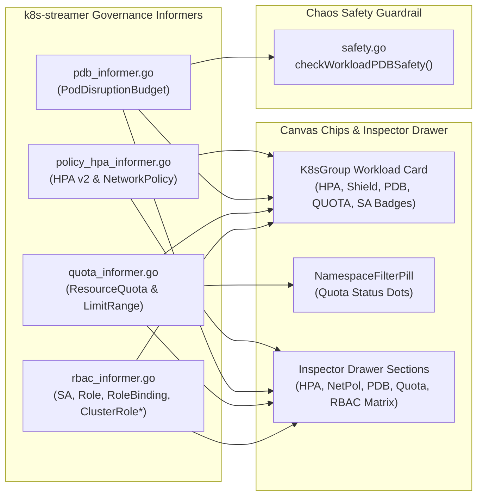

# Scaling, Network Policies, PDBs, Resource Quotas & In-Cluster RBAC

> **Document Scope:** Real-time Kubernetes governance observation and enforcement telemetry covering `HorizontalPodAutoscaler` (`autoscaling/v2`), `NetworkPolicy` (`networking.k8s.io/v1`), `PodDisruptionBudget` (`policy/v1`) with Chaos Safety Guardrails, `ResourceQuota` & `LimitRange` (`CoreV1`), and In-Cluster RBAC (`ServiceAccount`, `Role`, `RoleBinding`, `ClusterRole`, `ClusterRoleBinding`).
> **Primary Modules:** [`apps/k8s-streamer/pkg/k8s/`](../apps/k8s-streamer/pkg/k8s), [`apps/k8s-streamer/pkg/chaos/safety.go`](../apps/k8s-streamer/pkg/chaos/safety.go), [`apps/web/src/components/canvas/K8sGroup.tsx`](../apps/web/src/components/canvas/K8sGroup.tsx), [`apps/web/src/components/drawer/inspector/`](../apps/web/src/components/drawer/inspector)

---

## 1. Governance Informer & Policy Enrichment Flow

---

## 2. HorizontalPodAutoscalers (`autoscaling/v2`)

Implemented in [`policy_hpa_informer.go`](../apps/k8s-streamer/pkg/k8s/policy_hpa_informer.go) (`setupPolicyHPAInformers`, `extractHPADelta`, `GetHPASnapshot`) and correlated on the frontend via [`policyHpaHelpers.ts`](../apps/web/src/store/helpers/policyHpaHelpers.ts):

- **Tracked Fields (`HPAStatusDelta`):** `TargetRefKind`, `TargetRefName`, `MinReplicas`, `MaxReplicas`, `CurrentReplicas`, `DesiredReplicas`, `CurrentCPUUtil`, `TargetCPUUtil`, and `LastScaleTime`.
- **Events:** `EVENT_HPA_MUTATED` and `EVENT_HPA_DELETED`.
- **Canvas Badge (`K8sGroup.tsx`):** Displays `HPA <min>–<max>` chip with hover tooltip showing `currentReplicas/desiredReplicas` and `currentCpuUtil% / targetCpuUtil%`.
- **Inspector UI ([`AutoscalingHPASection.tsx`](../apps/web/src/components/drawer/inspector/AutoscalingHPASection.tsx)):** Renders a live CPU gauge bar with an amber target threshold marker (`▲ Target <pct>%`) and a 4-column grid (`Min`, `Max`, `Current`, `Desired`).

---

## 3. NetworkPolicies (`networking.k8s.io/v1`)

Implemented in [`policy_hpa_informer.go`](../apps/k8s-streamer/pkg/k8s/policy_hpa_informer.go#L113-L187) (`extractNetworkPolicyDelta`, `GetNetworkPolicySnapshot`):

- **Rule Extraction:** Parses `Spec.PodSelector.MatchLabels`, `PolicyTypes` (`Ingress`, `Egress`), allowed port rules (`<PROTO>:<PORT>`), `from:pod(<k>=<v>)` selectors, and `from:all-namespaces`.
- **Events:** `EVENT_NETWORKPOLICY_MUTATED` and `EVENT_NETWORKPOLICY_DELETED`.
- **Canvas & Inspector UI:** [`K8sGroup.tsx`](../apps/web/src/components/canvas/K8sGroup.tsx#L341-L349) displays an emerald shield icon (`NetworkPolicy Enforced`), and [`NetworkPolicyRolloutSection.tsx`](../apps/web/src/components/drawer/inspector/NetworkPolicyRolloutSection.tsx) lists Deployment rollout strategy (`MaxSurge`, `MaxUnavailable`, `MinReadySeconds`) alongside matched ingress whitelist rules.

---

## 4. PodDisruptionBudgets (`policy/v1`) & Chaos Safety Guardrails

### Informer & Workload Resolution
Implemented in [`pdb_informer.go`](../apps/k8s-streamer/pkg/k8s/pdb_informer.go):
- `extractPDBDelta` captures `MinAvailable`, `MaxUnavailable`, `CurrentHealthy`, `DesiredHealthy`, `ExpectedPods`, `DisruptionsAllowed`, and `MatchLabels`, emitting `EVENT_PDB_MUTATED` and `EVENT_PDB_DELETED`.
- `CheckWorkloadPDB` resolves a workload's governing PDB using two strategies:
  1. **Label Selector Match:** Evaluates `metav1.LabelSelectorAsSelector(pdb.Spec.Selector)` against target labels (or `app == workloadName`).
  2. **Name Heuristic Fallback:** Strips `-pdb` / `-disruption-budget` suffixes to match workload names.

### In-Flight Chaos Safety Guardrail (`pkg/chaos/safety.go`)
Before [`injector.go`](../apps/k8s-streamer/pkg/chaos/injector.go) executes a fault (`crash`, `oom-pressure`, `scale-down`), [`safety.go`](../apps/k8s-streamer/pkg/chaos/safety.go) enforces SLA disruption budgets:

1. `countActiveDisruptions` counts active in-flight faults targeting the same `clusterID`, `namespace`, and workload/target name.
2. `checkWorkloadPDBSafety` calculates:
   `effectiveAllowed = pdbDelta.DisruptionsAllowed - activeInflight`
3. **Budget Exhausted (`effectiveAllowed <= 0`):**
   - If `force == false`: Injection is blocked with `*chaos.ErrPDBViolation`. [`routes_chaos.go`](../apps/k8s-streamer/pkg/server/routes_chaos.go#L66-L79) returns HTTP `409 Conflict` with `{"status": "blocked_by_pdb", "pdbName", "disruptionsAllowed", "workload", "namespace", "message"}`.
   - If `force == true`: Injection proceeds with `pdbBreached = true`, flagging active faults as `PDB Breached` in `EVENT_CHAOS_FAULT_INJECTED` and [`ChaosTab.tsx`](../apps/web/src/components/drawer/inspector/ChaosTab.tsx#L55-L104).
4. **Canvas & Inspector UI:** [`K8sGroup.tsx`](../apps/web/src/components/canvas/K8sGroup.tsx#L351-L370) shows `PDB: <allowed>` (teal) or pulsing `PDB: 0!` (rose), and [`PodDisruptionBudgetSection.tsx`](../apps/web/src/components/drawer/inspector/PodDisruptionBudgetSection.tsx) renders an SLA health bar and `Expected`/`Healthy`/`Desired`/`Allowed` metrics.

---

## 5. ResourceQuotas & LimitRanges (`CoreV1`)

Implemented in [`quota_informer.go`](../apps/k8s-streamer/pkg/k8s/quota_informer.go) and [`quotaHelpers.ts`](../apps/web/src/store/helpers/quotaHelpers.ts):

- **ResourceQuota Calculation (`extractResourceQuotaDelta`):**
  - Parses `Status.Hard` and `Status.Used` for CPU cores (`cpu` / `requests.cpu`), memory bytes (`memory` / `requests.memory`), and pod counts (`pods`).
  - Computes `CPUUtilizationPct`, `MemoryUtilizationPct`, and `PodsUtilizationPct`.
  - Sets `IsWarning = true` when any dimension is `>= 85.0%` and `IsBreached = true` when `>= 100.0%`.
- **LimitRange Extraction (`extractLimitRangeDelta`):** Extracts `Container`, `Pod`, and `PersistentVolumeClaim` `min`, `max`, `default`, `defaultRequest`, and `maxLimitRequestRatio` constraints.
- **Events:** `EVENT_RESOURCE_QUOTA_MUTATED` / `DELETED` and `EVENT_LIMIT_RANGE_MUTATED` / `DELETED`.
- **Frontend Indicators:**
  - [`NamespaceFilterPill.tsx`](../apps/web/src/components/layout/NamespaceFilterPill.tsx#L147-L163) renders status dots next to namespaces (pulsing rose if breached, amber if warning, emerald if normal).
  - [`K8sGroup.tsx`](../apps/web/src/components/canvas/K8sGroup.tsx#L373-L391) surfaces a `QUOTA <maxPct>%` chip when utilization is `>= 75%` or warning/breached.
  - [`ResourceQuotaSection.tsx`](../apps/web/src/components/drawer/inspector/ResourceQuotaSection.tsx) renders CPU, Memory, and Pod utilization bars alongside LimitRange constraint grids.

---

## 6. In-Cluster Kubernetes RBAC Informer & Verb Matrix

Implemented in [`rbac_informer.go`](../apps/k8s-streamer/pkg/k8s/rbac_informer.go), [`rbac.go`](../apps/k8s-streamer/pkg/types/rbac.go), [`rbacHelpers.ts`](../apps/web/src/store/helpers/rbacHelpers.ts), [`rbacWsHelpers.ts`](../apps/web/src/store/helpers/rbacWsHelpers.ts), and [`RBACAuthorizationSection.tsx`](../apps/web/src/components/drawer/inspector/RBACAuthorizationSection.tsx):

### Watched RBAC Resources & Event Contracts
Wrapped in a defensive `recover()` guard for restricted clusters, `setupRBACInformers` watches all five authorization primitives:
- `ServiceAccounts` -> `EVENT_SERVICEACCOUNT_MUTATED` / `EVENT_SERVICEACCOUNT_DELETED`
- `RoleBindings` -> `EVENT_ROLEBINDING_MUTATED` / `EVENT_ROLEBINDING_DELETED`
- `ClusterRoleBindings` -> `EVENT_CLUSTERROLEBINDING_MUTATED` / `EVENT_CLUSTERROLEBINDING_DELETED`
- `Roles` -> `EVENT_ROLE_MUTATED` / `EVENT_ROLE_DELETED`
- `ClusterRoles` -> `EVENT_CLUSTERROLE_MUTATED` / `EVENT_CLUSTERROLE_DELETED`

### Privilege Resolution & Inspector Visualization
1. **Canvas Identity Badge:** [`K8sGroup.tsx`](../apps/web/src/components/canvas/K8sGroup.tsx#L394-L406) renders an `SA <name>` badge whenever a workload runs under a non-`default` ServiceAccount.
2. **Binding & Rule Correlation (`resolvePodRBAC`):** Matches the Pod's `serviceAccountName` and `namespace` against all `RoleBindings` (within namespace) and `ClusterRoleBindings` (cluster-wide), aggregating effective `RBACPolicyRuleInfo[]` (`Verbs`, `APIGroups`, `Resources`, `ResourceNames`).
3. **4-Tier Privilege Classification:**
   - **Cluster Admin (`ClusterAdmin`):** `ClusterRoleBinding` to `cluster-admin` / `admin`, or rules granting `*` verbs on `*`/all resources (pulsing rose warning badge).
   - **Elevated Write (`Elevated`):** Rules containing `create`, `update`, `patch`, `delete`, `deletecollection`, or `*` (amber badge).
   - **Read-Only Access (`ReadOnly`):** Rules limited to `get`, `list`, or `watch` (blue badge).
   - **Restricted Default (`Restricted`):** No custom bindings attached (emerald badge).
4. **Permissions Matrix UI:** Displays `ServiceAccount`, `Namespace Scope`, `Token Automount` (`Projected Token` vs `Disabled (No Token)`), bound roles/bindings, and a color-coded verb matrix (`*` purple, write verbs amber, read verbs emerald).

