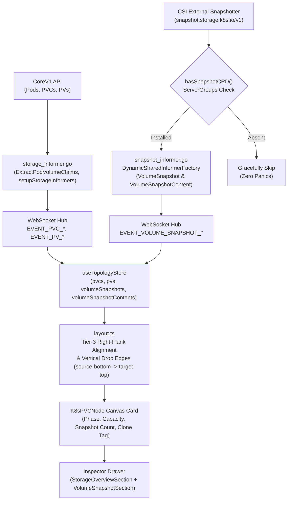

# Persistent Storage (PV/PVC/StorageClass) & CSI Volume Snapshots

> **Document Scope:** Real-time storage topology observation, Pod-to-PVC volume mount correlation, cluster-scoped `PersistentVolume` tracking, dynamic CSI `VolumeSnapshot` / `VolumeSnapshotContent` discovery, clone lineage, and Tier-3 vertical drop layout routing.
> **Primary Modules:** [`apps/k8s-streamer/pkg/k8s/storage_informer.go`](../apps/k8s-streamer/pkg/k8s/storage_informer.go), [`apps/k8s-streamer/pkg/k8s/snapshot_informer.go`](../apps/k8s-streamer/pkg/k8s/snapshot_informer.go), [`apps/web/src/components/canvas/K8sPVC.tsx`](../apps/web/src/components/canvas/K8sPVC.tsx), [`apps/web/src/components/drawer/inspector/StorageOverviewSection.tsx`](../apps/web/src/components/drawer/inspector/StorageOverviewSection.tsx), [`apps/web/src/components/drawer/inspector/VolumeSnapshotSection.tsx`](../apps/web/src/components/drawer/inspector/VolumeSnapshotSection.tsx)

---

## 1. Storage & Snapshot Streaming Pipeline

---

## 2. Pod Volume Mount Extraction

`ExtractPodVolumeClaims` in [`storage_informer.go`](../apps/k8s-streamer/pkg/k8s/storage_informer.go#L15-L73) bridges compute workloads and persistent storage:

1. Builds a lookup map (`volumeName -> pvcName`) from `pod.Spec.Volumes[*].PersistentVolumeClaim.ClaimName`.
2. Iterates across both standard `pod.Spec.Containers` and `pod.Spec.InitContainers` inspecting `container.VolumeMounts`.
3. Deduplicates `(claimName, mountPath)` pairs and emits `types.PodVolumeMountInfo` containing `Name`, `PVCName`, `MountPath` (e.g., `/var/lib/postgresql/data`), and `ReadOnly`.
4. Captures unmounted PVC volume declarations so referenced claims still appear in topology correlations and [`OverviewTab.tsx`](../apps/web/src/components/drawer/inspector/OverviewTab.tsx#L336-L358) (`Attached Storage Claims`).

---

## 3. PersistentVolumeClaim & PersistentVolume Informers

Implemented in [`apps/k8s-streamer/pkg/k8s/storage_informer.go`](../apps/k8s-streamer/pkg/k8s/storage_informer.go#L76-L299):

- **Namespace-Scoped PVCs (`extractPVCDelta`):**
  - Extracts `Phase` (`Bound`, `Pending`, `Lost`), bound `VolumeName`, `StorageClassName`, `RequestedSize`, allocated `Capacity`, `AccessModes`, `VolumeMode` (`Filesystem` / `Block`), and `Spec.DataSource` (`APIGroup`, `Kind`, `Name`) for cloned or restored claims.
  - Deduplicated via `DedupCache` (`PVC/<ns>/<name>`) and broadcast as `EVENT_PVC_MUTATED` / `EVENT_PVC_DELETED`.
- **Cluster-Scoped PVs (`extractPVDelta`):**
  - Wrapped in a `recover()` panic guard inside `setupStorageInformers` and `getPVSnapshot` so clusters with namespace-only RBAC permissions degrade cleanly without crashing the informer factory.
  - Extracts `Phase` (`Available`, `Bound`, `Released`, `Failed`), `Capacity`, `AccessModes`, `ReclaimPolicy` (`Delete`, `Retain`, `Recycle`), `StorageClassName`, `ClaimRef` (`ClaimRefName`, `ClaimRefNs`), and physical driver source classification (`HostPath`, `CSI (<driver>)`, `NFS`, `Local`, `AWS-EBS`).
  - Broadcast as `EVENT_PV_MUTATED` / `EVENT_PV_DELETED`.

---

## 4. Dynamic CSI VolumeSnapshot Informers

Implemented in [`apps/k8s-streamer/pkg/k8s/snapshot_informer.go`](../apps/k8s-streamer/pkg/k8s/snapshot_informer.go) with Go types in [`storage_snapshot.go`](../apps/k8s-streamer/pkg/types/storage_snapshot.go):

### CRD Discovery Guard & Dynamic Informers
- **Watched GVRs (`snapshot.storage.k8s.io/v1`):**
  - `VolumeSnapshotGVR`: `volumesnapshots`
  - `VolumeSnapshotContentGVR`: `volumesnapshotcontents`
- **Safe Cluster Discovery (`hasSnapshotCRD`):** Queries `clientset.Discovery().ServerGroups()` for `snapshot.storage.k8s.io`. If absent (e.g., a vanilla cluster without CSI external-snapshotter CRDs), `setupSnapshotInformers` logs and skips dynamic informer registration cleanly.
- **Unstructured Parsing:**
  - `ExtractVolumeSnapshotDelta` extracts `spec.source.persistentVolumeClaimName`, `status.boundVolumeSnapshotContentName`, `spec.volumeSnapshotClassName`, `status.readyToUse`, `status.restoreSize`, `status.creationTime`, and `status.error.message`.
  - `ExtractVolumeSnapshotContentDelta` extracts `spec.driver`, `spec.deletionPolicy`, `spec.volumeSnapshotClassName`, `status.snapshotHandle` (or `spec.source.snapshotHandle`), `spec.volumeSnapshotRef`, `status.readyToUse`, and `status.restoreSize`.
- **Events Emitted (with FNV-1a deduplication):**
  - `EVENT_VOLUME_SNAPSHOT_MUTATED` / `EVENT_VOLUME_SNAPSHOT_DELETED`
  - `EVENT_VOLUME_SNAPSHOT_CONTENT_MUTATED` / `EVENT_VOLUME_SNAPSHOT_CONTENT_DELETED`

---

## 5. Canvas Rendering, Tier-3 Routing & Inspector UI

### Canvas Storage Card ([`K8sPVC.tsx`](../apps/web/src/components/canvas/K8sPVC.tsx))
- Displays claim name, namespace, phase badge (`Bound` emerald, `Pending` amber, `Lost` crimson), allocated capacity, shortened access mode (`RWO`, `ROX`, `RWX`), and `StorageClassName`.
- **Clone Provenance Banner:** Renders `Cloned: <dataSource.name>` when `dataSource` is present.
- **Snapshot Counter Badge:** Counts matching `volumeSnapshots` for the PVC and displays ready vs pending status.

### Tier-3 Vertical Drop Layout Heuristic
As documented in [`algorithms.md`](algorithms.md#L48-L50) and [`detailed-design.md`](detailed-design.md#L646-L653), [`layout.ts`](../apps/web/src/utils/layout.ts) shifts storage-backed workloads and their PVCs to the right flank of Tier 2 (`Y ~ 350px`) and Tier 3 (`Y ~ 510px`), connecting `source-bottom` to `target-top` so storage edges never cross compute traffic paths.

### Inspector Drawer Views
1. **[`StorageOverviewSection.tsx`](../apps/web/src/components/drawer/inspector/StorageOverviewSection.tsx):**
   - **Storage Claim Spec:** Claim name, namespace, allocated capacity, StorageClass, access modes, and volume mode.
   - **Backing Physical Volume (PV):** Resolves the bound `K8sPVData` (`pvc.volumeName` or `claimRef`), displaying reclaim policy and CSI/HostPath/NFS driver source (or pending dynamic provisioning status).
   - **Active Mount Consumers:** Lists every pod mounting the claim with container mount path and `RO`/`RW` mode.
2. **[`VolumeSnapshotSection.tsx`](../apps/web/src/components/drawer/inspector/VolumeSnapshotSection.tsx):**
   - **Restoration Lineage:** Displays inbound `dataSource` provenance if the PVC was cloned from a snapshot.
   - **Snapshot Timeline:** Lists snapshots (`Ready`, `Pending`, `Failed`), restore size, snapshot class, error details, and an expandable **Physical VolumeSnapshotContent** accordion showing CSI driver, storage provider `snapshotHandle`, and `deletionPolicy`.
   - **Derived Volume Clones:** Lists downstream PVCs whose `dataSource` references a snapshot belonging to this claim.

