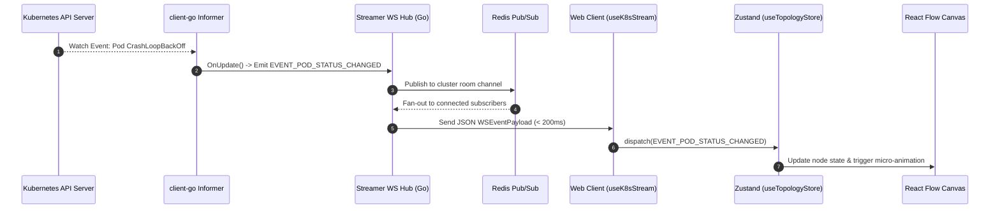
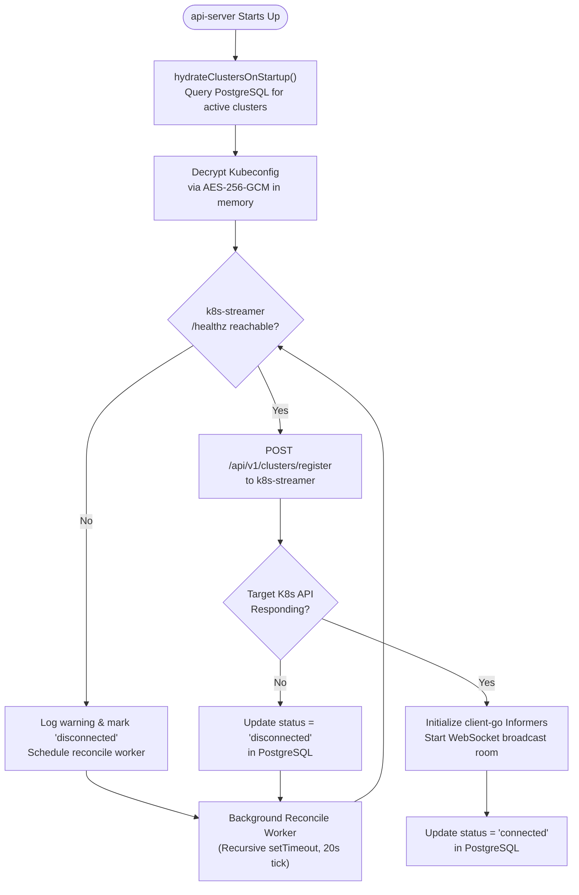
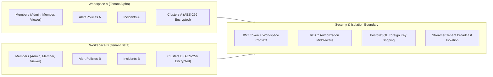

# EnvScale — System Architecture Specification & Block Diagram

> **Document Purpose:** Comprehensive system architecture reference and structural block diagram for **EnvScale** — a multi-tenant Kubernetes observability and gamified governance platform.  
> **Detailed Design:** See [`docs/detailed-design.md`](file:///run/media/pranavissam/files%20and%20data/programming/mega%20projects/EnvScale/docs/detailed-design.md) for formal UML diagrams, flowcharts, and ER models.  
> **Audience:** Core System Developers (Pranav, Vinit, Neha, Ishika), Architects, and Academic Reviewers.  
> **Module Scope:** Monorepo root, [`apps/web`](file:///run/media/pranavissam/files%20and%20data/programming/mega%20projects/EnvScale/apps/web), [`apps/api-server`](file:///run/media/pranavissam/files%20and%20data/programming/mega%20projects/EnvScale/apps/api-server), [`apps/k8s-streamer`](file:///run/media/pranavissam/files%20and%20data/programming/mega%20projects/EnvScale/apps/k8s-streamer), and [`packages/types`](file:///run/media/pranavissam/files%20and%20data/programming/mega%20projects/EnvScale/packages/types).

---

## 1. High-Level System Architecture Block Diagram

The following block diagram illustrates the end-to-end architecture of EnvScale, displaying component groupings, communication protocols, data stores, external dependencies, and control flows.

```mermaid
flowchart TB
    %% ─────────────────────────────────────────────────────────────────────────
    %% Client & Presentation Layer
    %% ─────────────────────────────────────────────────────────────────────────
    subgraph PRESENTATION ["1. Presentation Layer (apps/web - React + Vite)"]
        UI_SHELL["Application Shell & Layout<br/>(TopNavbar, LeftSidebar, Modals)"]
        CANVAS["React Flow Canvas Engine<br/>(@xyflow/react + Dagre Layout)"]
        CUSTOM_NODES["Custom Graph Node Primitives<br/>(K8sGroup, K8sNode, K8sPod, K8sService)"]
        DRAWERS["Contextual Inspectors<br/>(Metrics, Live Logs, Incidents, Chaos UI)"]
        
        subgraph WEB_STATE ["Client State Management"]
            TOPO_STORE["Topology Store<br/>(useTopologyStore - Zustand)"]
            WS_CLIENT["Streaming Client Hook<br/>(useK8sStream - Backoff & Circuit Breaker)"]
            AUTH_STORE["Auth Store & HTTP Client<br/>(Better Auth Client + Axios)"]
        end

        UI_SHELL --> CANVAS
        CANVAS --- CUSTOM_NODES
        CANVAS --> DRAWERS
        TOPO_STORE --> CANVAS
        WS_CLIENT --> TOPO_STORE
    end

    %% ─────────────────────────────────────────────────────────────────────────
    %% Ingress & Gateway Communication
    %% ─────────────────────────────────────────────────────────────────────────
    USER(("Platform Engineer / Operator"))
    USER -->|HTTPS / Web Interface| PRESENTATION

    %% ─────────────────────────────────────────────────────────────────────────
    %% Backend Services Layer
    %% ─────────────────────────────────────────────────────────────────────────
    subgraph BACKEND ["2. Application Services & Control Plane"]
        
        %% REST API Engine
        subgraph API_SERVER ["REST API Server (apps/api-server - Express + TypeScript)"]
            direction TB
            API_ENTRY["Express Application Entry<br/>(Helmet, CORS, Rate Limiter)"]
            AUTH_MOD["Better Auth Engine<br/>(JWT HMAC Plugin & Session Guard)"]
            RBAC_VAL["Middleware Security Layer<br/>(RBAC Guard & Zod Request Validator)"]
            
            subgraph CONTROLLERS ["Domain Controllers & Services"]
                WS_CTRL["Workspace Controller<br/>(Multi-Tenant Isolation)"]
                CLUS_CTRL["Cluster Controller<br/>(Connect, Lifecycle, Sync)"]
                ALERT_CTRL["Alert & Incident Controller<br/>(Policies, Trigger, Resolve)"]
                HEALTH_CALC["Cluster Health Index Engine<br/>(CHI Score: 0-100 Calculation)"]
                LEADER_CTRL["Leaderboard & Gamification<br/>(Rankings, Streaks, Badges)"]
            end

            subgraph SEC_VAULT ["Secrets & Cryptography"]
                CRYPTO_VAULT["AES-256-GCM Vault<br/>(Kubeconfig Encryption / Decryption)"]
            end

            subgraph BG_WORKERS ["Background Workers"]
                RECON_WORKER["Cluster Reconciler Worker<br/>(Recursive setTimeout, Self-Healing)"]
                SNAP_WORKER["Health Snapshot Worker<br/>(Periodic CHI DB Snapshots)"]
            end

            API_ENTRY --> AUTH_MOD
            AUTH_MOD --> RBAC_VAL
            RBAC_VAL --> CONTROLLERS
            CLUS_CTRL <--> CRYPTO_VAULT
            RECON_WORKER --> CLUS_CTRL
            SNAP_WORKER --> HEALTH_CALC
        end

        %% Kubernetes Streaming Gateway
        subgraph STREAMER ["Kubernetes Streaming Gateway (apps/k8s-streamer - Go)"]
            direction TB
            STREAM_ENTRY["HTTP & WS Server<br/>(:8080 - Gorilla WebSocket)"]
            AUTH_VERIFY["HMAC JWT Validator<br/>(Shared JWT_ACCESS_SECRET)"]
            WS_HUB["WebSocket Hub & Multiplexer<br/>(Client Subscriptions & Room Fan-out)"]
            
            subgraph K8S_CORE ["Core Kubernetes Engine"]
                CLUS_MGR["Dynamic Cluster Manager<br/>(Multi-Tenant Cluster Registry)"]
                INFORMERS["client-go Informer Factory<br/>(Pods, Nodes, Services, Deployments, Events)"]
                LOG_STREAM["Pod Log Streamer Pipeline<br/>(kubectl logs -f Streaming)"]
                DELTA_EMIT["Status Delta Emitter<br/>(Sub-200ms State Delta Dispatch)"]
            end

            subgraph CHAOS_ENGINE ["Chaos Testing Module"]
                CHAOS_MGR["Chaos Fault Injector<br/>(pkg/chaos: Crash, Latency, OOM)"]
            end

            STREAM_ENTRY --> AUTH_VERIFY
            AUTH_VERIFY --> WS_HUB
            WS_HUB <--> CLUS_MGR
            CLUS_MGR --> INFORMERS
            INFORMERS --> DELTA_EMIT
            DELTA_EMIT --> WS_HUB
            LOG_STREAM --> WS_HUB
            CHAOS_MGR --> CLUS_MGR
        end
    end

    %% ─────────────────────────────────────────────────────────────────────────
    %% Persistence, Event Bus & External Providers
    %% ─────────────────────────────────────────────────────────────────────────
    subgraph DATA_TIER ["3. Data Persistence & Distributed Message Bus"]
        POSTGRES[("PostgreSQL 16 Database<br/>(Drizzle ORM Managed)<br/>Users, Workspaces, Clusters,<br/>Alerts, Incidents, Snapshots")]
        REDIS[("Redis 7 Cache & Pub/Sub<br/>(Multi-Instance Streamer Fan-Out<br/>& Fast Ephemeral State)")]
    end

    subgraph EXTERNAL_SYSTEMS ["4. External Infrastructure & Managed Services"]
        IDP["OAuth Providers<br/>(GitHub & Google OAuth)"]
        
        subgraph K8S_TARGETS ["Target Kubernetes Clusters"]
            MINIKUBE["Local Cluster<br/>(Minikube / K3s)"]
            EKS["Production Cloud Cluster<br/>(AWS EKS)"]
        end
    end

    %% ─────────────────────────────────────────────────────────────────────────
    %% Edge Interconnections & Cross-Service Dataflows
    %% ─────────────────────────────────────────────────────────────────────────
    AUTH_STORE -->|REST / HTTPS - Port 5000<br/>Bearer JWT / Cookies| API_ENTRY
    WS_CLIENT -->|WebSocket / WSS - Port 8080<br/>/?token=JWT| STREAM_ENTRY

    API_SERVER <-->|Drizzle ORM Connection Pool| POSTGRES
    API_SERVER -->|OAuth 2.0 Auth Code / Tokens| IDP
    
    STREAMER <-->|Redis Pub/Sub Events| REDIS
    API_SERVER -.->|Cache & Sync Events| REDIS

    RECON_WORKER -->|POST /api/v1/clusters/register<br/>GET /healthz Pre-flight Ping| STREAM_ENTRY

    INFORMERS -->|client-go Watch / List API| K8S_TARGETS
    LOG_STREAM -->|Kubelet REST Stream Pod Logs| K8S_TARGETS
    CHAOS_MGR -->|Kube API Fault Injection| K8S_TARGETS
```

---

## 2. Layer-by-Layer Architectural Breakdown

### 2.1 Layer 1: Client & Presentation Tier (`apps/web`)
* **Primary Tech Stack:** React 18, Vite, TypeScript, Tailwind CSS, `@xyflow/react` (React Flow), Zustand.
* **Component Responsibilities:**
  * **Top Navbar & Left Sidebar Capsules:** Floating capsules implementing Material Design 3 harmonic proportions and Google Material Icons (`react-icons/md`).
  * **Visual Topology Engine:** Renders clustered Kubernetes infrastructure inside a dark grid canvas (`#09090b`). Custom graph nodes include:
    * [`K8sGroup`](file:///run/media/pranavissam/files%20and%20data/programming/mega%20projects/EnvScale/apps/web/src/components/canvas/K8sGroup.tsx): Parent grouping node representing Namespaces and Workloads with strict handle routing.
    * [`K8sNode`](file:///run/media/pranavissam/files%20and%20data/programming/mega%20projects/EnvScale/apps/web/src/components/canvas/K8sNode.tsx): Worker/control-plane host container tracking CPU/Memory allocation.
    * [`K8sPod`](file:///run/media/pranavissam/files%20and%20data/programming/mega%20projects/EnvScale/apps/web/src/components/canvas/K8sPod.tsx): Workload card displaying phase, restart counters, and health badges.
    * [`K8sService`](file:///run/media/pranavissam/files%20and%20data/programming/mega%20projects/EnvScale/apps/web/src/components/canvas/K8sService.tsx): Pill-shaped ingress and routing representation.
  * **Automated Layout:** Auto-arranges nodes into an ArgoCD-style hierarchical graph using [Dagre Auto-Layout](file:///run/media/pranavissam/files%20and%20data/programming/mega%20projects/EnvScale/apps/web/src/utils/layout.ts).
  * **State & Hook Pipeline:**
    * [`useTopologyStore`](file:///run/media/pranavissam/files%20and%20data/programming/mega%20projects/EnvScale/apps/web/src/store/useTopologyStore.ts): Central Zustand store for active nodes, edges, active cluster selection, live metrics, and log buffers.
    * [`useK8sStream`](file:///run/media/pranavissam/files%20and%20data/programming/mega%20projects/EnvScale/apps/web/src/hooks/useK8sStream.ts): Resilient WebSocket hook providing exponential backoff (`1.5s`, `2.7s`, `4.8s`, `8.7s`, `12s`) and a 5-attempt circuit breaker.
  * **Contextual Drawers & Views:** Inspector Drawer (pod details, live logs, resource gauges, chaos triggers), Alert Policy Rule Builder, Gamified Leaderboard, and Cluster Onboarding Wizard.

### 2.2 Layer 2: API & Business Logic Tier (`apps/api-server`)
* **Primary Tech Stack:** Node.js, Express, TypeScript, Better Auth, Drizzle ORM, Zod, Helmet.
* **Component Responsibilities:**
  * **Authentication & Authorization Engine:**
    * Implements Better Auth with GitHub and Google OAuth plugins, plus fallback email/password.
    * Issues short-lived JWT access tokens (`15m` expiry) signed via `JWT_ACCESS_SECRET` alongside HTTP-only refresh tokens.
    * Enforces multi-tenant workspace RBAC (`ADMIN`, `MEMBER`, `VIEWER`) via [`rbac.ts`](file:///run/media/pranavissam/files%20and%20data/programming/mega%20projects/EnvScale/apps/api-server/src/middleware/rbac.ts).
  * **Cryptographic Vault:**
    * Uses AES-256-GCM ([`crypto.ts`](file:///run/media/pranavissam/files%20and%20data/programming/mega%20projects/EnvScale/apps/api-server/src/utils/crypto.ts)) to encrypt raw Kubeconfig files before storing them in PostgreSQL. Raw cluster credentials are never exposed in plaintext logs or API responses.
  * **Cluster Hydration & Self-Healing Service:**
    * [`cluster-sync.service.ts`](file:///run/media/pranavissam/files%20and%20data/programming/mega%20projects/EnvScale/apps/api-server/src/services/cluster-sync.service.ts): Decrypts kubeconfigs on server startup and registers active clusters with the Go streamer.
    * [`cluster-reconcile.worker.ts`](file:///run/media/pranavissam/files%20and%20data/programming/mega%20projects/EnvScale/apps/api-server/src/workers/cluster-reconcile.worker.ts): Non-overlapping recursive background worker (20s tick) that polls streamer `/healthz` and reconciles disconnected clusters.
  * **Governance & Gamification Engine:**
    * Dynamic Cluster Health Index (CHI) calculation algorithm ([`health-calculator.service.ts`](file:///run/media/pranavissam/files%20and%20data/programming/mega%20projects/EnvScale/apps/api-server/src/services/health-calculator.service.ts)) scoring clusters $0-100$.
    * Background snapshot worker ([`snapshot.worker.ts`](file:///run/media/pranavissam/files%20and%20data/programming/mega%20projects/EnvScale/apps/api-server/src/workers/snapshot.worker.ts)) persisting historical trend metrics.

### 2.3 Layer 3: Kubernetes Streaming Gateway (`apps/k8s-streamer`)
* **Primary Tech Stack:** Go 1.22+, `k8s.io/client-go`, Gorilla WebSocket, `redis/go-redis`.
* **Component Responsibilities:**
  * **Real-time Event Gateway:** Operates a concurrent WebSocket Hub maintaining persistent client connections, tenant rooms, and authenticated message broadcasts.
  * **Informer Factory & Event Multiplexing:**
    * Initializes `SharedInformerFactory` instances per cluster (`PodInformer`, `NodeInformer`, `ServiceInformer`, `DeploymentInformer`, `EventInformer`).
    * Emits sub-200ms granular delta events (`EVENT_POD_STATUS_CHANGED`, `EVENT_NODE_MUTATED`, `EVENT_SERVICE_MUTATED`) over WebSockets.
    * Monitors Kubernetes events to detect failure states like `CrashLoopBackOff`, `OOMKilled`, and `ImagePullBackOff`.
  * **Log Tailing Pipeline:** Direct streaming of pod stdout/stderr logs (`kubectl logs -f` style) over WebSockets to client drawers.
  * **Fault Injection Engine (`pkg/chaos`):** Safely injects synthetic anomalies into target clusters (pod termination, container latency, simulated memory stress) to test resilience.
  * **Horizontal Scalability:** Integrates with Redis Pub/Sub to synchronize streaming state across multiple streamer replicas.

### 2.4 Layer 4: Persistence, Caching & Event Bus
* **PostgreSQL 16 (Relational Store):**
  * Managed via Drizzle ORM schemas in [`apps/api-server/src/db/schema/`](file:///run/media/pranavissam/files%20and%20data/programming/mega%20projects/EnvScale/apps/api-server/src/db/schema).
  * Enforces foreign-key cascades, composite B-tree indexes, and strict multi-tenant boundaries across `users`, `workspaces`, `clusters`, `alert_policies`, `incidents`, and `health_snapshots`.
* **Redis 7 (Distributed Event Bus & Ephemeral Cache):**
  * Scalable Pub/Sub channel for multi-instance streamer fan-out.
  * Cache tier for fast cluster ping states, rate limits, and ephemeral health counters.

### 2.5 Layer 5: Target Kubernetes Clusters
* **Local Sandboxes:** Minikube and K3s instances for local development and integration testing.
* **Production Clouds:** Managed AWS EKS clusters accessed via encrypted Kubeconfigs or IAM roles.

---

## 3. Core Subsystem Workflows & Sequences

### 3.1 Real-Time Topology & Status Delta Stream

### 3.2 Resilient Cluster Lifecycle & Self-Healing Loop

### 3.3 Authentication & Cryptographic Vault Flow

```mermaid
sequenceDiagram
    autonumber
    participant Dev as Platform Engineer
    participant Web as React Web App
    participant Auth as Better Auth / Express API
    participant DB as PostgreSQL
    participant Streamer as Go WebSocket Streamer

    Dev->>Web: Submit Credentials or OAuth (Google/GitHub)
    Web->>Auth: POST /api/auth/sign-in
    Auth->>DB: Verify user & create session
    Auth-->>Web: Set HTTP-only Cookie + issue JWT Token
    
    rect rgb(20, 20, 30)
        Note over Web,Auth: Kubeconfig Onboarding Flow
        Dev->>Web: Upload Kubeconfig YAML
        Web->>Auth: POST /api/v1/workspaces/:id/clusters (Bearer JWT)
        Auth->>Auth: AES-256-GCM Encrypt(kubeconfig, MASTER_KEY)
        Auth->>DB: INSERT INTO clusters (encrypted_kubeconfig)
    end

    rect rgb(20, 30, 20)
        Note over Web,Streamer: WebSocket Handshake Flow
        Web->>Streamer: Connect ws://localhost:8080/ws/k8s?token=JWT
        Streamer->>Streamer: Validate HMAC-SHA256 signature (Shared Secret)
        Streamer-->>Web: 101 Switching Protocols (Connection Established)
    end
```

---

## 4. Network Interfaces, Protocols & Port Matrix

| Service | Port | Protocol | Path / Endpoint | Authentication | Purpose |
| :--- | :--- | :--- | :--- | :--- | :--- |
| **Frontend UI** | `5173` | HTTP / HTTPS | `/` | Session / JWT | User visualization interface |
| **API Server** | `5000` | HTTP / HTTPS | `/api/auth/*` | Better Auth | OAuth & credential authentication |
| **API Server** | `5000` | HTTP / HTTPS | `/api/v1/*` | Bearer JWT / Cookie | REST CRUD, RBAC, Governance, Secrets |
| **Streamer** | `8080` | HTTP | `/healthz` | None (Internal) | Liveness & readiness probes |
| **Streamer** | `8080` | HTTP | `/api/v1/clusters/register` | Internal Shared Secret | Dynamic cluster registration |
| **Streamer** | `8080` | WS / WSS | `/ws/k8s` | JWT Query Param | Real-time state delta & log streaming |
| **PostgreSQL** | `5432` | TCP / PG | `postgres://...` | DB Credentials | Relational persistent storage |
| **Redis** | `6379` | TCP / RESP | `redis://...` | Redis Password | Pub/Sub message broker & cache |
| **Kubernetes** | `6443` | HTTPS | `/api`, `/apis` | Kubeconfig mTLS / Bearer | Kubernetes Control Plane API |

---

## 5. Security Boundaries & Multi-Tenancy Governance

* **Tenant Isolation Guarantee:** Every database query in `api-server` strictly filters by `workspace_id`. WebSocket rooms in `k8s-streamer` isolate broadcasts so that cluster state deltas are received only by authenticated members of the associated workspace.
* **Defense in Depth:** Kubeconfig credentials are encrypted at rest with AES-256-GCM using an authenticated 12-byte IV and 16-byte auth tag. Plaintext kubeconfigs exist only temporarily in heap memory during cluster registration.

---

## 6. Monorepo Implementation File Mapping

| Architectural Component | Primary Repository File Links | Assigned Owner |
| :--- | :--- | :--- |
| **Frontend Canvas & Shell** | [`App.tsx`](file:///run/media/pranavissam/files%20and%20data/programming/mega%20projects/EnvScale/apps/web/src/App.tsx), [`layout.ts`](file:///run/media/pranavissam/files%20and%20data/programming/mega%20projects/EnvScale/apps/web/src/utils/layout.ts), [`K8sPod.tsx`](file:///run/media/pranavissam/files%20and%20data/programming/mega%20projects/EnvScale/apps/web/src/components/canvas/K8sPod.tsx) | **Neha** |
| **Frontend State & Stream** | [`useTopologyStore.ts`](file:///run/media/pranavissam/files%20and%20data/programming/mega%20projects/EnvScale/apps/web/src/store/useTopologyStore.ts), [`useK8sStream.ts`](file:///run/media/pranavissam/files%20and%20data/programming/mega%20projects/EnvScale/apps/web/src/hooks/useK8sStream.ts) | **Neha** |
| **Onboarding & UI Primitives** | [`ConnectClusterModal.tsx`](file:///run/media/pranavissam/files%20and%20data/programming/mega%20projects/EnvScale/apps/web/src/components/onboarding/ConnectClusterModal.tsx), [`Button.tsx`](file:///run/media/pranavissam/files%20and%20data/programming/mega%20projects/EnvScale/apps/web/src/components/ui/Button.tsx) | **Ishika** |
| **Core Streaming Gateway** | [`main.go`](file:///run/media/pranavissam/files%20and%20data/programming/mega%20projects/EnvScale/apps/k8s-streamer/cmd/server/main.go), [`hub.go`](file:///run/media/pranavissam/files%20and%20data/programming/mega%20projects/EnvScale/apps/k8s-streamer/pkg/websocket/hub.go) | **Pranav** |
| **Informer & Chaos Engine** | [`cluster_manager.go`](file:///run/media/pranavissam/files%20and%20data/programming/mega%20projects/EnvScale/apps/k8s-streamer/pkg/k8s/cluster_manager.go), [`chaos`](file:///run/media/pranavissam/files%20and%20data/programming/mega%20projects/EnvScale/apps/k8s-streamer/pkg/chaos) | **Pranav** |
| **REST Server & Better Auth** | [`index.ts`](file:///run/media/pranavissam/files%20and%20data/programming/mega%20projects/EnvScale/apps/api-server/src/index.ts), [`auth.ts`](file:///run/media/pranavissam/files%20and%20data/programming/mega%20projects/EnvScale/apps/api-server/src/lib/auth.ts), [`rbac.ts`](file:///run/media/pranavissam/files%20and%20data/programming/mega%20projects/EnvScale/apps/api-server/src/middleware/rbac.ts) | **Vinit** |
| **Database Schemas & Vault** | [`schema.ts`](file:///run/media/pranavissam/files%20and%20data/programming/mega%20projects/EnvScale/apps/api-server/src/db/schema.ts), [`crypto.ts`](file:///run/media/pranavissam/files%20and%20data/programming/mega%20projects/EnvScale/apps/api-server/src/utils/crypto.ts) | **Vinit** |
| **Reconciler & Health Sync** | [`cluster-reconcile.worker.ts`](file:///run/media/pranavissam/files%20and%20data/programming/mega%20projects/EnvScale/apps/api-server/src/workers/cluster-reconcile.worker.ts), [`cluster-sync.service.ts`](file:///run/media/pranavissam/files%20and%20data/programming/mega%20projects/EnvScale/apps/api-server/src/services/cluster-sync.service.ts) | **Vinit** |
| **Shared Monorepo Types** | [`types/index.ts`](file:///run/media/pranavissam/files%20and%20data/programming/mega%20projects/EnvScale/packages/types/src/index.ts) | **Core Team** |
